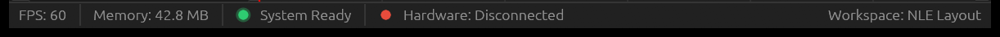

# Pealayer v0.1.0 — First public cross-platform packages

The first public packages brought together the June player, docked 4D timeline, July remote controls and September binary hardware/curve-authoring work, then added the cross-platform build foundation.

> **[Historical release]** Original tag, publication date and downloads preserved. Notes and evidence expanded during the 10 November 2026 backfill.

**Source checkpoint:** 2026-09-24 (Asia/Tehran) · [`d798109`](https://github.com/ToghrolTP/pealayer/commit/d798109c0387ce70ea283a12593216583247b15e)

## Added and implemented

- **[Added]** Native Rust/libmpv playback; a 4D editor with F1–F8 macro recording, relay indicators, timecode validation and template creation (June 4–15).
- **[Added]** Docked NLE panels, offscreen aspect-correct video, direct timeline editing and emergency-stop groundwork (June 27).
- **[Added]** Serial output, timeline sidecars, URL opening, recent media, drag/drop, frame stepping, OSD, local IPC and the first React/Ant Design Web remote (July 13–23).
- **[Added]** COBS/CRC-8 binary commands, watchdog heartbeat, PCController wire support, analog curves, live recording with punch-in/out, undo/redo, marquee selection and typed hardware-target routing (September 16–19).
- **[Added]** Automated Linux/Windows build and release packaging, dynamic Windows libmpv resolution and grouped dependency maintenance ([#1](https://github.com/ToghrolTP/pealayer/pull/1)).

## Fixes and improvements

- **[Fixed]** High-DPI video placement ([#3](https://github.com/ToghrolTP/pealayer/issues/3); e9c391c), render/input lock re-entry (e722507, 2a474c1), duplicate Web seek dispatch and seek-drag notification flooding (eddaa15, bd7e247).
- **[Fixed]** Preserve templates in undo history and effect action patterns during relocation; prevent media-track drops and accidental ruler scrubbing (4476329, 0089b3b, 534c033).
- **[Fixed]** Scale delayed effect actions with duration changes and reject invalid/non-finite hardware values (ecfdace, fb7f7f8).

## Experimental features and later follow-ups

- **[Experimental]** Early 4D execution and direct serial control were development groundwork. Later semantic PCController authoring arrives in v0.2.0; live recording is repaired in v0.4.0-alpha.1 ([#58](https://github.com/ToghrolTP/pealayer/pull/58)).
- **[Experimental]** The July Web interface is a remote control, with the broader Web Studio introduced in v0.4.0-alpha.1 ([#55](https://github.com/ToghrolTP/pealayer/pull/55)). Full parity remains tracked by [#63](https://github.com/ToghrolTP/pealayer/issues/63).
- **[Experimental]** There is no recorded source activity between July 23 and September 16 in this lineage. The September work resumes with the binary protocol; this gap is not represented as an invented release.

## Bugs and problems in this build

- **[Known issue]** Slider snap-backs, scrub labels, incomplete audio/subtitle menus and control fade/layout problems still need the fixes later shipped in v0.2.0 ([#5](https://github.com/ToghrolTP/pealayer/pull/5), [#2](https://github.com/ToghrolTP/pealayer/issues/2)).
- **[Known issue]** Early dock status UI contains hard-coded Memory/System Ready placeholders. These are removed in the Windows-readiness work included in v0.2.0 ([#25](https://github.com/ToghrolTP/pealayer/pull/25)); they were never measured telemetry.
- **[Known issue]** No macOS download was published for this version. Both macOS architectures are added in v0.2.0.
- **[Known issue]** Later Windows runtime/CPU-baseline, hardware stress, GPU-surface and frame-window requests ([#51](https://github.com/ToghrolTP/pealayer/issues/51), [#60](https://github.com/ToghrolTP/pealayer/issues/60), [#61](https://github.com/ToghrolTP/pealayer/issues/61), [#62](https://github.com/ToghrolTP/pealayer/issues/62), [#63](https://github.com/ToghrolTP/pealayer/issues/63), [#64](https://github.com/ToghrolTP/pealayer/issues/64), [#65](https://github.com/ToghrolTP/pealayer/issues/65), [#66](https://github.com/ToghrolTP/pealayer/issues/66)) are not retroactively claimed complete here.

## Packages and verification

Original published packages retained; tag and original asset bytes unchanged. Original release CI succeeded; existing platform availability is preserved.

| Platform | Download | Recorded verification |
| --- | --- | --- |
| Linux x86-64 | [Download](https://github.com/ToghrolTP/pealayer/releases/download/v0.1.0/Pealayer-linux-x86_64-v0.1.0-d798109.tar.gz) | original release package; SHA-256 in manifest |
| Windows x86-64 | [Download](https://github.com/ToghrolTP/pealayer/releases/download/v0.1.0/Pealayer-windows-x86_64-v0.1.0-d798109.zip) | original release package; SHA-256 in manifest |
| macOS Apple silicon | Not available | No successful exact-source package recovered for this platform |
| macOS Intel | Not available | No successful exact-source package recovered for this platform |

Download `SHA256SUMS.txt` and verify the attached files with `sha256sum --check SHA256SUMS.txt`. The attached `release-manifest.json` records the source, original artifact IDs/digests, packaging and platform results. Archive directory names and executable permission bits are normalized; executable bytes and embedded Cargo versions are unchanged. Existing native downloads are not rebuilt or replaced.

**[Acceptance]** Build/test/package success is separate from installed-device, human, audio, physical timing, GPU and soak acceptance. See [the current acceptance index](https://github.com/ToghrolTP/pealayer/blob/main/docs/verification/CURRENT-ACCEPTANCE.md).

## Screenshots

Actual archived or newly captured historical builds only. Captions identify the capture source; an earlier feature capture is not presented as the final tagged executable. No later UI is attributed to this version.

Genuine rebuilt June dock status bar. Historical Memory/System Ready text is placeholder content; no connected board is shown. [Capture provenance](https://github.com/ToghrolTP/pealayer/blob/1e171e8bbd66348d00f9742704c5b78b006f6faf/docs/verification/status-bar-evolution.md) · source [`3bc0e08`](https://github.com/ToghrolTP/pealayer/commit/3bc0e0872739b736ab942bfe9ae216004cc04462).

The `screenshots.zip` attachment preserves the inspected image bytes and `screenshot-provenance.json` lists their hashes and source references.

## Pull requests and issues

All merged PRs first included in this milestone

- [#1](https://github.com/ToghrolTP/pealayer/pull/1) — Add multi-platform GitHub CI/CD with dynamic Windows libmpv resolution, Dependabot updates, and release automation

Related issues (references do not imply closure): [#2](https://github.com/ToghrolTP/pealayer/issues/2), [#3](https://github.com/ToghrolTP/pealayer/issues/3), [#40](https://github.com/ToghrolTP/pealayer/issues/40), [#63](https://github.com/ToghrolTP/pealayer/issues/63).

[Version index](https://github.com/ToghrolTP/pealayer/blob/main/docs/releases/README.md) · [Changelog](https://github.com/ToghrolTP/pealayer/blob/main/CHANGELOG.md) · [Next: v0.2.0](https://github.com/ToghrolTP/pealayer/releases/tag/v0.2.0)

<!-- pealayer-release-backfill:v0.1.0 -->
