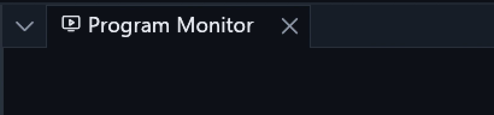
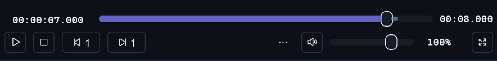
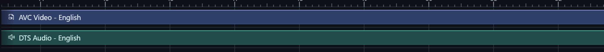
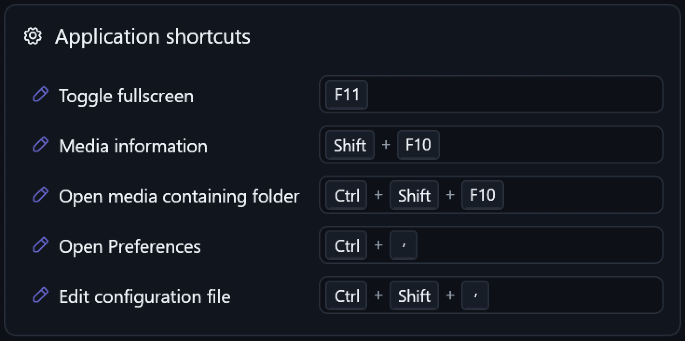

# ▶️ Pealayer v0.10.0-alpha.1 — Playback recovery and native media sessions

The accumulated native/timeline/media integration strengthens frame publication, external-player recovery, workspace controls, safe imports and factual OS now-playing state.

> [!NOTE]
> **[Historical alpha]** Backfilled on 10 November 2026 from the original source checkpoint. This is a retrospective development prerelease, with the exact package/CI limits below; it is not a newly certified stable build.

📦 [Downloads](https://github.com/ToghrolTP/pealayer/releases/tag/v0.10.0-alpha.1#assets) · 📚 [Version history](https://github.com/ToghrolTP/pealayer/blob/main/docs/releases/README.md) · 📝 [Changelog](https://github.com/ToghrolTP/pealayer/blob/main/CHANGELOG.md)

**🗓️ Source checkpoint:** 2026-11-09 (Asia/Tehran) · [`0651d40`](https://github.com/ToghrolTP/pealayer/commit/0651d4059f5b0ecf0f242225d7ef448c86dea119) · [Full source changes](https://github.com/ToghrolTP/pealayer/compare/0ae407f3c4576798cf408e6851d69116100b4391...0651d4059f5b0ecf0f242225d7ef448c86dea119)

## ✨ Added and implemented

- **[Added]** Editable repeat projections with correct cancellation, reviewed external asset/timeline imports and contextual disconnected Hardware Monitor behavior ([#232](https://github.com/ToghrolTP/pealayer/pull/232), [#233](https://github.com/ToghrolTP/pealayer/pull/233), [#234](https://github.com/ToghrolTP/pealayer/pull/234), [#235](https://github.com/ToghrolTP/pealayer/pull/235)).
- **[Added]** Phase-aware CLI update progress/JSON results and mutual Pealayer/PCController software updates ([#237](https://github.com/ToghrolTP/pealayer/pull/237), [#241](https://github.com/ToghrolTP/pealayer/pull/241), issue [#240](https://github.com/ToghrolTP/pealayer/issues/240)).
- **[Added]** Contextual native OLE drops, authoring clipboard and bounded taskbar attention ([#249](https://github.com/ToghrolTP/pealayer/pull/249)); configurable sidebar shortcuts/panel drops ([#256](https://github.com/ToghrolTP/pealayer/pull/256)).
- **[Added]** Independent CraftUI close/menu/collapse controls, movable monitor volume, themed Studio strips and shortcut keycaps ([#254](https://github.com/ToghrolTP/pealayer/pull/254), [#259](https://github.com/ToghrolTP/pealayer/pull/259), [#261](https://github.com/ToghrolTP/pealayer/pull/261), [#264](https://github.com/ToghrolTP/pealayer/pull/264), [#267](https://github.com/ToghrolTP/pealayer/pull/267)).
- **[Added]** Factual Windows SMTC and Linux/BSD MPRIS metadata, position, rates, capabilities and seek events, plus contextual minus/plus zoom ([#268](https://github.com/ToghrolTP/pealayer/pull/268), [#270](https://github.com/ToghrolTP/pealayer/pull/270)).

## 🛠️ Fixes and improvements

- **[Fixed]** Retain last published video frame across failed render/resize; remove Preferences per-frame filesystem/translation work ([#247](https://github.com/ToghrolTP/pealayer/pull/247), [#246](https://github.com/ToghrolTP/pealayer/pull/246)).
- **[Fixed]** Repair minimized-window normal placement, Task View/Peek composites and cross-transport media routing ([#239](https://github.com/ToghrolTP/pealayer/pull/239), [#245](https://github.com/ToghrolTP/pealayer/pull/245)).
- **[Fixed]** Anchor external clocks, stabilize paused dual previews and track selection, preserve exact seek/resume intent and recover external-player Quit/relaunch ([#258](https://github.com/ToghrolTP/pealayer/pull/258), [#260](https://github.com/ToghrolTP/pealayer/pull/260)).
- **[Fixed]** Balance NLE transport rows, restore functional overflow/menu ownership, improve workspace/profile restore errors and contextual reveal-playhead fading ([#257](https://github.com/ToghrolTP/pealayer/pull/257), [#262](https://github.com/ToghrolTP/pealayer/pull/262), [#263](https://github.com/ToghrolTP/pealayer/pull/263)).
- **[Fixed]** Verify remote parent listings, improve plain-language hardware hints, fix Dock seams/dropdown palette/icon picker/status tooltips and preserve names while panning ([#236](https://github.com/ToghrolTP/pealayer/pull/236), [#238](https://github.com/ToghrolTP/pealayer/pull/238), [#250](https://github.com/ToghrolTP/pealayer/pull/250), [#251](https://github.com/ToghrolTP/pealayer/pull/251), [#252](https://github.com/ToghrolTP/pealayer/pull/252), [#253](https://github.com/ToghrolTP/pealayer/pull/253), [#254](https://github.com/ToghrolTP/pealayer/pull/254), [#265](https://github.com/ToghrolTP/pealayer/pull/265), [#266](https://github.com/ToghrolTP/pealayer/pull/266)).

## 🧪 Experimental features and later follow-ups

- **[Experimental]** The consolidation preserves all contributing heads; [#268](https://github.com/ToghrolTP/pealayer/pull/268) and [#270](https://github.com/ToghrolTP/pealayer/pull/270) are integration owners, while the individual PR list below records the included histories.
- **[Experimental]** Only the portable document model is reused from the project draft. Full scene execution/project restoration ([#227](https://github.com/ToghrolTP/pealayer/pull/227)) and the user-held optional FilmCraft presentation ([#248](https://github.com/ToghrolTP/pealayer/pull/248)) remain excluded.
- **[Experimental]** Apple Now Playing rate/capability publication remains open in [#269](https://github.com/ToghrolTP/pealayer/issues/269); Windows/Linux evidence does not prove Mac or paired-phone acceptance.

## 🐞 Bugs and problems in this build

- **[Known issue]** The exact post-merge run fails a Windows remote-parent HTTP fixture with WouldBlock (error 10035), and Intel macOS is cancelled. Linux and Apple-silicon packages passed. This does not negate earlier PR evidence, but the exact merge matrix is not green.
- **[Known issue]** Repeated dynamic taskbar artwork still fails canonical displayed-pixel acceptance despite correct HWND/property readback ([#34](https://github.com/ToghrolTP/pealayer/issues/34), [#268](https://github.com/ToghrolTP/pealayer/pull/268)). Do not equate the implemented refresh with a proven visible fix.
- **[Known issue]** Native Explorer/clipboard/flashing behavior, remote/browser clipboard parity, icon-picker after-capture and sustained fullscreen/GPU/audio checks retain their documented gates ([#80](https://github.com/ToghrolTP/pealayer/issues/80)).
- **[Known issue]** The new command toolbar/palette/Terminal are not included until v0.11.0-alpha.1 ([#273](https://github.com/ToghrolTP/pealayer/pull/273)).

## 📦 Packages and verification

Recovered exact-source CI artifacts; original file bytes retained inside renamed containers. No new build or artifact attestation is claimed. Exact-source aggregate did not pass; see the platform/run results below.

| Platform | Download | Recorded verification |
| --- | --- | --- |
| 🐧 Linux x86-64 | [⬇️ Download](https://github.com/ToghrolTP/pealayer/releases/download/v0.10.0-alpha.1/Pealayer-linux-x86_64-v0.10.0-alpha.1-0651d40.tar.gz) | [successful platform job](https://github.com/ToghrolTP/pealayer/actions/runs/42689797034); SHA-256 in manifest |
| 🪟 Windows x86-64 | — Not available | No successful exact-source package recovered for this platform |
| 🍎 macOS Apple silicon | [⬇️ Download](https://github.com/ToghrolTP/pealayer/releases/download/v0.10.0-alpha.1/Pealayer-macos-aarch64-v0.10.0-alpha.1-0651d40.zip) | [successful platform job](https://github.com/ToghrolTP/pealayer/actions/runs/42689797034); SHA-256 in manifest |
| 🍎 macOS Intel | — Not available | No successful exact-source package recovered for this platform |

- [Workflow 42689797034](https://github.com/ToghrolTP/pealayer/actions/runs/42689797034): **failure**. Windows · x86-64: failure; macOS · Intel: cancelled; Pealayer · Complete: failure

Download `SHA256SUMS.txt` and verify the attached files with `sha256sum --check SHA256SUMS.txt`. The attached `release-manifest.json` records the source, original artifact IDs/digests, packaging and platform results. Archive directory names and executable permission bits are normalized; executable bytes and embedded Cargo versions are unchanged. These source-milestone versions do not rewrite the older binaries’ embedded `0.2.0` package version.

**🧭 [Acceptance]** Build/test/package success is separate from installed-device, human, audio, physical timing, GPU and soak acceptance. See [the current acceptance index](https://github.com/ToghrolTP/pealayer/blob/main/docs/verification/CURRENT-ACCEPTANCE.md).

## 📸 Screenshots

Actual archived or newly captured historical builds only. Captions identify the capture source; an earlier feature capture is not presented as the final tagged executable. No later UI is attributed to this version.

Actual native Dock header repair included by the consolidation; see the linked receipt for its code build and crop provenance. [Capture provenance](https://github.com/ToghrolTP/pealayer/blob/1e171e8bbd66348d00f9742704c5b78b006f6faf/docs/verification/egui-dock-restoration.md) · source [`816ec6e`](https://github.com/ToghrolTP/pealayer/commit/816ec6eed7366a2868633d0057de54bfcb4b2f5b).

Actual native Program Monitor volume/transport at the recorded desktop width; no connected-board state is invented. [Capture provenance](https://github.com/ToghrolTP/pealayer/blob/1e171e8bbd66348d00f9742704c5b78b006f6faf/docs/verification/movable-monitor-volume.md) · source [`cce030c`](https://github.com/ToghrolTP/pealayer/commit/cce030cfec620f2c1610878bc6580b54ea710ada).

Actual native palette-owned Studio strips and visible-span captions from the included feature work. [Capture provenance](https://github.com/ToghrolTP/pealayer/blob/1e171e8bbd66348d00f9742704c5b78b006f6faf/docs/verification/studio-media-strips.md) · source [`387deee`](https://github.com/ToghrolTP/pealayer/commit/387deee7aefb71638744cd55de9b24faf09374b7).

Actual native shortcut keycaps; linked receipt distinguishes source checks from remaining human acceptance. [Capture provenance](https://github.com/ToghrolTP/pealayer/blob/1e171e8bbd66348d00f9742704c5b78b006f6faf/docs/verification/shortcut-keycaps.md) · source [`0688050`](https://github.com/ToghrolTP/pealayer/commit/06880500156aef6efe6da0904995363530596eaa).

The `screenshots.zip` attachment preserves the inspected image bytes and `screenshot-provenance.json` lists their hashes and source references.

## 🔗 Pull requests and issues

🔀 All merged PRs first included in this milestone

- [#232](https://github.com/ToghrolTP/pealayer/pull/232) — Show and edit repeat projections in the effects designer
- [#233](https://github.com/ToghrolTP/pealayer/pull/233) — Add shared external asset drops and reviewed timeline imports
- [#234](https://github.com/ToghrolTP/pealayer/pull/234) — Restore the Hardware Monitor disconnected state and contextual RF controls
- [#235](https://github.com/ToghrolTP/pealayer/pull/235) — Finish repeat projection cancellation and interaction coverage
- [#236](https://github.com/ToghrolTP/pealayer/pull/236) — Restore compact aligned egui Dock chrome without changing CraftUI
- [#237](https://github.com/ToghrolTP/pealayer/pull/237) — Polish updater console progress and result reporting
- [#238](https://github.com/ToghrolTP/pealayer/pull/238) — Simplify hardware connection messages with on-demand info hints
- [#239](https://github.com/ToghrolTP/pealayer/pull/239) — Fix window restoration, live taskbar branding and Task View previews
- [#241](https://github.com/ToghrolTP/pealayer/pull/241) — Integrate mutual Pealayer and PCController software updates
- [#242](https://github.com/ToghrolTP/pealayer/pull/242) — Add Copy to the Duration context menu
- [#244](https://github.com/ToghrolTP/pealayer/pull/244) — Preserve the October 10 egui Dock UI comparison
- [#245](https://github.com/ToghrolTP/pealayer/pull/245) — Complete window placement and cross-transport media control
- [#246](https://github.com/ToghrolTP/pealayer/pull/246) — Improve native Preferences wheel responsiveness
- [#247](https://github.com/ToghrolTP/pealayer/pull/247) — Preserve the last good video frame when rendering fails
- [#249](https://github.com/ToghrolTP/pealayer/pull/249) — Add contextual Windows drops, authoring clipboard and taskbar attention
- [#250](https://github.com/ToghrolTP/pealayer/pull/250) — Hide unavailable remote parent folders and fix navigation rows
- [#251](https://github.com/ToghrolTP/pealayer/pull/251) — Use the selected palette for expanded dropdowns
- [#252](https://github.com/ToghrolTP/pealayer/pull/252) — Keep timeline panning cursors out of sticky headers and controls
- [#253](https://github.com/ToghrolTP/pealayer/pull/253) — Polish native frame-rate details and matching Web hover card
- [#254](https://github.com/ToghrolTP/pealayer/pull/254) — Fix native Dock header seams and restore CraftUI header actions
- [#255](https://github.com/ToghrolTP/pealayer/pull/255) — Open the exact Timeline Toolbar preferences page
- [#256](https://github.com/ToghrolTP/pealayer/pull/256) — Customize sidebar shortcuts and drag panels into the workspace
- [#257](https://github.com/ToghrolTP/pealayer/pull/257) — Balance NLE transport rows and repair the three-dot control menu
- [#258](https://github.com/ToghrolTP/pealayer/pull/258) — Keep paused video stable and correct timeline activity and reveal controls
- [#259](https://github.com/ToghrolTP/pealayer/pull/259) — Make Program Monitor volume movable and focus its default controls
- [#260](https://github.com/ToghrolTP/pealayer/pull/260) — Recover external player lifecycle and add contextual player switching
- [#261](https://github.com/ToghrolTP/pealayer/pull/261) — Restore individual CraftUI pane close buttons and configurable collapse controls
- [#262](https://github.com/ToghrolTP/pealayer/pull/262) — Fix Workspace switching and complete dialog title backgrounds
- [#263](https://github.com/ToghrolTP/pealayer/pull/263) — Fade the disabled reveal-playhead action without delaying input guards
- [#264](https://github.com/ToghrolTP/pealayer/pull/264) — Theme Studio media strips and keep timeline names visible while panning
- [#265](https://github.com/ToghrolTP/pealayer/pull/265) — Align hardware connection messages and separate the recovery instruction
- [#266](https://github.com/ToghrolTP/pealayer/pull/266) — Polish the native icon picker search and view switch
- [#267](https://github.com/ToghrolTP/pealayer/pull/267) — Display shortcut fields as themed keyboard keycaps
- [#268](https://github.com/ToghrolTP/pealayer/pull/268) — Consolidate native, timeline and media fixes with accurate OS media sessions
- [#270](https://github.com/ToghrolTP/pealayer/pull/270) — Route minus and plus zoom to the active editor

**🔎 Related issues** (references do not imply closure): [#30](https://github.com/ToghrolTP/pealayer/issues/30), [#34](https://github.com/ToghrolTP/pealayer/issues/34), [#63](https://github.com/ToghrolTP/pealayer/issues/63), [#64](https://github.com/ToghrolTP/pealayer/issues/64), [#65](https://github.com/ToghrolTP/pealayer/issues/65), [#66](https://github.com/ToghrolTP/pealayer/issues/66), [#80](https://github.com/ToghrolTP/pealayer/issues/80), [#114](https://github.com/ToghrolTP/pealayer/issues/114), [#141](https://github.com/ToghrolTP/pealayer/issues/141), [#226](https://github.com/ToghrolTP/pealayer/issues/226), [#228](https://github.com/ToghrolTP/pealayer/issues/228), [#240](https://github.com/ToghrolTP/pealayer/issues/240), [#243](https://github.com/ToghrolTP/pealayer/issues/243), [#269](https://github.com/ToghrolTP/pealayer/issues/269).

[📚 Version index](https://github.com/ToghrolTP/pealayer/blob/main/docs/releases/README.md) · [📝 Changelog](https://github.com/ToghrolTP/pealayer/blob/main/CHANGELOG.md) · [← Previous: v0.9.0-alpha.1](https://github.com/ToghrolTP/pealayer/releases/tag/v0.9.0-alpha.1) · [Next →: v0.11.0-alpha.1](https://github.com/ToghrolTP/pealayer/releases/tag/v0.11.0-alpha.1)

<!-- pealayer-release-backfill:v0.10.0-alpha.1 -->
