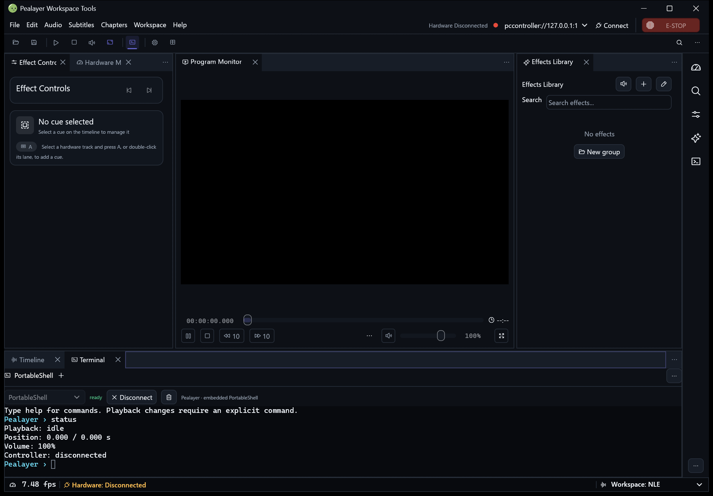
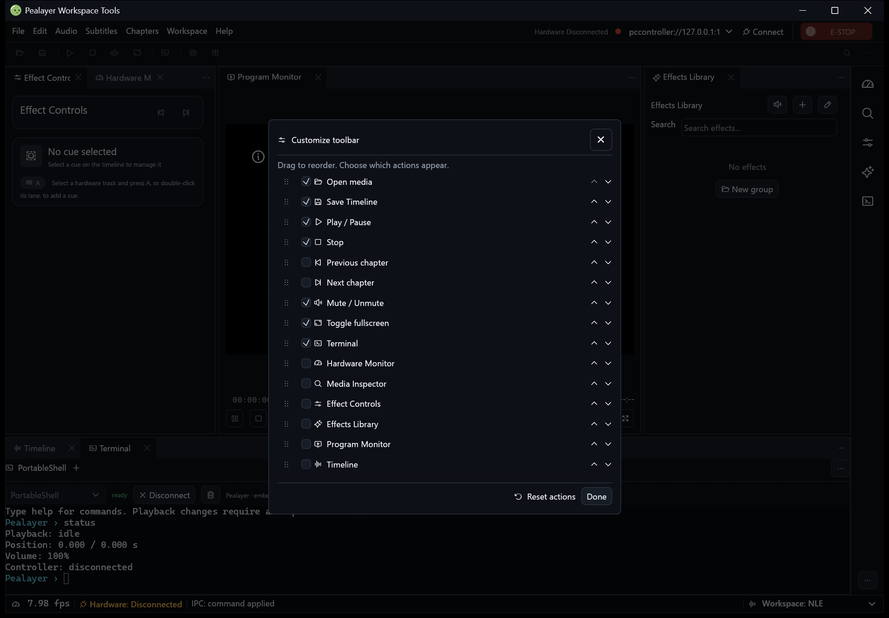
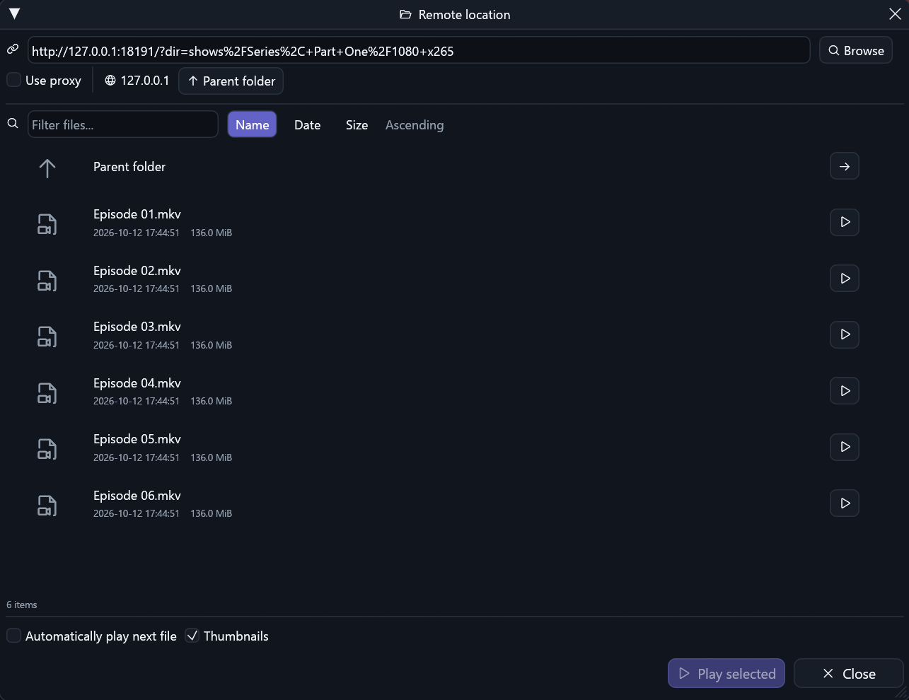
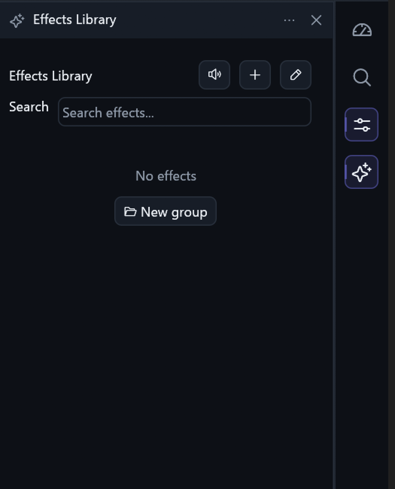

# 🧰 Pealayer v0.11.0-alpha.1 — Command tools, remote folders and sidebar recovery

The standard package gains optional command tools and a real dockable Terminal, while native FPS sizing, remote folder encoding and remembered sidebar placement are repaired.

> [!NOTE]
> **[Historical alpha]** Backfilled on 10 November 2026 from the original source checkpoint. This is a retrospective development prerelease, with the exact package/CI limits below; it is not a newly certified stable build.

📦 [Downloads](https://github.com/ToghrolTP/pealayer/releases/tag/v0.11.0-alpha.1#assets) · 📚 [Version history](https://github.com/ToghrolTP/pealayer/blob/main/docs/releases/README.md) · 📝 [Changelog](https://github.com/ToghrolTP/pealayer/blob/main/CHANGELOG.md)

**🗓️ Source checkpoint:** 2026-11-10 (Asia/Tehran) · [`0cde16f`](https://github.com/ToghrolTP/pealayer/commit/0cde16fd5d59e6068d43f81e55b0c2e0f35aca7e) · [Full source changes](https://github.com/ToghrolTP/pealayer/compare/0651d4059f5b0ecf0f242225d7ef448c86dea119...0cde16fd5d59e6068d43f81e55b0c2e0f35aca7e)

## ✨ Added and implemented

- **[Added]** Grouped command toolbar, trailing overflow/context menus, reorderable editor and Ctrl+Shift+P command palette ([#273](https://github.com/ToghrolTP/pealayer/pull/273)).
- **[Added]** Dockable Terminal in both adapters with PCController host console, owned PTY/ConPTY sessions and an embedded Pealayer PortableShell prompt ([#273](https://github.com/ToghrolTP/pealayer/pull/273)).
- **[Added]** Read-only native terminal-profile discovery reuses the upstream PortableShell library. Both tools ship in the standard build and remain hidden by default ([#273](https://github.com/ToghrolTP/pealayer/pull/273), [#272](https://github.com/ToghrolTP/pealayer/issues/272)).

## 🛠️ Fixes and improvements

- **[Fixed]** Center actual CraftUI tab icon/title/close ink rather than the mixed-font line box ([#271](https://github.com/ToghrolTP/pealayer/pull/271)).
- **[Fixed]** Measure native FPS slots for three/four-digit values and keep secondary text small/regular ([#274](https://github.com/ToghrolTP/pealayer/pull/274)).
- **[Fixed]** Treat equivalent encoded directory/query names consistently, restoring listings instead of filtering all entries ([#275](https://github.com/ToghrolTP/pealayer/pull/275)).
- **[Fixed]** Remember sidebar panel placement and sizes, reveal/toggle panels correctly, restore native header/menu chrome and keep active icons visible ([#276](https://github.com/ToghrolTP/pealayer/pull/276)).
- **[Fixed]** Publish the previously missing native FPS/About comparisons and correct the historical capability-status crop without fabricating UI ([#273](https://github.com/ToghrolTP/pealayer/pull/273), [#228](https://github.com/ToghrolTP/pealayer/issues/228)).

## 🧪 Experimental features and later follow-ups

- **[Experimental]** Opening a pane or prompt executes nothing; owned terminal sessions retain bounded output, cancellation and local-IPC fencing. Linux/macOS discovery, full-screen TUI and physical acceptance remain separate ([#272](https://github.com/ToghrolTP/pealayer/issues/272)).
- **[Experimental]** The command palette/toolbar completion work in [#277](https://github.com/ToghrolTP/pealayer/pull/277) and proportional/tabular FPS digit alignment in [#278](https://github.com/ToghrolTP/pealayer/pull/278) are open at the pinned main checkpoint. Their later local packages/screenshots do not belong to this tag.
- **[Experimental]** Plugin extraction/additional build gating remains [#44](https://github.com/ToghrolTP/pealayer/issues/44)/#272. Full projects/scenes ([#227](https://github.com/ToghrolTP/pealayer/pull/227)) and the user-held FilmCraft PR ([#248](https://github.com/ToghrolTP/pealayer/pull/248)) stay excluded.

## 🐞 Bugs and problems in this build

- **[Known issue]** The initial palette can reserve excessive empty height; toolbar icons/disabled paint and drag-to-hide still need [#277](https://github.com/ToghrolTP/pealayer/pull/277). The remaining FPS icon/digit-center discrepancy is addressed by [#278](https://github.com/ToghrolTP/pealayer/pull/278), outside this release.
- **[Known issue]** Repeated displayed taskbar artwork, native Apple media rate/capability, physical/audio/GPU/soak and complete Web parity remain open ([#34](https://github.com/ToghrolTP/pealayer/issues/34), [#269](https://github.com/ToghrolTP/pealayer/issues/269), [#80](https://github.com/ToghrolTP/pealayer/issues/80), [#63](https://github.com/ToghrolTP/pealayer/issues/63), [#64](https://github.com/ToghrolTP/pealayer/issues/64), [#65](https://github.com/ToghrolTP/pealayer/issues/65), [#66](https://github.com/ToghrolTP/pealayer/issues/66)).
- **[Known issue]** Cafe delivery remains user-deferred/offline. A local or hosted package is not a Cafe installation receipt.
- **[Known issue]** Recording repeat-policy and full project/scene restoration remain unfinished ([#114](https://github.com/ToghrolTP/pealayer/issues/114), [#141](https://github.com/ToghrolTP/pealayer/issues/141), [#226](https://github.com/ToghrolTP/pealayer/issues/226), [#227](https://github.com/ToghrolTP/pealayer/pull/227)).

## 📦 Packages and verification

Recovered exact-source CI artifacts; original file bytes retained inside renamed containers. No new build or artifact attestation is claimed. Exact-source aggregate passed.

| Platform | Download | Recorded verification |
| --- | --- | --- |
| 🐧 Linux x86-64 | [⬇️ Download](https://github.com/ToghrolTP/pealayer/releases/download/v0.11.0-alpha.1/Pealayer-linux-x86_64-v0.11.0-alpha.1-0cde16f.tar.gz) | [successful platform job](https://github.com/ToghrolTP/pealayer/actions/runs/42735332267); SHA-256 in manifest |
| 🪟 Windows x86-64 | [⬇️ Download](https://github.com/ToghrolTP/pealayer/releases/download/v0.11.0-alpha.1/Pealayer-windows-x86_64-v0.11.0-alpha.1-0cde16f.zip) | [successful platform job](https://github.com/ToghrolTP/pealayer/actions/runs/42735332267); SHA-256 in manifest |
| 🍎 macOS Apple silicon | [⬇️ Download](https://github.com/ToghrolTP/pealayer/releases/download/v0.11.0-alpha.1/Pealayer-macos-aarch64-v0.11.0-alpha.1-0cde16f.zip) | [successful platform job](https://github.com/ToghrolTP/pealayer/actions/runs/42735332267); SHA-256 in manifest |
| 🍎 macOS Intel | [⬇️ Download](https://github.com/ToghrolTP/pealayer/releases/download/v0.11.0-alpha.1/Pealayer-macos-x86_64-v0.11.0-alpha.1-0cde16f.zip) | [successful platform job](https://github.com/ToghrolTP/pealayer/actions/runs/42735332267); SHA-256 in manifest |

- [Workflow 42735332267](https://github.com/ToghrolTP/pealayer/actions/runs/42735332267): **success**. All executed jobs succeeded.

Download `SHA256SUMS.txt` and verify the attached files with `sha256sum --check SHA256SUMS.txt`. The attached `release-manifest.json` records the source, original artifact IDs/digests, packaging and platform results. Archive directory names and executable permission bits are normalized; executable bytes and embedded Cargo versions are unchanged. These source-milestone versions do not rewrite the older binaries’ embedded `0.2.0` package version.

**🧭 [Acceptance]** Build/test/package success is separate from installed-device, human, audio, physical timing, GPU and soak acceptance. See [the current acceptance index](https://github.com/ToghrolTP/pealayer/blob/main/docs/verification/CURRENT-ACCEPTANCE.md).

## 📸 Screenshots

Actual archived or newly captured historical builds only. Captions identify the capture source; an earlier feature capture is not presented as the final tagged executable. No later UI is attributed to this version.

Actual native grouped toolbar and embedded docked shell from the included workspace-tools build. The tools are temporarily visible for review and remain hidden by default. [Capture provenance](https://github.com/ToghrolTP/pealayer/blob/1e171e8bbd66348d00f9742704c5b78b006f6faf/docs/verification/workspace-tools.md) · source [`28cbfb4`](https://github.com/ToghrolTP/pealayer/commit/28cbfb4399cb4c112bd249a64dd5ffe96e596379).

Actual native toolbar editor from the same included build; excludes the later #277 palette/toolbar completion. [Capture provenance](https://github.com/ToghrolTP/pealayer/blob/1e171e8bbd66348d00f9742704c5b78b006f6faf/docs/verification/workspace-tools.md) · source [`28cbfb4`](https://github.com/ToghrolTP/pealayer/commit/28cbfb4399cb4c112bd249a64dd5ffe96e596379).

Matched synthetic native remote-folder result after the encoding repair; no private production URL is published. [Capture provenance](https://github.com/ToghrolTP/pealayer/blob/1e171e8bbd66348d00f9742704c5b78b006f6faf/docs/verification/remote-directory-encoding.md) · source [`37c6f6b`](https://github.com/ToghrolTP/pealayer/commit/37c6f6b470945629a8719161ef23da56b3cc9e49).

Actual native sidebar panel recovery included in this exact source ancestry. [Capture provenance](https://github.com/ToghrolTP/pealayer/blob/1e171e8bbd66348d00f9742704c5b78b006f6faf/docs/verification/sidebar-panel-recovery.md) · source [`62593e8`](https://github.com/ToghrolTP/pealayer/commit/62593e840b45cddf76b5535f18fd1383e39a0ac8).

The `screenshots.zip` attachment preserves the inspected image bytes and `screenshot-provenance.json` lists their hashes and source references.

## 🔗 Pull requests and issues

🔀 All merged PRs first included in this milestone

- [#271](https://github.com/ToghrolTP/pealayer/pull/271) — Center CraftUI panel icons, captions and close controls
- [#273](https://github.com/ToghrolTP/pealayer/pull/273) — Add optional command toolbar, palette and native terminal
- [#274](https://github.com/ToghrolTP/pealayer/pull/274) — Keep large native FPS values visible and balance status typography
- [#275](https://github.com/ToghrolTP/pealayer/pull/275) — Fix empty remote directory listings with encoded folder names
- [#276](https://github.com/ToghrolTP/pealayer/pull/276) — Restore sidebar panel toggling, saved sizes and native chrome

**🔎 Related issues** (references do not imply closure): [#34](https://github.com/ToghrolTP/pealayer/issues/34), [#44](https://github.com/ToghrolTP/pealayer/issues/44), [#63](https://github.com/ToghrolTP/pealayer/issues/63), [#64](https://github.com/ToghrolTP/pealayer/issues/64), [#65](https://github.com/ToghrolTP/pealayer/issues/65), [#66](https://github.com/ToghrolTP/pealayer/issues/66), [#80](https://github.com/ToghrolTP/pealayer/issues/80), [#114](https://github.com/ToghrolTP/pealayer/issues/114), [#141](https://github.com/ToghrolTP/pealayer/issues/141), [#226](https://github.com/ToghrolTP/pealayer/issues/226), [#228](https://github.com/ToghrolTP/pealayer/issues/228), [#269](https://github.com/ToghrolTP/pealayer/issues/269), [#272](https://github.com/ToghrolTP/pealayer/issues/272).

[📚 Version index](https://github.com/ToghrolTP/pealayer/blob/main/docs/releases/README.md) · [📝 Changelog](https://github.com/ToghrolTP/pealayer/blob/main/CHANGELOG.md) · [← Previous: v0.10.0-alpha.1](https://github.com/ToghrolTP/pealayer/releases/tag/v0.10.0-alpha.1)

<!-- pealayer-release-backfill:v0.11.0-alpha.1 -->
