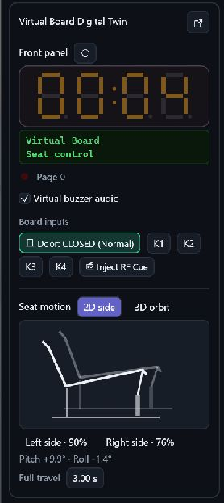
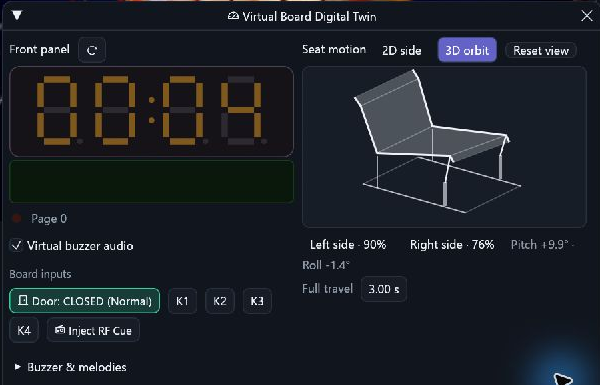
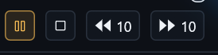

# 🎞️ Pealayer v0.12.0-alpha.2 — Projects, Virtual Board and native playback

Save and restore projects and scenes, run a firmware-backed Virtual Board with live front-panel and seat feedback, and use the updated native playback and Download Center controls.

📦 [Downloads](https://github.com/ToghrolTP/pealayer/releases/tag/v0.12.0-alpha.2) · 📚 [Version history](https://github.com/ToghrolTP/pealayer/blob/main/docs/releases/README.md) · 📝 [Changelog](https://github.com/ToghrolTP/pealayer/blob/main/CHANGELOG.md)

The [verified product checkpoint](https://github.com/ToghrolTP/pealayer/commit/cda2fd7212b615458df2822f9a0344c38a0bb63b) was integrated on November 11, 2026. The [release tag](https://github.com/ToghrolTP/pealayer/tree/v0.12.0-alpha.2) adds the version identity and release notes. [Compare with v0.11.0-alpha.1](https://github.com/ToghrolTP/pealayer/compare/v0.11.0-alpha.1...v0.12.0-alpha.2).

## ✨ Added and implemented

- **[Added]** Save and restore projects, scenes and standalone timelines. Project restore handles both internal and external players. [#227](https://github.com/ToghrolTP/pealayer/pull/227)
- **[Added]** Run the Virtual Board through a private PCController coordinator. Monitor the firmware LCD, segments, relay state and buzzer. Inspect both sides of a seat in 2D or orbit it in 3D. [#311](https://github.com/ToghrolTP/pealayer/pull/311) · [#313](https://github.com/ToghrolTP/pealayer/pull/313)
- **[Added]** Use the shared terminal from native and Web views with paired sessions, typed preferences and explicit execution permissions. [#281](https://github.com/ToghrolTP/pealayer/pull/281)
- **[Added]** Choose FilmCraft or the existing monitor and timeline presentations. Tune panel tab rounding, panel colors and collapse controls for CraftUI and egui Dock. [#248](https://github.com/ToghrolTP/pealayer/pull/248) · [#309](https://github.com/ToghrolTP/pealayer/pull/309)

## 🛠️ Fixes and improvements

- **[Fixed]** Remove duplicate seek work and keep the native window background opaque during redraws. [#308](https://github.com/ToghrolTP/pealayer/pull/308)
- **[Fixed]** Fit elapsed time and duration to their visible tabular figures. Restore the native volume context menu, with an opt-in boost range, and align Play, Pause, Stop and Mute paint with their state. [#310](https://github.com/ToghrolTP/pealayer/pull/310) · [#312](https://github.com/ToghrolTP/pealayer/pull/312) · [#314](https://github.com/ToghrolTP/pealayer/pull/314) · [#315](https://github.com/ToghrolTP/pealayer/pull/315)
- **[Fixed]** Share the native app palette and typography with the standalone Download Center. Restore input focus and style its title bar. [#294](https://github.com/ToghrolTP/pealayer/pull/294) · [#307](https://github.com/ToghrolTP/pealayer/pull/307)
- **[Fixed]** Restore Windows DirectComposition preview work and native playback gestures. Show live and seekable remote playback states and report recording overflow. [#299](https://github.com/ToghrolTP/pealayer/pull/299) · [#300](https://github.com/ToghrolTP/pealayer/pull/300) · [#305](https://github.com/ToghrolTP/pealayer/pull/305) · [#306](https://github.com/ToghrolTP/pealayer/pull/306)
- **[Fixed]** Improve the Pastel palette and align the status bar FPS value and unit. [#296](https://github.com/ToghrolTP/pealayer/pull/296) · [#297](https://github.com/ToghrolTP/pealayer/pull/297) · [#298](https://github.com/ToghrolTP/pealayer/pull/298)

## 🧪 Experimental features and later follow-ups

- **[Experimental]** The bundled demo clip uses the controller and virtual firmware companions. For setup and the required companion revisions, see the [Virtual Board verification notes](https://github.com/ToghrolTP/pealayer/blob/cda2fd7212b615458df2822f9a0344c38a0bb63b/docs/verification/virtual-board-parity.md). This release includes the clip and Pealayer integration. The PCController host and Virtual Board executables are supplied separately.
- **[Experimental]** Real hardware, deployment and long-running acceptance continue in the [current acceptance record](https://github.com/ToghrolTP/pealayer/blob/cda2fd7212b615458df2822f9a0344c38a0bb63b/docs/verification/CURRENT-ACCEPTANCE.md).

## 🐞 Bugs and problems in this build

- **[Known issue]** Under concurrent heavy compilation the demo can hit the existing hardware timing guard and pause after a late controller read. The verified replay reached 9.84 seconds of the 10-second example with the build load removed. [Virtual Board evidence](https://github.com/ToghrolTP/pealayer/blob/cda2fd7212b615458df2822f9a0344c38a0bb63b/docs/verification/virtual-board-parity.md)

## 📦 Packages and verification

The [exact tagged source](https://github.com/ToghrolTP/pealayer/commit/49e78c6df791e328fb1e6e4ab72f34cdc27ceb1f) passed the [four-platform release matrix](https://github.com/ToghrolTP/pealayer/actions/runs/43065265627). GitHub attested the release files in that run. Its workflow token received a 403 on publication, so the release maintainer published the verified assets through the GitHub CLI.

- [Pealayer-linux-x86_64-v0.12.0-alpha.2-49e78c6.tar.gz](https://github.com/ToghrolTP/pealayer/releases/download/v0.12.0-alpha.2/Pealayer-linux-x86_64-v0.12.0-alpha.2-49e78c6.tar.gz)
- [Pealayer-macos-aarch64-v0.12.0-alpha.2-49e78c6.zip](https://github.com/ToghrolTP/pealayer/releases/download/v0.12.0-alpha.2/Pealayer-macos-aarch64-v0.12.0-alpha.2-49e78c6.zip)
- [Pealayer-macos-x86_64-v0.12.0-alpha.2-49e78c6.zip](https://github.com/ToghrolTP/pealayer/releases/download/v0.12.0-alpha.2/Pealayer-macos-x86_64-v0.12.0-alpha.2-49e78c6.zip)
- [Pealayer-windows-x86_64-v0.12.0-alpha.2-49e78c6.zip](https://github.com/ToghrolTP/pealayer/releases/download/v0.12.0-alpha.2/Pealayer-windows-x86_64-v0.12.0-alpha.2-49e78c6.zip)

## 📸 Screenshots

**Virtual Board.** The Windows feature build shows the firmware LCD and live seat positions. [Capture conditions](https://github.com/ToghrolTP/pealayer/blob/0a9240f6c8f2ffdfbd87da0332cbf7e58c100538/docs/verification/virtual-board-parity.md)

| Docked 2D | Floating 3D |
| --- | --- |
|  |  |

**Native transport.** Active Pause in the included Windows feature build. [Matched capture conditions](https://github.com/ToghrolTP/pealayer/blob/6a44d5ebd7b7258a6554275cee8c6815248d3df7/docs/verification/semantic-transport.md)

## 🔗 Pull requests and issues

Included merged work: [#227](https://github.com/ToghrolTP/pealayer/pull/227), [#248](https://github.com/ToghrolTP/pealayer/pull/248), [#277](https://github.com/ToghrolTP/pealayer/pull/277), [#278](https://github.com/ToghrolTP/pealayer/pull/278), [#279](https://github.com/ToghrolTP/pealayer/pull/279), [#280](https://github.com/ToghrolTP/pealayer/pull/280), [#281](https://github.com/ToghrolTP/pealayer/pull/281), [#294](https://github.com/ToghrolTP/pealayer/pull/294), [#295](https://github.com/ToghrolTP/pealayer/pull/295), [#296](https://github.com/ToghrolTP/pealayer/pull/296), [#297](https://github.com/ToghrolTP/pealayer/pull/297), [#298](https://github.com/ToghrolTP/pealayer/pull/298), [#299](https://github.com/ToghrolTP/pealayer/pull/299), [#300](https://github.com/ToghrolTP/pealayer/pull/300), [#301](https://github.com/ToghrolTP/pealayer/pull/301), [#302](https://github.com/ToghrolTP/pealayer/pull/302), [#303](https://github.com/ToghrolTP/pealayer/pull/303), [#304](https://github.com/ToghrolTP/pealayer/pull/304), [#305](https://github.com/ToghrolTP/pealayer/pull/305), [#306](https://github.com/ToghrolTP/pealayer/pull/306), [#307](https://github.com/ToghrolTP/pealayer/pull/307), [#308](https://github.com/ToghrolTP/pealayer/pull/308), [#309](https://github.com/ToghrolTP/pealayer/pull/309), [#310](https://github.com/ToghrolTP/pealayer/pull/310), [#311](https://github.com/ToghrolTP/pealayer/pull/311), [#312](https://github.com/ToghrolTP/pealayer/pull/312), [#313](https://github.com/ToghrolTP/pealayer/pull/313), [#314](https://github.com/ToghrolTP/pealayer/pull/314), [#315](https://github.com/ToghrolTP/pealayer/pull/315).

Related issues: [#80](https://github.com/ToghrolTP/pealayer/issues/80), [#226](https://github.com/ToghrolTP/pealayer/issues/226), [#292](https://github.com/ToghrolTP/pealayer/issues/292).

← [Previous release v0.11.0-alpha.1](https://github.com/ToghrolTP/pealayer/releases/tag/v0.11.0-alpha.1)

<!-- pealayer-release-backfill:v0.12.0-alpha.2 -->
