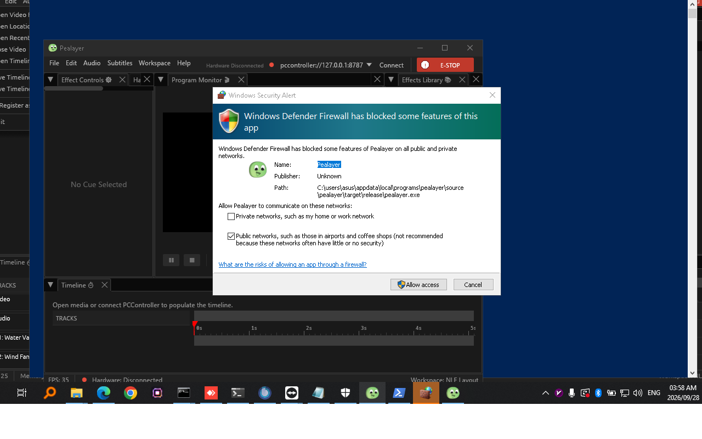
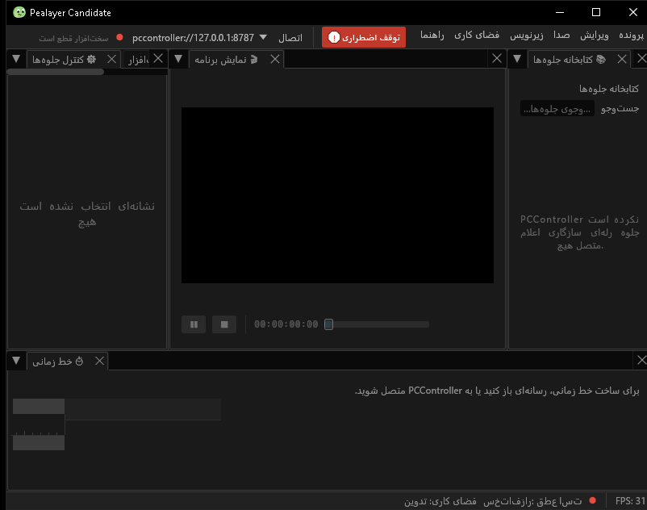

# Pealayer v0.2.0 — Native shell and semantic hardware authoring

Native Windows shell integration, persistent portable/system settings and semantic PCController authoring, with the first packages for both macOS architectures.

> **[Historical release]** Original tag, publication date and downloads preserved. Notes and evidence expanded during the 10 November 2026 backfill.

**Source checkpoint:** 2026-09-30 (Asia/Tehran) · [`d1c4956`](https://github.com/ToghrolTP/pealayer/commit/d1c4956f8b592cae6f1cd2de065cc3b684da3df3) · [Full source changes](https://github.com/ToghrolTP/pealayer/compare/d798109c0387ce70ea283a12593216583247b15e...d1c4956f8b592cae6f1cd2de065cc3b684da3df3)

## Added and implemented

- **[Added]** Taskbar media buttons, video thumbnails, progress/error state, system tray controls and branded native GUI ownership ([#25](https://github.com/ToghrolTP/pealayer/pull/25), [#35](https://github.com/ToghrolTP/pealayer/pull/35)).
- **[Added]** Portable configuration discovery, Windows Registry settings/history and application-exit persistence; expanded CLI/IPC and media explorer controls (db8f29f, cfa2322, 079c75f, 8db826a, e5191f3).
- **[Added]** Contextual hardware/player controls, semantic profiles and autoconnect, video-synchronized PCController macro clips and hardware effect authoring ([#36](https://github.com/ToghrolTP/pealayer/pull/36), [#41](https://github.com/ToghrolTP/pealayer/pull/41), [#42](https://github.com/ToghrolTP/pealayer/pull/42), [#43](https://github.com/ToghrolTP/pealayer/pull/43)).
- **[Added]** Custom hardware endpoints, compact subtitle settings and remote fullscreen reconciliation ([#37](https://github.com/ToghrolTP/pealayer/pull/37), [#38](https://github.com/ToghrolTP/pealayer/pull/38)); recovered local work is preserved through [#39](https://github.com/ToghrolTP/pealayer/pull/39).
- **[Added]** Linux, Windows, macOS Apple silicon and macOS Intel release packages.

## Fixes and improvements

- **[Fixed]** Slider snap-backs, scrub-time labels, delay bounds and audio/subtitle menus ([#5](https://github.com/ToghrolTP/pealayer/pull/5), 2912d77); smoother seeking/frame previews, control fade and seekbar/mute layout (b080831, f49cb88).
- **[Fixed]** macOS libmpv search/rpath, shared initialization and serialized headless tests (7a0529e, 3658fc3, 2b475c4, 65745c2).
- **[Fixed]** End the 4D engine loop when its command channel disconnects, preventing a worker-thread leak (d1c4956).
- **[Fixed]** Remove invented memory/readiness values from the native status bar in Windows-readiness work ([#25](https://github.com/ToghrolTP/pealayer/pull/25)).

## Experimental features and later follow-ups

- **[Experimental]** Semantic hardware editing and macro placements are early implementations; capability-led workspace/port unification follows in v0.3.0-alpha.1 ([#45](https://github.com/ToghrolTP/pealayer/pull/45), [#50](https://github.com/ToghrolTP/pealayer/pull/50)).
- **[Experimental]** Saved live recordings can still fail to appear/select after Finish; v0.4.0-alpha.1 updates the changed controller response and live state ([#58](https://github.com/ToghrolTP/pealayer/pull/58)).
- **[Experimental]** Initial Windows taskbar support does not include the later preview-loop, minimized-window, Task View and dynamic-artwork fixes ([#81](https://github.com/ToghrolTP/pealayer/pull/81), [#239](https://github.com/ToghrolTP/pealayer/pull/239)).

## Bugs and problems in this build

- **[Known issue]** Professional responsive hardware layout, durable pane restoration and live/buffered remote-media work are still pending at this tag; see v0.3.0-alpha.1 ([#45](https://github.com/ToghrolTP/pealayer/pull/45), [#47](https://github.com/ToghrolTP/pealayer/pull/47), [#49](https://github.com/ToghrolTP/pealayer/pull/49)).
- **[Known issue]** Later reports cover unsupported Windows libmpv CPU baselines, motion/control lockups and idle CPU ([#51](https://github.com/ToghrolTP/pealayer/issues/51), [#60](https://github.com/ToghrolTP/pealayer/issues/60), [#61](https://github.com/ToghrolTP/pealayer/issues/61), [#62](https://github.com/ToghrolTP/pealayer/issues/62)). The four built packages do not establish those runtime or physical acceptance gates.
- **[Known issue]** The release is bound to GitHub's published d1c4956 source and existing downloads. A divergent local historical tag was found during backfill and was not used to redefine this release.

## Packages and verification

Original published packages retained; tag and original asset bytes unchanged. Original release CI succeeded; existing platform availability is preserved.

| Platform | Download | Recorded verification |
| --- | --- | --- |
| Linux x86-64 | [Download](https://github.com/ToghrolTP/pealayer/releases/download/v0.2.0/Pealayer-linux-x86_64-v0.2.0-d1c4956.tar.gz) | original release package; SHA-256 in manifest |
| Windows x86-64 | [Download](https://github.com/ToghrolTP/pealayer/releases/download/v0.2.0/Pealayer-windows-x86_64-v0.2.0-d1c4956.zip) | original release package; SHA-256 in manifest |
| macOS Apple silicon | [Download](https://github.com/ToghrolTP/pealayer/releases/download/v0.2.0/Pealayer-macos-aarch64-v0.2.0-d1c4956.zip) | original release package; SHA-256 in manifest |
| macOS Intel | [Download](https://github.com/ToghrolTP/pealayer/releases/download/v0.2.0/Pealayer-macos-x86_64-v0.2.0-d1c4956.zip) | original release package; SHA-256 in manifest |

Download `SHA256SUMS.txt` and verify the attached files with `sha256sum --check SHA256SUMS.txt`. The attached `release-manifest.json` records the source, original artifact IDs/digests, packaging and platform results. Archive directory names and executable permission bits are normalized; executable bytes and embedded Cargo versions are unchanged. Existing native downloads are not rebuilt or replaced.

**[Acceptance]** Build/test/package success is separate from installed-device, human, audio, physical timing, GPU and soak acceptance. See [the current acceptance index](https://github.com/ToghrolTP/pealayer/blob/main/docs/verification/CURRENT-ACCEPTANCE.md).

## Screenshots

Actual archived or newly captured historical builds only. Captions identify the capture source; an earlier feature capture is not presented as the final tagged executable. No later UI is attributed to this version.

Accepted native English candidate from September 28, an ancestor of this tag; not an exact d1c4956 package capture. [Capture provenance](https://github.com/ToghrolTP/pealayer/blob/1e171e8bbd66348d00f9742704c5b78b006f6faf/docs/screenshots/manifest.json) · source [`0bd2db0`](https://github.com/ToghrolTP/pealayer/commit/0bd2db074667b0688a941bb015dc42b0391327ce).

Matching native Persian/RTL candidate; the same manifest records executable and image hashes. [Capture provenance](https://github.com/ToghrolTP/pealayer/blob/1e171e8bbd66348d00f9742704c5b78b006f6faf/docs/screenshots/manifest.json) · source [`0bd2db0`](https://github.com/ToghrolTP/pealayer/commit/0bd2db074667b0688a941bb015dc42b0391327ce).

The `screenshots.zip` attachment preserves the inspected image bytes and `screenshot-provenance.json` lists their hashes and source references.

## Pull requests and issues

All merged PRs first included in this milestone

- [#23](https://github.com/ToghrolTP/pealayer/pull/23) — build(deps): bump the npm-dependencies group in /web_ui with 9 updates
- [#24](https://github.com/ToghrolTP/pealayer/pull/24) — build(deps): bump the cargo-dependencies group across 1 directory with 3 updates
- [#25](https://github.com/ToghrolTP/pealayer/pull/25) — Windows production packaging and PCController integration
- [#35](https://github.com/ToghrolTP/pealayer/pull/35) — Enforce branded Windows GUI ownership
- [#36](https://github.com/ToghrolTP/pealayer/pull/36) — Make hardware and player UI contextual, live, and consistent
- [#37](https://github.com/ToghrolTP/pealayer/pull/37) — Restore NLE after remote fullscreen and advertise actions
- [#38](https://github.com/ToghrolTP/pealayer/pull/38) — Allow custom hardware endpoints and compact subtitle settings
- [#39](https://github.com/ToghrolTP/pealayer/pull/39) — Preserve recovered local Pealayer work without regressions
- [#41](https://github.com/ToghrolTP/pealayer/pull/41) — Add video-synchronized PCController macro clips
- [#42](https://github.com/ToghrolTP/pealayer/pull/42) — Add profile-driven semantic hardware controls
- [#43](https://github.com/ToghrolTP/pealayer/pull/43) — Add PCController hardware effect authoring

Related issues (references do not imply closure): [#2](https://github.com/ToghrolTP/pealayer/issues/2), [#26](https://github.com/ToghrolTP/pealayer/issues/26), [#29](https://github.com/ToghrolTP/pealayer/issues/29), [#30](https://github.com/ToghrolTP/pealayer/issues/30), [#34](https://github.com/ToghrolTP/pealayer/issues/34), [#40](https://github.com/ToghrolTP/pealayer/issues/40), [#51](https://github.com/ToghrolTP/pealayer/issues/51), [#60](https://github.com/ToghrolTP/pealayer/issues/60), [#61](https://github.com/ToghrolTP/pealayer/issues/61), [#62](https://github.com/ToghrolTP/pealayer/issues/62).

[Version index](https://github.com/ToghrolTP/pealayer/blob/main/docs/releases/README.md) · [Changelog](https://github.com/ToghrolTP/pealayer/blob/main/CHANGELOG.md) · [Previous: v0.1.0](https://github.com/ToghrolTP/pealayer/releases/tag/v0.1.0) · [Next: v0.3.0-alpha.1](https://github.com/ToghrolTP/pealayer/releases/tag/v0.3.0-alpha.1)

<!-- pealayer-release-backfill:v0.2.0 -->
