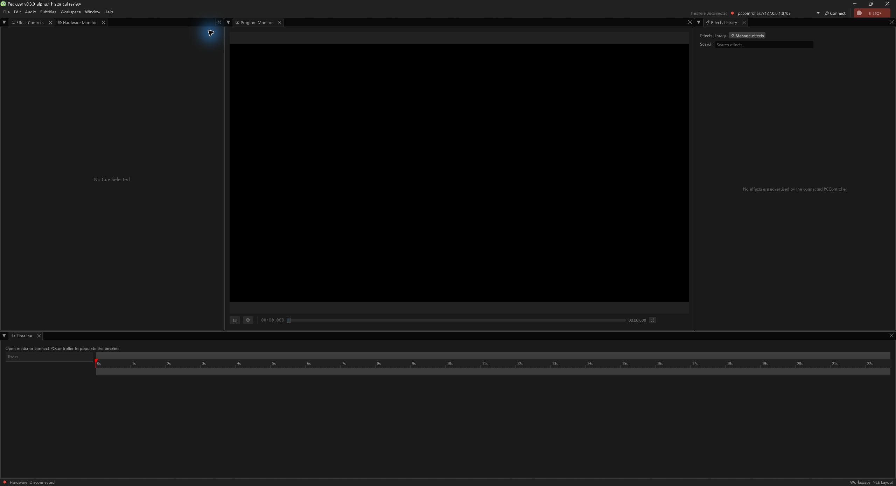

# Pealayer v0.3.0-alpha.1 — Capability workspace and unified control port

A capability-led hardware workspace, saved dock layouts, live/remote media and a single control port replace the earlier fragmented workflow.

> **[Historical alpha]** Backfilled on 10 November 2026 from the original source checkpoint. This is a retrospective development prerelease, with the exact package/CI limits below; it is not a newly certified stable build.

**Source checkpoint:** 2026-10-01 (Asia/Tehran) · [`14087de`](https://github.com/ToghrolTP/pealayer/commit/14087de3f103c2e7a0394c0f5c205eb78b42d5f9) · [Full source changes](https://github.com/ToghrolTP/pealayer/compare/d1c4956f8b592cae6f1cd2de065cc3b684da3df3...14087de3f103c2e7a0394c0f5c205eb78b42d5f9)

## Added and implemented

- **[Added]** Contextual live hardware cards, board identity, configurable status visibility, user-managed addressable effects and cross-platform vector icons ([#45](https://github.com/ToghrolTP/pealayer/pull/45)).
- **[Added]** Restore closed workspace panels in their canonical slots, persist dock layout and recover empty workspaces ([#47](https://github.com/ToghrolTP/pealayer/pull/47)).
- **[Added]** Play live and buffered remote media ([#49](https://github.com/ToghrolTP/pealayer/pull/49)); unify HTTP, WebSocket and IPC on one control port ([#50](https://github.com/ToghrolTP/pealayer/pull/50)).
- **[Added]** Grouped dependency/Actions updates and clearer platform CI presentation ([#48](https://github.com/ToghrolTP/pealayer/pull/48), [#52](https://github.com/ToghrolTP/pealayer/pull/52), [#53](https://github.com/ToghrolTP/pealayer/pull/53), [#54](https://github.com/ToghrolTP/pealayer/pull/54)).

## Fixes and improvements

- **[Fixed]** Preserve the complete Windows config while loading isolated test profiles; retain live semantic controls separately from raw relay state ([#47](https://github.com/ToghrolTP/pealayer/pull/47), [#45](https://github.com/ToghrolTP/pealayer/pull/45)).
- **[Fixed]** Stabilize media FPS, prefer actual board identity and use the packaged tray branding ([#45](https://github.com/ToghrolTP/pealayer/pull/45); 8643b10, fb3e851, 1249f87).
- **[Fixed]** Migrate Windows shell calls to windows 0.62 and repair native handle/procedure conversions (9a9c16a, 9ca18e7, 26a835f).

## Experimental features and later follow-ups

- **[Experimental]** The first capability workspace is subsequently expanded by the large [#46](https://github.com/ToghrolTP/pealayer/pull/46) integration in v0.4.0-alpha.1. Later screenshots of that integration do not depict this tag.
- **[Experimental]** Live/remote browsing and the unified server contract are implemented, while richer URL inspection and Web Studio follow in v0.4.0-alpha.1 ([#55](https://github.com/ToghrolTP/pealayer/pull/55)).
- **[Experimental]** PCController effects/recording are still evolving. The saved-response mismatch is repaired in v0.4.0-alpha.1 ([#58](https://github.com/ToghrolTP/pealayer/pull/58)); SFX and external mpv arrive in v0.5.0-alpha.1 ([#104](https://github.com/ToghrolTP/pealayer/pull/104), [#106](https://github.com/ToghrolTP/pealayer/pull/106)).

## Bugs and problems in this build

- **[Known issue]** The original aggregate CI run was cancelled: Linux, Windows and Intel macOS jobs succeeded, but Apple-silicon macOS was cancelled. A cancelled matrix is not a four-platform pass.
- **[Known issue]** Taskbar thumbnail acknowledgements can renew their own repaint work; the specific fix is in v0.4.0-alpha.1 ([#81](https://github.com/ToghrolTP/pealayer/pull/81)).
- **[Known issue]** Windows runtime baseline, rapid-motion lockup, idle CPU and full Web parity remain tracked by [#51](https://github.com/ToghrolTP/pealayer/issues/51) and [#60](https://github.com/ToghrolTP/pealayer/issues/60), [#61](https://github.com/ToghrolTP/pealayer/issues/61), [#62](https://github.com/ToghrolTP/pealayer/issues/62), [#63](https://github.com/ToghrolTP/pealayer/issues/63).

## Packages and verification

Recovered exact-source CI artifacts; original file bytes retained inside renamed containers. No new build or artifact attestation is claimed. Exact-source aggregate did not pass; see the platform/run results below.

| Platform | Download | Recorded verification |
| --- | --- | --- |
| Linux x86-64 | [Download](https://github.com/ToghrolTP/pealayer/releases/download/v0.3.0-alpha.1/Pealayer-linux-x86_64-v0.3.0-alpha.1-14087de.tar.gz) | [successful platform job](https://github.com/ToghrolTP/pealayer/actions/runs/36844489774); SHA-256 in manifest |
| Windows x86-64 | [Download](https://github.com/ToghrolTP/pealayer/releases/download/v0.3.0-alpha.1/Pealayer-windows-x86_64-v0.3.0-alpha.1-14087de.zip) | [successful platform job](https://github.com/ToghrolTP/pealayer/actions/runs/36844489774); SHA-256 in manifest |
| macOS Apple silicon | Not available | No successful exact-source package recovered for this platform |
| macOS Intel | [Download](https://github.com/ToghrolTP/pealayer/releases/download/v0.3.0-alpha.1/Pealayer-macos-x86_64-v0.3.0-alpha.1-14087de.zip) | [successful platform job](https://github.com/ToghrolTP/pealayer/actions/runs/36844489774); SHA-256 in manifest |

- [Workflow 36844489774](https://github.com/ToghrolTP/pealayer/actions/runs/36844489774): **cancelled**. macOS · Apple silicon: cancelled; Pealayer · Complete: failure

Download `SHA256SUMS.txt` and verify the attached files with `sha256sum --check SHA256SUMS.txt`. The attached `release-manifest.json` records the source, original artifact IDs/digests, packaging and platform results. Archive directory names and executable permission bits are normalized; executable bytes and embedded Cargo versions are unchanged. These source-milestone versions do not rewrite the older binaries’ embedded `0.2.0` package version.

**[Acceptance]** Build/test/package success is separate from installed-device, human, audio, physical timing, GPU and soak acceptance. See [the current acceptance index](https://github.com/ToghrolTP/pealayer/blob/main/docs/verification/CURRENT-ACCEPTANCE.md).

## Screenshots

Actual archived or newly captured historical builds only. Captions identify the capture source; an earlier feature capture is not presented as the final tagged executable. No later UI is attributed to this version.

Actual native workspace in the exact recovered CI package, captured during this backfill with an isolated disconnected profile. No media/telemetry is fabricated. [Capture provenance](https://github.com/ToghrolTP/pealayer/blob/1e171e8bbd66348d00f9742704c5b78b006f6faf/docs/screenshots/releases/v0.3.0-alpha.1/manifest.json) · source [`14087de`](https://github.com/ToghrolTP/pealayer/commit/14087de3f103c2e7a0394c0f5c205eb78b42d5f9).

The `screenshots.zip` attachment preserves the inspected image bytes and `screenshot-provenance.json` lists their hashes and source references.

## Pull requests and issues

All merged PRs first included in this milestone

- [#45](https://github.com/ToghrolTP/pealayer/pull/45) — Build a professional capability-driven hardware workspace
- [#47](https://github.com/ToghrolTP/pealayer/pull/47) — feat(ui): industrial-standard workspace panel restoration and layout persistence
- [#48](https://github.com/ToghrolTP/pealayer/pull/48) — ci: bring PCController-grade workflow presentation
- [#49](https://github.com/ToghrolTP/pealayer/pull/49) — feat: play live and buffered remote media
- [#50](https://github.com/ToghrolTP/pealayer/pull/50) — feat: unify HTTP, WebSocket, and IPC on one port
- [#52](https://github.com/ToghrolTP/pealayer/pull/52) — build(deps-dev): bump vite from 8.3.0 to 8.3.1 in /web_ui in the npm-dependencies group
- [#53](https://github.com/ToghrolTP/pealayer/pull/53) — build(deps): bump the cargo-dependencies group with 3 updates
- [#54](https://github.com/ToghrolTP/pealayer/pull/54) — build(deps): bump the actions group with 4 updates

Related issues (references do not imply closure): [#29](https://github.com/ToghrolTP/pealayer/issues/29), [#30](https://github.com/ToghrolTP/pealayer/issues/30), [#40](https://github.com/ToghrolTP/pealayer/issues/40), [#44](https://github.com/ToghrolTP/pealayer/issues/44), [#51](https://github.com/ToghrolTP/pealayer/issues/51), [#60](https://github.com/ToghrolTP/pealayer/issues/60), [#61](https://github.com/ToghrolTP/pealayer/issues/61), [#62](https://github.com/ToghrolTP/pealayer/issues/62), [#63](https://github.com/ToghrolTP/pealayer/issues/63).

[Version index](https://github.com/ToghrolTP/pealayer/blob/main/docs/releases/README.md) · [Changelog](https://github.com/ToghrolTP/pealayer/blob/main/CHANGELOG.md) · [Previous: v0.2.0](https://github.com/ToghrolTP/pealayer/releases/tag/v0.2.0) · [Next: v0.4.0-alpha.1](https://github.com/ToghrolTP/pealayer/releases/tag/v0.4.0-alpha.1)

<!-- pealayer-release-backfill:v0.3.0-alpha.1 -->
