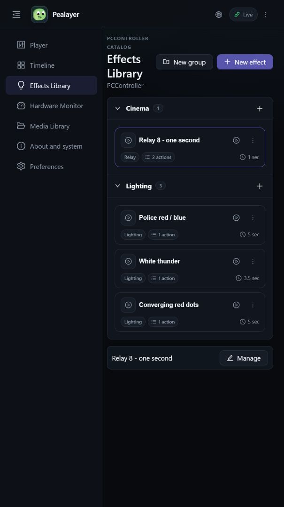
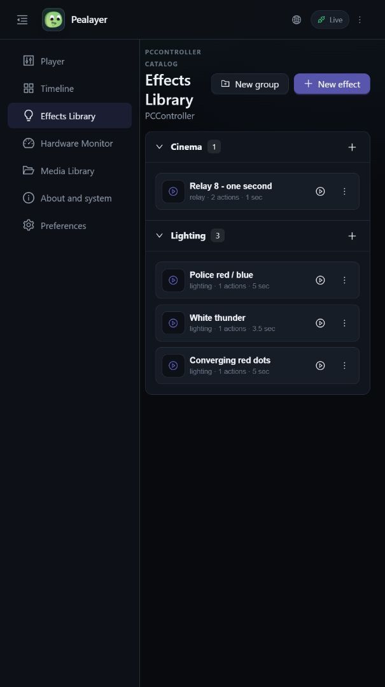
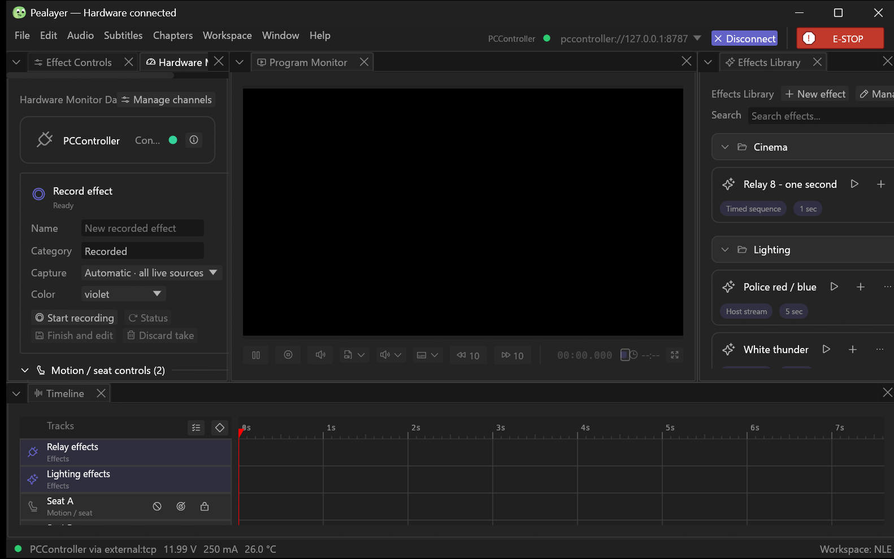

# 🌐 Pealayer v0.4.0-alpha.1 — Web Studio and live effects recording

The integrated hardware workspace and Web Studio add live effect recording, controller-owned catalogs, palettes, remote authority and richer timeline interaction.

> [!NOTE]
> **[Historical alpha]** Backfilled on 10 November 2026 from the original source checkpoint. This is a retrospective development prerelease, with the exact package/CI limits below; it is not a newly certified stable build.

📦 [Downloads](https://github.com/ToghrolTP/pealayer/releases/tag/v0.4.0-alpha.1#assets) · 📚 [Version history](https://github.com/ToghrolTP/pealayer/blob/main/docs/releases/README.md) · 📝 [Changelog](https://github.com/ToghrolTP/pealayer/blob/main/CHANGELOG.md)

**🗓️ Source checkpoint:** 2026-10-08 (Asia/Tehran) · [`db328d1`](https://github.com/ToghrolTP/pealayer/commit/db328d153e19c1713b98c02f6adefdf3d92717f3) · [Full source changes](https://github.com/ToghrolTP/pealayer/compare/14087de3f103c2e7a0394c0f5c205eb78b42d5f9...db328d153e19c1713b98c02f6adefdf3d92717f3)

## ✨ Added and implemented

- **[Added]** Responsive native/Web hardware workspace, channel manager, front-panel and board settings, RF/melody/strip controls and shared appearance/preferences ([#46](https://github.com/ToghrolTP/pealayer/pull/46)).
- **[Added]** Web Studio with shared playback, effects, timeline, workspace and recording commands/status ([#55](https://github.com/ToghrolTP/pealayer/pull/55)); remote peer/session and authority work is consolidated in [#46](https://github.com/ToghrolTP/pealayer/pull/46).
- **[Added]** Solid recording feedback, editable effect-group icons and drag/drop between groups ([#67](https://github.com/ToghrolTP/pealayer/pull/67), [#68](https://github.com/ToghrolTP/pealayer/pull/68)).
- **[Added]** Playback-aware icon packs and safe UPX icon patching ([#70](https://github.com/ToghrolTP/pealayer/pull/70), [#71](https://github.com/ToghrolTP/pealayer/pull/71)); timeline playhead follow, configurable toolbar, directional marquee selection and intrinsic cue grips ([#72](https://github.com/ToghrolTP/pealayer/pull/72), [#73](https://github.com/ToghrolTP/pealayer/pull/73), [#75](https://github.com/ToghrolTP/pealayer/pull/75)).
- **[Added]** Respect advertised PCController PWM transfer curves ([#76](https://github.com/ToghrolTP/pealayer/pull/76)).

## 🛠️ Fixes and improvements

- **[Fixed]** Finish now consumes the controller's 'effect … saved' response, selects the saved sequence and refreshes recording state from push events; stale unpublished drafts get a useful error ([#58](https://github.com/ToghrolTP/pealayer/pull/58)).
- **[Fixed]** Clear recovered transport errors ([#69](https://github.com/ToghrolTP/pealayer/pull/69)), avoid per-frame icon-config cloning ([#78](https://github.com/ToghrolTP/pealayer/pull/78)), stop the self-renewing taskbar-preview repaint loop ([#81](https://github.com/ToghrolTP/pealayer/pull/81)) and reduce paused peer polling ([#82](https://github.com/ToghrolTP/pealayer/pull/82)).
- **[Fixed]** Restore closed Effect Controls on cue reveal, center icon-picker tiles and refine the hardware/effects interaction surface ([#85](https://github.com/ToghrolTP/pealayer/pull/85), [#46](https://github.com/ToghrolTP/pealayer/pull/46)).

## 🧪 Experimental features and later follow-ups

- **[Experimental]** Web Studio is implemented, but [#63](https://github.com/ToghrolTP/pealayer/issues/63) still tracks full parity. A working recorder is not proof of physical motion timing, speaker routing or sustained load acceptance ([#80](https://github.com/ToghrolTP/pealayer/issues/80), [#61](https://github.com/ToghrolTP/pealayer/issues/61)).
- **[Experimental]** Sound-output preferences existed as a scaffold; the real SFX engine and per-effect routing arrive in v0.5.0-alpha.1 ([#104](https://github.com/ToghrolTP/pealayer/pull/104)).
- **[Experimental]** Step/whole-effect repeat and intrinsic cue durations are refined in v0.5.0-alpha.1 ([#115](https://github.com/ToghrolTP/pealayer/pull/115)), v0.6.0-alpha.1 ([#142](https://github.com/ToghrolTP/pealayer/pull/142), [#146](https://github.com/ToghrolTP/pealayer/pull/146)) and v0.10.0-alpha.1 ([#232](https://github.com/ToghrolTP/pealayer/pull/232), [#235](https://github.com/ToghrolTP/pealayer/pull/235)).

## 🐞 Bugs and problems in this build

- **[Known issue]** The exact main checkpoint's aggregate CI was cancelled after Linux, Windows and Intel macOS succeeded; Apple-silicon macOS did not finish in that run.
- **[Known issue]** Later fixes still address hidden NLE volume, segmented time editing and cue properties in v0.5.0-alpha.1 ([#96](https://github.com/ToghrolTP/pealayer/pull/96), [#97](https://github.com/ToghrolTP/pealayer/pull/97), [#100](https://github.com/ToghrolTP/pealayer/pull/100)).
- **[Known issue]** Hardware timing/ACK freshness, rapid-command stress, idle CPU and Web/native acceptance remain open ([#61](https://github.com/ToghrolTP/pealayer/issues/61), [#62](https://github.com/ToghrolTP/pealayer/issues/62), [#63](https://github.com/ToghrolTP/pealayer/issues/63), [#80](https://github.com/ToghrolTP/pealayer/issues/80)).

## 📦 Packages and verification

Recovered exact-source CI artifacts; original file bytes retained inside renamed containers. No new build or artifact attestation is claimed. Exact-source aggregate did not pass; see the platform/run results below.

| Platform | Download | Recorded verification |
| --- | --- | --- |
| 🐧 Linux x86-64 | [⬇️ Download](https://github.com/ToghrolTP/pealayer/releases/download/v0.4.0-alpha.1/Pealayer-linux-x86_64-v0.4.0-alpha.1-db328d1.tar.gz) | [successful platform job](https://github.com/ToghrolTP/pealayer/actions/runs/37810002589); SHA-256 in manifest |
| 🪟 Windows x86-64 | [⬇️ Download](https://github.com/ToghrolTP/pealayer/releases/download/v0.4.0-alpha.1/Pealayer-windows-x86_64-v0.4.0-alpha.1-db328d1.zip) | [successful platform job](https://github.com/ToghrolTP/pealayer/actions/runs/37810002589); SHA-256 in manifest |
| 🍎 macOS Apple silicon | — Not available | No successful exact-source package recovered for this platform |
| 🍎 macOS Intel | [⬇️ Download](https://github.com/ToghrolTP/pealayer/releases/download/v0.4.0-alpha.1/Pealayer-macos-x86_64-v0.4.0-alpha.1-db328d1.zip) | [successful platform job](https://github.com/ToghrolTP/pealayer/actions/runs/37810002589); SHA-256 in manifest |

- [Workflow 37810002589](https://github.com/ToghrolTP/pealayer/actions/runs/37810002589): **cancelled**. macOS · Apple silicon: cancelled; Pealayer · Complete: failure

Download `SHA256SUMS.txt` and verify the attached files with `sha256sum --check SHA256SUMS.txt`. The attached `release-manifest.json` records the source, original artifact IDs/digests, packaging and platform results. Archive directory names and executable permission bits are normalized; executable bytes and embedded Cargo versions are unchanged. These source-milestone versions do not rewrite the older binaries’ embedded `0.2.0` package version.

**🧭 [Acceptance]** Build/test/package success is separate from installed-device, human, audio, physical timing, GPU and soak acceptance. See [the current acceptance index](https://github.com/ToghrolTP/pealayer/blob/main/docs/verification/CURRENT-ACCEPTANCE.md).

## 📸 Screenshots

Actual archived or newly captured historical builds only. Captions identify the capture source; an earlier feature capture is not presented as the final tagged executable. No later UI is attributed to this version.

Actual Web effects cards with neutral metadata badges and separate duration. Native geometry tests are documented separately; this is a Web capture. [Capture provenance](https://github.com/ToghrolTP/pealayer/blob/1e171e8bbd66348d00f9742704c5b78b006f6faf/docs/screenshots/effect-cards/README.md) · source [`162f006`](https://github.com/ToghrolTP/pealayer/commit/162f00648e52b893bbcf645bc2e2639dd1b34981).

Actual Web group controls and shared palette from the #46 integration. [Capture provenance](https://github.com/ToghrolTP/pealayer/blob/1e171e8bbd66348d00f9742704c5b78b006f6faf/docs/screenshots/effects-library/README.md) · source [`62aac62`](https://github.com/ToghrolTP/pealayer/commit/62aac623f27d69258e76231c39bd6ea513c0da80).

Archived native recording workflow; the linked manifest identifies its source and executable. [Capture provenance](https://github.com/ToghrolTP/pealayer/blob/1e171e8bbd66348d00f9742704c5b78b006f6faf/docs/screenshots/effects-recording/native-recorder-final/manifest.json) · source [`502e12a`](https://github.com/ToghrolTP/pealayer/commit/502e12a843fe328bcf1222f633d133b4b2372f67).

The `screenshots.zip` attachment preserves the inspected image bytes and `screenshot-provenance.json` lists their hashes and source references.

## 🔗 Pull requests and issues

🔀 All merged PRs first included in this milestone

- [#46](https://github.com/ToghrolTP/pealayer/pull/46) — Polish the live hardware workspace layout
- [#55](https://github.com/ToghrolTP/pealayer/pull/55) — Build the production Pealayer Web Studio suite
- [#58](https://github.com/ToghrolTP/pealayer/pull/58) — Fix live effect recording and controller playback
- [#67](https://github.com/ToghrolTP/pealayer/pull/67) — Effects: solid red recording and editable group icons
- [#68](https://github.com/ToghrolTP/pealayer/pull/68) — Effects: drag cards between parent groups
- [#69](https://github.com/ToghrolTP/pealayer/pull/69) — Clear recovered hardware clock transport errors
- [#70](https://github.com/ToghrolTP/pealayer/pull/70) — feat: add playback-aware application icon packs
- [#71](https://github.com/ToghrolTP/pealayer/pull/71) — fix: patch UPX executables safely
- [#72](https://github.com/ToghrolTP/pealayer/pull/72) — Timeline playhead follow and configurable ruler toolbar
- [#73](https://github.com/ToghrolTP/pealayer/pull/73) — Fix timeline cue marquee selection with CAD-style direction modes
- [#75](https://github.com/ToghrolTP/pealayer/pull/75) — feat: add intrinsic cue grips and configurable label overflow
- [#76](https://github.com/ToghrolTP/pealayer/pull/76) — feat: respect PCController PWM transfer curves
- [#78](https://github.com/ToghrolTP/pealayer/pull/78) — Avoid per-frame playback icon configuration clones
- [#81](https://github.com/ToghrolTP/pealayer/pull/81) — Stop self-renewing Windows taskbar preview repaint loop
- [#82](https://github.com/ToghrolTP/pealayer/pull/82) — perf: slow peer session polling while paused
- [#83](https://github.com/ToghrolTP/pealayer/pull/83) — build(deps-dev): bump vite from 8.3.1 to 8.3.2 in /web_ui in the npm-dependencies group
- [#85](https://github.com/ToghrolTP/pealayer/pull/85) — fix(timeline): restore closed effect controls on cue reveal and center icon picker tiles

**🔎 Related issues** (references do not imply closure): [#40](https://github.com/ToghrolTP/pealayer/issues/40), [#59](https://github.com/ToghrolTP/pealayer/issues/59), [#61](https://github.com/ToghrolTP/pealayer/issues/61), [#62](https://github.com/ToghrolTP/pealayer/issues/62), [#63](https://github.com/ToghrolTP/pealayer/issues/63), [#80](https://github.com/ToghrolTP/pealayer/issues/80).

[📚 Version index](https://github.com/ToghrolTP/pealayer/blob/main/docs/releases/README.md) · [📝 Changelog](https://github.com/ToghrolTP/pealayer/blob/main/CHANGELOG.md) · [← Previous: v0.3.0-alpha.1](https://github.com/ToghrolTP/pealayer/releases/tag/v0.3.0-alpha.1) · [Next →: v0.5.0-alpha.1](https://github.com/ToghrolTP/pealayer/releases/tag/v0.5.0-alpha.1)

<!-- pealayer-release-backfill:v0.4.0-alpha.1 -->
