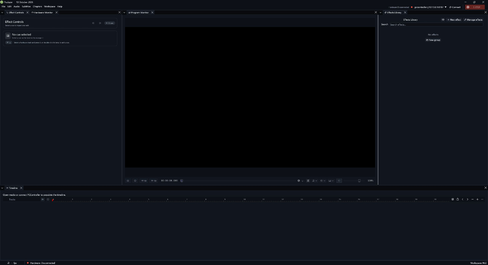
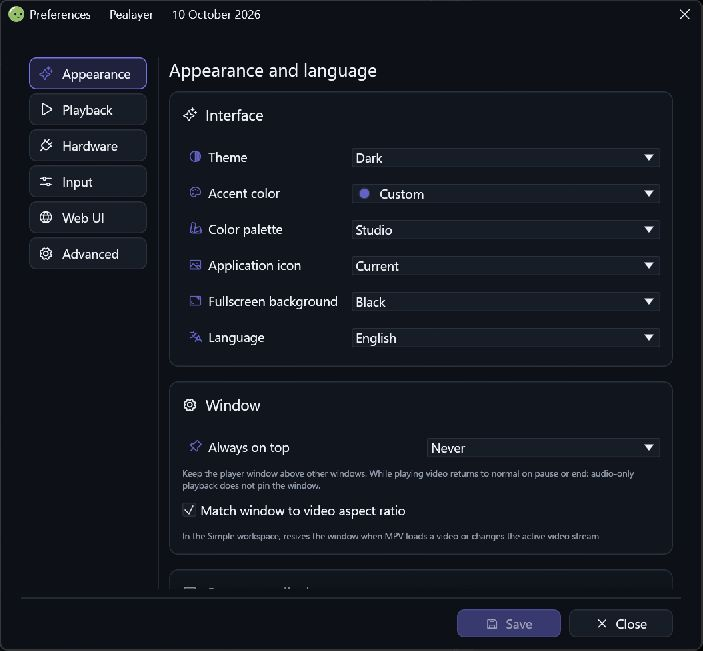

# Pealayer v0.5.0-alpha.1 — Audio, external mpv and authoring workspace

The versioned home of the previously date-named October 10 comparison: sound effects, independent audio outputs, external mpv, better source browsing and a much fuller authoring workspace.

> **[Historical alpha]** Backfilled on 10 November 2026 from the original source checkpoint. This is a retrospective development prerelease, with the exact package/CI limits below; it is not a newly certified stable build.

**Source checkpoint:** 2026-10-10 (Asia/Tehran) · [`ad4b466`](https://github.com/ToghrolTP/pealayer/commit/ad4b466fbe40e4556edf4bd9594d3f4eb468329c) · [Full source changes](https://github.com/ToghrolTP/pealayer/compare/db328d153e19c1713b98c02f6adefdf3d92717f3...ad4b466fbe40e4556edf4bd9594d3f4eb468329c)

## Added and implemented

- **[Added]** Import, preview and schedule sound effects with main/SFX/per-effect audio-output discovery and routing ([#104](https://github.com/ToghrolTP/pealayer/pull/104)).
- **[Added]** External-only mpv, muted dual preview and control of an existing player through event-driven socket/named-pipe IPC ([#106](https://github.com/ToghrolTP/pealayer/pull/106)).
- **[Added]** Copied-link inspection, stable remote-directory browsing and verified clipboard sources ([#105](https://github.com/ToghrolTP/pealayer/pull/105), [#122](https://github.com/ToghrolTP/pealayer/pull/122), [#123](https://github.com/ToghrolTP/pealayer/pull/123)); shared download center and standalone downloader ([#111](https://github.com/ToghrolTP/pealayer/pull/111)).
- **[Added]** Frame-window scrubbing, frame-per-wheel ruler navigation, direct semantic seat cues and a shared Effect Controls inspector ([#86](https://github.com/ToghrolTP/pealayer/pull/86), [#92](https://github.com/ToghrolTP/pealayer/pull/92), [#100](https://github.com/ToghrolTP/pealayer/pull/100), [#119](https://github.com/ToghrolTP/pealayer/pull/119), [#126](https://github.com/ToghrolTP/pealayer/pull/126)).
- **[Added]** Hardware channel folders, customizable timeline controls, palette-safe Elegance widgets, live appearance, native Persian shaping and keyboard-navigable selectors ([#89](https://github.com/ToghrolTP/pealayer/pull/89), [#108](https://github.com/ToghrolTP/pealayer/pull/108), [#118](https://github.com/ToghrolTP/pealayer/pull/118), [#125](https://github.com/ToghrolTP/pealayer/pull/125), [#128](https://github.com/ToghrolTP/pealayer/pull/128), [#130](https://github.com/ToghrolTP/pealayer/pull/130)).

## Fixes and improvements

- **[Fixed]** Hidden-window command processing, updater/lifecycle routing and Preferences organization ([#87](https://github.com/ToghrolTP/pealayer/pull/87)); proper contextual transport/volume in narrower NLE panels ([#95](https://github.com/ToghrolTP/pealayer/pull/95), [#96](https://github.com/ToghrolTP/pealayer/pull/96), [#124](https://github.com/ToghrolTP/pealayer/pull/124)).
- **[Fixed]** Commit segmented elapsed-time edits safely, settle scrub release frames, share chapter markers and refresh the buzzer catalog from authority ([#93](https://github.com/ToghrolTP/pealayer/pull/93), [#97](https://github.com/ToghrolTP/pealayer/pull/97), [#98](https://github.com/ToghrolTP/pealayer/pull/98)).
- **[Fixed]** Streamed-strip cue windows resize without changing cycle speed; finite recordings remain move-only and shared placements keep their own durations ([#115](https://github.com/ToghrolTP/pealayer/pull/115)).
- **[Fixed]** Reduce redundant UI work ([#103](https://github.com/ToghrolTP/pealayer/pull/103), [#107](https://github.com/ToghrolTP/pealayer/pull/107)), preserve clean package provenance and bound Windows compiler/cache writes ([#113](https://github.com/ToghrolTP/pealayer/pull/113), [#120](https://github.com/ToghrolTP/pealayer/pull/120), [#121](https://github.com/ToghrolTP/pealayer/pull/121)).
- **[Fixed]** Refine Effects Library hover spacing, hidden-channel disclosure and dropdown/color-picker alignment ([#127](https://github.com/ToghrolTP/pealayer/pull/127), [#129](https://github.com/ToghrolTP/pealayer/pull/129), [#130](https://github.com/ToghrolTP/pealayer/pull/130)).

## Experimental features and later follow-ups

- **[Experimental]** SFX now has a real implementation, superseding the v0.4.0-alpha.1 scaffold; human listening and physical output routing remain open ([#104](https://github.com/ToghrolTP/pealayer/pull/104), [#80](https://github.com/ToghrolTP/pealayer/issues/80)).
- **[Experimental]** Independent external/internal decoders are not frame-locked. Later pause, seek/resume, selected-track and external Quit recovery arrives in v0.10.0-alpha.1 ([#258](https://github.com/ToghrolTP/pealayer/pull/258), [#260](https://github.com/ToghrolTP/pealayer/pull/260)).
- **[Experimental]** Frame-accurate scrubbing is implemented, with the larger decoded-window/GPU/native-surface work still tracked by [#64](https://github.com/ToghrolTP/pealayer/issues/64), [#65](https://github.com/ToghrolTP/pealayer/issues/65), [#66](https://github.com/ToghrolTP/pealayer/issues/66).
- **[Experimental]** Recording repeat windows/counts and scoped exits are explicitly incomplete ([#114](https://github.com/ToghrolTP/pealayer/issues/114)); this release must not be described as completing that backlog.

## Bugs and problems in this build

- **[Known issue]** Prepared hardware playback can be starved by configuration I/O and metadata work; v0.6.0-alpha.1 removes that work and repairs pending/empty-plan recovery ([#132](https://github.com/ToghrolTP/pealayer/pull/132), [#133](https://github.com/ToghrolTP/pealayer/pull/133), [#156](https://github.com/ToghrolTP/pealayer/pull/156)).
- **[Known issue]** The original CI and the later exact-source comparison rebuild each had a cancelled macOS job. All four platforms can be recovered across successful jobs from those two runs, but neither aggregate run is a complete green matrix.
- **[Known issue]** The genuine comparison package explicitly skipped native unit reruns and UPX. Its screenshots are UI evidence, not production certification.
- **[Known issue]** Hardware/audio/human/GPU and broad Web acceptance remain in [#80](https://github.com/ToghrolTP/pealayer/issues/80) and [#63](https://github.com/ToghrolTP/pealayer/issues/63).

## Packages and verification

Recovered exact-source CI artifacts; original file bytes retained inside renamed containers. No new build or artifact attestation is claimed. Exact-source aggregate did not pass; see the platform/run results below.

| Platform | Download | Recorded verification |
| --- | --- | --- |
| Linux x86-64 | [Download](https://github.com/ToghrolTP/pealayer/releases/download/v0.5.0-alpha.1/Pealayer-linux-x86_64-v0.5.0-alpha.1-ad4b466.tar.gz) | [successful platform job](https://github.com/ToghrolTP/pealayer/actions/runs/38079579921); SHA-256 in manifest |
| Windows x86-64 | [Download](https://github.com/ToghrolTP/pealayer/releases/download/v0.5.0-alpha.1/Pealayer-windows-x86_64-v0.5.0-alpha.1-ad4b466.zip) | [successful platform job](https://github.com/ToghrolTP/pealayer/actions/runs/38079579921); SHA-256 in manifest |
| macOS Apple silicon | [Download](https://github.com/ToghrolTP/pealayer/releases/download/v0.5.0-alpha.1/Pealayer-macos-aarch64-v0.5.0-alpha.1-ad4b466.zip) | [successful platform job](https://github.com/ToghrolTP/pealayer/actions/runs/38079579921); SHA-256 in manifest |
| macOS Intel | [Download](https://github.com/ToghrolTP/pealayer/releases/download/v0.5.0-alpha.1/Pealayer-macos-x86_64-v0.5.0-alpha.1-ad4b466.zip) | [successful platform job](https://github.com/ToghrolTP/pealayer/actions/runs/42305499535); SHA-256 in manifest |

- [Workflow 38079579921](https://github.com/ToghrolTP/pealayer/actions/runs/38079579921): **cancelled**. macOS · Intel: cancelled; Pealayer · Complete: failure
- [Workflow 42305499535](https://github.com/ToghrolTP/pealayer/actions/runs/42305499535): **cancelled**. macOS · Apple silicon: cancelled; Pealayer · Complete: failure

Download `SHA256SUMS.txt` and verify the attached files with `sha256sum --check SHA256SUMS.txt`. The attached `release-manifest.json` records the source, original artifact IDs/digests, packaging and platform results. Archive directory names and executable permission bits are normalized; executable bytes and embedded Cargo versions are unchanged. These source-milestone versions do not rewrite the older binaries’ embedded `0.2.0` package version.

**[Acceptance]** Build/test/package success is separate from installed-device, human, audio, physical timing, GPU and soak acceptance. See [the current acceptance index](https://github.com/ToghrolTP/pealayer/blob/main/docs/verification/CURRENT-ACCEPTANCE.md).

## Screenshots

Actual archived or newly captured historical builds only. Captions identify the capture source; an earlier feature capture is not presented as the final tagged executable. No later UI is attributed to this version.

Actual native v0.5.0-alpha.1 source rebuilt with its original lockfile. The existing filename is retained for provenance; this comparison is now identified by version. [Capture provenance](https://github.com/ToghrolTP/pealayer/blob/1e171e8bbd66348d00f9742704c5b78b006f6faf/docs/verification/october10-ui-comparison.md) · source [`ad4b466`](https://github.com/ToghrolTP/pealayer/commit/ad4b466fbe40e4556edf4bd9594d3f4eb468329c).

Matching native Preferences capture from the same source and isolated disconnected comparison profile. [Capture provenance](https://github.com/ToghrolTP/pealayer/blob/1e171e8bbd66348d00f9742704c5b78b006f6faf/docs/verification/october10-ui-comparison.md) · source [`ad4b466`](https://github.com/ToghrolTP/pealayer/commit/ad4b466fbe40e4556edf4bd9594d3f4eb468329c).

The `screenshots.zip` attachment preserves the inspected image bytes and `screenshot-provenance.json` lists their hashes and source references.

## Pull requests and issues

All merged PRs first included in this milestone

- [#77](https://github.com/ToghrolTP/pealayer/pull/77) — Timeline track state feedback and direct cue creation
- [#79](https://github.com/ToghrolTP/pealayer/pull/79) — Fix task-specific Windows Jump List icons
- [#84](https://github.com/ToghrolTP/pealayer/pull/84) — build(deps): bump the cargo-dependencies group across 1 directory with 3 updates
- [#86](https://github.com/ToghrolTP/pealayer/pull/86) — feat(timeline): implement frame-accurate scrubbing with decoded frame cache
- [#87](https://github.com/ToghrolTP/pealayer/pull/87) — Consolidate Preferences refinement and shell/timeline recovery
- [#89](https://github.com/ToghrolTP/pealayer/pull/89) — fix(timeline): immediate toolbar edits, drag customization and stable navigation
- [#90](https://github.com/ToghrolTP/pealayer/pull/90) — Fix explicit FPS source and responsive hardware status
- [#91](https://github.com/ToghrolTP/pealayer/pull/91) — Distinguish persistent hardware markers from timed holds and PWM ramps
- [#92](https://github.com/ToghrolTP/pealayer/pull/92) — feat(timeline): step one frame per scroll tick on timeline ruler
- [#93](https://github.com/ToghrolTP/pealayer/pull/93) — Fix seekbar release frames, chapter navigation and shared marker colors
- [#94](https://github.com/ToghrolTP/pealayer/pull/94) — Fix channel feedback, shared cue properties and track state
- [#95](https://github.com/ToghrolTP/pealayer/pull/95) — fix: synchronize semantic transport controls across native and Web
- [#96](https://github.com/ToghrolTP/pealayer/pull/96) — Fix NLE volume visibility and responsive transport
- [#97](https://github.com/ToghrolTP/pealayer/pull/97) — Make elapsed time an immutable segmented editor with safe seek commits
- [#98](https://github.com/ToghrolTP/pealayer/pull/98) — Refresh buzzer melodies on events and selector opening through authority
- [#99](https://github.com/ToghrolTP/pealayer/pull/99) — Fix live application branding across tray, dialogs and Web
- [#100](https://github.com/ToghrolTP/pealayer/pull/100) — Refine shared Effect Controls inspector and cue dialog
- [#101](https://github.com/ToghrolTP/pealayer/pull/101) — Fix live runtime branding integration test
- [#102](https://github.com/ToghrolTP/pealayer/pull/102) — Fix shared mobile Web button icon centering
- [#103](https://github.com/ToghrolTP/pealayer/pull/103) — Improve playback and timeline rendering smoothness
- [#104](https://github.com/ToghrolTP/pealayer/pull/104) — Add SFX audio effects and independent output routing
- [#105](https://github.com/ToghrolTP/pealayer/pull/105) — Inspect copied links and stabilize remote-location browsing
- [#106](https://github.com/ToghrolTP/pealayer/pull/106) — External mpv: event-driven duplex playback, remote controls and muted dual preview
- [#107](https://github.com/ToghrolTP/pealayer/pull/107) — Complete remaining UI smoothness optimizations
- [#108](https://github.com/ToghrolTP/pealayer/pull/108) — Palette-safe Elegance widgets with live host theme and compact sections
- [#109](https://github.com/ToghrolTP/pealayer/pull/109) — Curated releases, grouped changelog and current acceptance
- [#111](https://github.com/ToghrolTP/pealayer/pull/111) — Shared download center and standalone utility
- [#112](https://github.com/ToghrolTP/pealayer/pull/112) — Preserve guarded cue timing and startup acceptance
- [#113](https://github.com/ToghrolTP/pealayer/pull/113) — Preserve clean provenance during Windows packaging
- [#115](https://github.com/ToghrolTP/pealayer/pull/115) — Resize strip active windows without stretching finite recordings
- [#117](https://github.com/ToghrolTP/pealayer/pull/117) — refactor(ui): consolidate panel controls into workspace menu
- [#118](https://github.com/ToghrolTP/pealayer/pull/118) — fix(i18n): use native HarfRust text shaping for Persian
- [#119](https://github.com/ToghrolTP/pealayer/pull/119) — Author semantic seat cues and configurable cue editing
- [#120](https://github.com/ToghrolTP/pealayer/pull/120) — test(windows): retain shared libmpv client for process
- [#121](https://github.com/ToghrolTP/pealayer/pull/121) — fix(build): bound Windows storage writes
- [#122](https://github.com/ToghrolTP/pealayer/pull/122) — Verify copied links before opening remote dialogs
- [#123](https://github.com/ToghrolTP/pealayer/pull/123) — Assert authoritative state in copied-link acceptance
- [#124](https://github.com/ToghrolTP/pealayer/pull/124) — Make NLE transport contextual and responsive
- [#125](https://github.com/ToghrolTP/pealayer/pull/125) — Fix timeline toolbar outlines and drag removal feedback
- [#126](https://github.com/ToghrolTP/pealayer/pull/126) — Add Show in timeline to Effect Controls
- [#127](https://github.com/ToghrolTP/pealayer/pull/127) — Fix Hardware Monitor hidden-channel menu alignment
- [#128](https://github.com/ToghrolTP/pealayer/pull/128) — Manage hardware channel folders with context menus and drops
- [#129](https://github.com/ToghrolTP/pealayer/pull/129) — Fix Effects Library spacing and hover actions
- [#130](https://github.com/ToghrolTP/pealayer/pull/130) — Fix native dropdown navigation and color picker alignment
- [#131](https://github.com/ToghrolTP/pealayer/pull/131) — Record Erfan board-connected authoring readiness

Related issues (references do not imply closure): [#40](https://github.com/ToghrolTP/pealayer/issues/40), [#63](https://github.com/ToghrolTP/pealayer/issues/63), [#64](https://github.com/ToghrolTP/pealayer/issues/64), [#65](https://github.com/ToghrolTP/pealayer/issues/65), [#66](https://github.com/ToghrolTP/pealayer/issues/66), [#80](https://github.com/ToghrolTP/pealayer/issues/80), [#88](https://github.com/ToghrolTP/pealayer/issues/88), [#110](https://github.com/ToghrolTP/pealayer/issues/110), [#114](https://github.com/ToghrolTP/pealayer/issues/114).

[Version index](https://github.com/ToghrolTP/pealayer/blob/main/docs/releases/README.md) · [Changelog](https://github.com/ToghrolTP/pealayer/blob/main/CHANGELOG.md) · [Previous: v0.4.0-alpha.1](https://github.com/ToghrolTP/pealayer/releases/tag/v0.4.0-alpha.1) · [Next: v0.6.0-alpha.1](https://github.com/ToghrolTP/pealayer/releases/tag/v0.6.0-alpha.1)

<!-- pealayer-release-backfill:v0.5.0-alpha.1 -->
