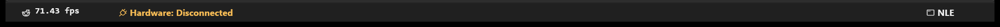
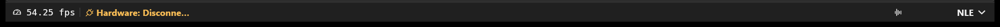

# Pealayer v0.6.0-alpha.1 — Effects Designer and customizable live status

Effects Designer gains repeat-aware gestures and capture selection, while status widgets, contextual tray/media controls and hardware preparation become more capable.

> **[Historical alpha]** Backfilled on 10 November 2026 from the original source checkpoint. This is a retrospective development prerelease, with the exact package/CI limits below; it is not a newly certified stable build.

**Source checkpoint:** 2026-10-12 (Asia/Tehran) · [`00687b1`](https://github.com/ToghrolTP/pealayer/commit/00687b16a70217963794bc2d867160f3fbcd5e65) · [Full source changes](https://github.com/ToghrolTP/pealayer/compare/ad4b466fbe40e4556edf4bd9594d3f4eb468329c...00687b16a70217963794bc2d867160f3fbcd5e65)

## Added and implemented

- **[Added]** Ctrl-drag copies, compatible seat-lane moves, scoped bulk edits, finite whole-effect repeats, exact timing and advertised capture channels/opcodes; Publish & Run waits for acknowledgement ([#142](https://github.com/ToghrolTP/pealayer/pull/142)).
- **[Added]** Source-bound step-repeat projections and consistent designer/lane interaction ([#146](https://github.com/ToghrolTP/pealayer/pull/146), [#147](https://github.com/ToghrolTP/pealayer/pull/147), [#162](https://github.com/ToghrolTP/pealayer/pull/162)).
- **[Added]** Reorderable status widgets, optional RAM-only charts, actual operation progress, HOT alerts, explicit FPS modes, stable metric slots and a workspace selector ([#149](https://github.com/ToghrolTP/pealayer/pull/149), [#150](https://github.com/ToghrolTP/pealayer/pull/150), [#164](https://github.com/ToghrolTP/pealayer/pull/164), [#166](https://github.com/ToghrolTP/pealayer/pull/166)).
- **[Added]** Contextual PCController tray actions, customizable control bars, background media-control preference and complete Windows media-session/shared Web projection ([#155](https://github.com/ToghrolTP/pealayer/pull/155), [#165](https://github.com/ToghrolTP/pealayer/pull/165), [#167](https://github.com/ToghrolTP/pealayer/pull/167), [#168](https://github.com/ToghrolTP/pealayer/pull/168), [#173](https://github.com/ToghrolTP/pealayer/pull/173)).
- **[Added]** Shared five-level input/dropdown density and coordinator-owned Buzzer Stop state ([#160](https://github.com/ToghrolTP/pealayer/pull/160)).

## Fixes and improvements

- **[Fixed]** Keep configuration I/O and routine metadata off hardware clock streams; expose bounded timing/coordinator diagnostics ([#132](https://github.com/ToghrolTP/pealayer/pull/132), [#133](https://github.com/ToghrolTP/pealayer/pull/133), [#136](https://github.com/ToghrolTP/pealayer/pull/136), [#137](https://github.com/ToghrolTP/pealayer/pull/137), [#138](https://github.com/ToghrolTP/pealayer/pull/138)).
- **[Fixed]** Resolve pending Play after acknowledged empty plans and reject stale ACKs that could erase new failures, retaining the existing timing/freshness limits ([#156](https://github.com/ToghrolTP/pealayer/pull/156)).
- **[Fixed]** Synchronize seek-worker shutdown, isolate app fixtures and retire libmpv worker leaks ([#144](https://github.com/ToghrolTP/pealayer/pull/144), [#158](https://github.com/ToghrolTP/pealayer/pull/158)).
- **[Fixed]** Live RGB invalidates the snapshot before repaint; preserve seat captions, renamed titles, effect-card rename geometry and contextual programming-latch state ([#145](https://github.com/ToghrolTP/pealayer/pull/145), [#154](https://github.com/ToghrolTP/pealayer/pull/154), [#157](https://github.com/ToghrolTP/pealayer/pull/157), [#159](https://github.com/ToghrolTP/pealayer/pull/159), [#171](https://github.com/ToghrolTP/pealayer/pull/171)).
- **[Fixed]** Bound modal close controls, Program Monitor overflow, hover previews and Web rendering/Wayland canvas/clipboard focus ([#148](https://github.com/ToghrolTP/pealayer/pull/148), [#151](https://github.com/ToghrolTP/pealayer/pull/151), [#152](https://github.com/ToghrolTP/pealayer/pull/152), [#153](https://github.com/ToghrolTP/pealayer/pull/153), [#169](https://github.com/ToghrolTP/pealayer/pull/169), [#170](https://github.com/ToghrolTP/pealayer/pull/170)).

## Experimental features and later follow-ups

- **[Experimental]** Step repeats return here, then gain interactive projected-occurrence editing/cancellation in v0.10.0-alpha.1 ([#232](https://github.com/ToghrolTP/pealayer/pull/232), [#235](https://github.com/ToghrolTP/pealayer/pull/235)). Recording execution/repeat policy remains separately tracked by [#114](https://github.com/ToghrolTP/pealayer/issues/114) and [#141](https://github.com/ToghrolTP/pealayer/issues/141).
- **[Experimental]** The new recording contract requires coordinated PCController deployment and preservation of existing repeat schedules. Source integration does not authorize discarding old definitions ([#142](https://github.com/ToghrolTP/pealayer/pull/142)).
- **[Experimental]** Native Windows media sessions are expanded here; accurate Linux/BSD discovery and fuller contextual publication follow in v0.10.0-alpha.1 ([#268](https://github.com/ToghrolTP/pealayer/pull/268)). Native Apple capability/rate work remains [#269](https://github.com/ToghrolTP/pealayer/issues/269).

## Bugs and problems in this build

- **[Known issue]** The exact checkpoint's CI failed Windows native tests; Apple-silicon macOS failed while downloading the Web artifact. Only Linux and Intel macOS packages are recovered from that run. These are recorded failures, not a green aggregate.
- **[Known issue]** The compact status rewrite uses fixed connection-width slots and shorter separators; later typography work reveals clipping and an additional panel-boundary defect, repaired in v0.9.0-alpha.1 ([#225](https://github.com/ToghrolTP/pealayer/pull/225), [#228](https://github.com/ToghrolTP/pealayer/issues/228)).
- **[Known issue]** Controller deadline restoration, paused-video churn, native PWM feedback writes and RF interaction still need the v0.7.0-alpha.1 fixes ([#176](https://github.com/ToghrolTP/pealayer/pull/176), [#180](https://github.com/ToghrolTP/pealayer/pull/180), [#186](https://github.com/ToghrolTP/pealayer/pull/186), [#194](https://github.com/ToghrolTP/pealayer/pull/194)).
- **[Known issue]** Physical timing, hardware stress, audio and native/Web acceptance remain open ([#61](https://github.com/ToghrolTP/pealayer/issues/61), [#62](https://github.com/ToghrolTP/pealayer/issues/62), [#63](https://github.com/ToghrolTP/pealayer/issues/63), [#80](https://github.com/ToghrolTP/pealayer/issues/80)).

## Packages and verification

Recovered exact-source CI artifacts; original file bytes retained inside renamed containers. No new build or artifact attestation is claimed. Exact-source aggregate did not pass; see the platform/run results below.

| Platform | Download | Recorded verification |
| --- | --- | --- |
| Linux x86-64 | [Download](https://github.com/ToghrolTP/pealayer/releases/download/v0.6.0-alpha.1/Pealayer-linux-x86_64-v0.6.0-alpha.1-00687b1.tar.gz) | [successful platform job](https://github.com/ToghrolTP/pealayer/actions/runs/38287048328); SHA-256 in manifest |
| Windows x86-64 | Not available | No successful exact-source package recovered for this platform |
| macOS Apple silicon | Not available | No successful exact-source package recovered for this platform |
| macOS Intel | [Download](https://github.com/ToghrolTP/pealayer/releases/download/v0.6.0-alpha.1/Pealayer-macos-x86_64-v0.6.0-alpha.1-00687b1.zip) | [successful platform job](https://github.com/ToghrolTP/pealayer/actions/runs/38287048328); SHA-256 in manifest |

- [Workflow 38287048328](https://github.com/ToghrolTP/pealayer/actions/runs/38287048328): **failure**. Windows · x86-64: failure; macOS · Apple silicon: failure; Pealayer · Complete: failure

Download `SHA256SUMS.txt` and verify the attached files with `sha256sum --check SHA256SUMS.txt`. The attached `release-manifest.json` records the source, original artifact IDs/digests, packaging and platform results. Archive directory names and executable permission bits are normalized; executable bytes and embedded Cargo versions are unchanged. These source-milestone versions do not rewrite the older binaries’ embedded `0.2.0` package version.

**[Acceptance]** Build/test/package success is separate from installed-device, human, audio, physical timing, GPU and soak acceptance. See [the current acceptance index](https://github.com/ToghrolTP/pealayer/blob/main/docs/verification/CURRENT-ACCEPTANCE.md).

## Screenshots

Actual archived or newly captured historical builds only. Captions identify the capture source; an earlier feature capture is not presented as the final tagged executable. No later UI is attributed to this version.

Genuine rebuilt status widget milestone from #150, with real idle screen FPS and the workspace restored to the trailing edge. [Capture provenance](https://github.com/ToghrolTP/pealayer/blob/1e171e8bbd66348d00f9742704c5b78b006f6faf/docs/verification/status-bar-evolution.md) · source [`3fb294e`](https://github.com/ToghrolTP/pealayer/commit/3fb294e63cfd9d9d059d9260d4b4f053123ab3f7).

Genuine #166 compact status layout, including its historical fixed-width caption limit and short dividers. [Capture provenance](https://github.com/ToghrolTP/pealayer/blob/1e171e8bbd66348d00f9742704c5b78b006f6faf/docs/verification/status-bar-history-audit.md) · source [`48fd59c`](https://github.com/ToghrolTP/pealayer/commit/48fd59ce65022b039d28570288ff967bf52bca8e).

The `screenshots.zip` attachment preserves the inspected image bytes and `screenshot-provenance.json` lists their hashes and source references.

## Pull requests and issues

All merged PRs first included in this milestone

- [#132](https://github.com/ToghrolTP/pealayer/pull/132) — Prevent configuration I/O and busy loops from starving hardware clocks
- [#133](https://github.com/ToghrolTP/pealayer/pull/133) — Keep routine metadata off the hardware playback clock stream
- [#134](https://github.com/ToghrolTP/pealayer/pull/134) — Document application-owned live screenshot verification
- [#135](https://github.com/ToghrolTP/pealayer/pull/135) — Bound CPU use for optional Piper agent narration
- [#136](https://github.com/ToghrolTP/pealayer/pull/136) — Expose live hardware timing diagnostics
- [#137](https://github.com/ToghrolTP/pealayer/pull/137) — Expose coordinator clock corrections and worker delays
- [#138](https://github.com/ToghrolTP/pealayer/pull/138) — Clarify timing diagnostic counter scopes
- [#139](https://github.com/ToghrolTP/pealayer/pull/139) — Reduce routine compiler writes and safely prune retired debug output
- [#140](https://github.com/ToghrolTP/pealayer/pull/140) — Document successful bounded cue ACK test and remaining physical gates
- [#142](https://github.com/ToghrolTP/pealayer/pull/142) — Effects Designer: cue gestures, whole-effect repeat and selective capture
- [#143](https://github.com/ToghrolTP/pealayer/pull/143) — Record current Erfan authoring delivery and live readiness gates
- [#144](https://github.com/ToghrolTP/pealayer/pull/144) — fix(mpv): synchronize SeekController shutdown to prevent condvar deadlock
- [#145](https://github.com/ToghrolTP/pealayer/pull/145) — Honor renamed seat titles across authoring surfaces
- [#146](https://github.com/ToghrolTP/pealayer/pull/146) — Restore step loops with source-bound designer ghosts
- [#147](https://github.com/ToghrolTP/pealayer/pull/147) — Unify designer presentation and lane authoring interactions
- [#148](https://github.com/ToghrolTP/pealayer/pull/148) — Polish responsive cue properties and guarded dismissal
- [#149](https://github.com/ToghrolTP/pealayer/pull/149) — Reorderable status widgets, live progress and HOT alerts
- [#150](https://github.com/ToghrolTP/pealayer/pull/150) — Fix status widget jitter and trailing workspace regression
- [#151](https://github.com/ToghrolTP/pealayer/pull/151) — Fix Program Monitor's persistent scroll overflow
- [#152](https://github.com/ToghrolTP/pealayer/pull/152) — Add safe dismissal to all publishing-authority prompts
- [#153](https://github.com/ToghrolTP/pealayer/pull/153) — Fix square modal close controls and prevent text-metric drift
- [#154](https://github.com/ToghrolTP/pealayer/pull/154) — Restore live RGB updates in native peer status bars
- [#155](https://github.com/ToghrolTP/pealayer/pull/155) — Add contextual PCController board actions to the Windows tray
- [#156](https://github.com/ToghrolTP/pealayer/pull/156) — Fix stuck hardware preparation and explicit playback recovery
- [#157](https://github.com/ToghrolTP/pealayer/pull/157) — Fix seat caption alignment independent of trailing actions
- [#158](https://github.com/ToghrolTP/pealayer/pull/158) — test: isolate PealayerApp::default fixtures and eliminate libmpv worker thread leaks
- [#159](https://github.com/ToghrolTP/pealayer/pull/159) — Keep Effects Library rename height and text alignment stable
- [#160](https://github.com/ToghrolTP/pealayer/pull/160) — Unify input/dropdown density and contextual buzzer controls
- [#161](https://github.com/ToghrolTP/pealayer/pull/161) — Fix native icons and Effect timeline navigation
- [#162](https://github.com/ToghrolTP/pealayer/pull/162) — Group Effects Designer navigation by folder
- [#163](https://github.com/ToghrolTP/pealayer/pull/163) — Keep empty cue icon square beside its caption
- [#164](https://github.com/ToghrolTP/pealayer/pull/164) — Unify workspace switching in the status bar
- [#165](https://github.com/ToghrolTP/pealayer/pull/165) — Make Hardware tray actions contextual
- [#166](https://github.com/ToghrolTP/pealayer/pull/166) — Refine status widgets with compact styling and two-sided layout
- [#167](https://github.com/ToghrolTP/pealayer/pull/167) — Customize control-bar action menus, ordering and visibility
- [#168](https://github.com/ToghrolTP/pealayer/pull/168) — Add background media-control preference
- [#169](https://github.com/ToghrolTP/pealayer/pull/169) — Restore one cursor-following seek preview across workspaces
- [#170](https://github.com/ToghrolTP/pealayer/pull/170) — Stabilize Web UI rendering, Wayland canvas, clipboard focus, and responsive header
- [#171](https://github.com/ToghrolTP/pealayer/pull/171) — Recognize programming latch instead of a hardware disconnect
- [#172](https://github.com/ToghrolTP/pealayer/pull/172) — Align Effects Library heading with card and Search edges
- [#173](https://github.com/ToghrolTP/pealayer/pull/173) — Complete Windows OS media session and shared Web projection

Related issues (references do not imply closure): [#61](https://github.com/ToghrolTP/pealayer/issues/61), [#62](https://github.com/ToghrolTP/pealayer/issues/62), [#63](https://github.com/ToghrolTP/pealayer/issues/63), [#80](https://github.com/ToghrolTP/pealayer/issues/80), [#114](https://github.com/ToghrolTP/pealayer/issues/114), [#116](https://github.com/ToghrolTP/pealayer/issues/116), [#141](https://github.com/ToghrolTP/pealayer/issues/141), [#228](https://github.com/ToghrolTP/pealayer/issues/228).

[Version index](https://github.com/ToghrolTP/pealayer/blob/main/docs/releases/README.md) · [Changelog](https://github.com/ToghrolTP/pealayer/blob/main/CHANGELOG.md) · [Previous: v0.5.0-alpha.1](https://github.com/ToghrolTP/pealayer/releases/tag/v0.5.0-alpha.1) · [Next: v0.7.0-alpha.1](https://github.com/ToghrolTP/pealayer/releases/tag/v0.7.0-alpha.1)

<!-- pealayer-release-backfill:v0.6.0-alpha.1 -->
