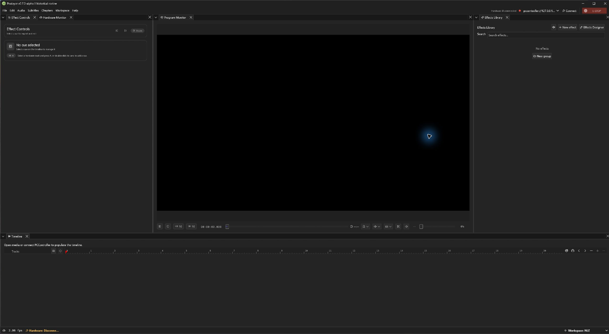

# Pealayer v0.7.0-alpha.1 — RF learning, PWM controls and Wayland recovery

RF learning/assignment and MOSFET controls become more usable and truthful; hardware-free development improves and Wayland focus/occlusion stops blocking the application.

> **[Historical alpha]** Backfilled on 10 November 2026 from the original source checkpoint. This is a retrospective development prerelease, with the exact package/CI limits below; it is not a newly certified stable build.

**Source checkpoint:** 2026-10-15 (Asia/Tehran) · [`81ec22e`](https://github.com/ToghrolTP/pealayer/commit/81ec22eacdccdc018889a8e2a6a71581c1e008fd) · [Full source changes](https://github.com/ToghrolTP/pealayer/compare/00687b16a70217963794bc2d867160f3fbcd5e65...81ec22eacdccdc018889a8e2a6a71581c1e008fd)

## Added and implemented

- **[Added]** RF reception indicators and modal-opening counters for complete waveform identities, including unassigned/unlearned observations; shared timed/continuous learning preferences ([#194](https://github.com/ToghrolTP/pealayer/pull/194), [#200](https://github.com/ToghrolTP/pealayer/pull/200)).
- **[Added]** MOSFET minus/plus controls, configurable indicator actions, channel-based RF assignment and shared Full/Restore On brightness policy ([#188](https://github.com/ToghrolTP/pealayer/pull/188), [#190](https://github.com/ToghrolTP/pealayer/pull/190), [#191](https://github.com/ToghrolTP/pealayer/pull/191), [#197](https://github.com/ToghrolTP/pealayer/pull/197)).
- **[Added]** Windows drives/server file locations, headless shared-firmware authoring support and real VirtualBoard integration ([#174](https://github.com/ToghrolTP/pealayer/pull/174), [#175](https://github.com/ToghrolTP/pealayer/pull/175)).
- **[Added]** Controller host/board update progress and a fresh process-local clean/dirty/busy/unknown authoring API for safe runtime replacement ([#196](https://github.com/ToghrolTP/pealayer/pull/196), [#201](https://github.com/ToghrolTP/pealayer/pull/201)).

## Fixes and improvements

- **[Fixed]** Restore short controller deadlines after preparation failures, retain authoritative live values and avoid redundant paused-video work ([#176](https://github.com/ToghrolTP/pealayer/pull/176), [#178](https://github.com/ToghrolTP/pealayer/pull/178), [#180](https://github.com/ToghrolTP/pealayer/pull/180)).
- **[Fixed]** Only operator PWM edits send commands; isolate per-channel drafts, keep context-menu clicks from changing output and derive power indicators from confirmed state ([#186](https://github.com/ToghrolTP/pealayer/pull/186), [#189](https://github.com/ToghrolTP/pealayer/pull/189), [#192](https://github.com/ToghrolTP/pealayer/pull/192), [#195](https://github.com/ToghrolTP/pealayer/pull/195)).
- **[Fixed]** Expose concise typed RF/connection errors without losing original details; separate assignment actions and keep the connection chevron clear of Disconnect ([#182](https://github.com/ToghrolTP/pealayer/pull/182), [#193](https://github.com/ToghrolTP/pealayer/pull/193), [#199](https://github.com/ToghrolTP/pealayer/pull/199), [#200](https://github.com/ToghrolTP/pealayer/pull/200)).
- **[Fixed]** Prevent Wayland EGL swap deadlock/compositor ANR on focus or workspace switches; retain bounded playback repaint pacing ([#206](https://github.com/ToghrolTP/pealayer/pull/206), issue [#205](https://github.com/ToghrolTP/pealayer/issues/205), 81ec22e).

## Experimental features and later follow-ups

- **[Experimental]** Hardware-free authoring is now testable against the shared native firmware; the selectable supervised Virtual Board Demo comes in v0.8.0-alpha.1 ([#207](https://github.com/ToghrolTP/pealayer/pull/207)).
- **[Experimental]** RF observation and opening a manager do not learn or assign a code. Guided pattern workflows and some assignment actions remain unfinished ([#181](https://github.com/ToghrolTP/pealayer/issues/181), [#187](https://github.com/ToghrolTP/pealayer/issues/187)).
- **[Experimental]** The process authoring API covers local UI state; remote browser drafts, pending recordings and hardware writes retain their separate ownership/acceptance limits ([#201](https://github.com/ToghrolTP/pealayer/pull/201)).
- **[Experimental]** The next recorded major integration follows a ten-day gap, on October 25. No intermediate releases are inferred from that gap.

## Bugs and problems in this build

- **[Known issue]** Hardware timing, sustained rapid-motion/idle CPU, real RF/strip behavior and full native/Web parity still require acceptance ([#61](https://github.com/ToghrolTP/pealayer/issues/61), [#62](https://github.com/ToghrolTP/pealayer/issues/62), [#63](https://github.com/ToghrolTP/pealayer/issues/63), [#80](https://github.com/ToghrolTP/pealayer/issues/80)).
- **[Known issue]** The shared recording repeat-mode contract remains incomplete ([#114](https://github.com/ToghrolTP/pealayer/issues/114), [#141](https://github.com/ToghrolTP/pealayer/issues/141)).
- **[Known issue]** Later playback-clock anchoring and admission/zero-seek bugs are fixed in v0.9.0-alpha.1 ([#217](https://github.com/ToghrolTP/pealayer/pull/217)); a successful platform matrix here does not include those later repairs.

## Packages and verification

Recovered exact-source CI artifacts; original file bytes retained inside renamed containers. No new build or artifact attestation is claimed. Exact-source aggregate passed.

| Platform | Download | Recorded verification |
| --- | --- | --- |
| Linux x86-64 | [Download](https://github.com/ToghrolTP/pealayer/releases/download/v0.7.0-alpha.1/Pealayer-linux-x86_64-v0.7.0-alpha.1-81ec22e.tar.gz) | [successful platform job](https://github.com/ToghrolTP/pealayer/actions/runs/38754011357); SHA-256 in manifest |
| Windows x86-64 | [Download](https://github.com/ToghrolTP/pealayer/releases/download/v0.7.0-alpha.1/Pealayer-windows-x86_64-v0.7.0-alpha.1-81ec22e.zip) | [successful platform job](https://github.com/ToghrolTP/pealayer/actions/runs/38754011357); SHA-256 in manifest |
| macOS Apple silicon | [Download](https://github.com/ToghrolTP/pealayer/releases/download/v0.7.0-alpha.1/Pealayer-macos-aarch64-v0.7.0-alpha.1-81ec22e.zip) | [successful platform job](https://github.com/ToghrolTP/pealayer/actions/runs/38754011357); SHA-256 in manifest |
| macOS Intel | [Download](https://github.com/ToghrolTP/pealayer/releases/download/v0.7.0-alpha.1/Pealayer-macos-x86_64-v0.7.0-alpha.1-81ec22e.zip) | [successful platform job](https://github.com/ToghrolTP/pealayer/actions/runs/38754011357); SHA-256 in manifest |

- [Workflow 38754011357](https://github.com/ToghrolTP/pealayer/actions/runs/38754011357): **success**. All executed jobs succeeded.

Download `SHA256SUMS.txt` and verify the attached files with `sha256sum --check SHA256SUMS.txt`. The attached `release-manifest.json` records the source, original artifact IDs/digests, packaging and platform results. Archive directory names and executable permission bits are normalized; executable bytes and embedded Cargo versions are unchanged. These source-milestone versions do not rewrite the older binaries’ embedded `0.2.0` package version.

**[Acceptance]** Build/test/package success is separate from installed-device, human, audio, physical timing, GPU and soak acceptance. See [the current acceptance index](https://github.com/ToghrolTP/pealayer/blob/main/docs/verification/CURRENT-ACCEPTANCE.md).

## Screenshots

Actual archived or newly captured historical builds only. Captions identify the capture source; an earlier feature capture is not presented as the final tagged executable. No later UI is attributed to this version.

Actual native workspace in the exact recovered CI package, captured during this backfill with an isolated disconnected profile. No media/telemetry is fabricated. [Capture provenance](https://github.com/ToghrolTP/pealayer/blob/1e171e8bbd66348d00f9742704c5b78b006f6faf/docs/screenshots/releases/v0.7.0-alpha.1/manifest.json) · source [`81ec22e`](https://github.com/ToghrolTP/pealayer/commit/81ec22eacdccdc018889a8e2a6a71581c1e008fd).

The `screenshots.zip` attachment preserves the inspected image bytes and `screenshot-provenance.json` lists their hashes and source references.

## Pull requests and issues

All merged PRs first included in this milestone

- [#174](https://github.com/ToghrolTP/pealayer/pull/174) — Make headless native firmware ready for hardware-free authoring
- [#175](https://github.com/ToghrolTP/pealayer/pull/175) — Expose Windows drives and server folder locations in Web browsing
- [#176](https://github.com/ToghrolTP/pealayer/pull/176) — Restore short controller deadlines after preparation failures
- [#177](https://github.com/ToghrolTP/pealayer/pull/177) — Reconcile issue80 acceptance with fresh runtime and CPU evidence
- [#178](https://github.com/ToghrolTP/pealayer/pull/178) — Keep controller live values authoritative in hardware views
- [#179](https://github.com/ToghrolTP/pealayer/pull/179) — Preserve relay clicks and refine hardware/status controls
- [#180](https://github.com/ToghrolTP/pealayer/pull/180) — Avoid redundant paused-video work during live hardware updates
- [#182](https://github.com/ToghrolTP/pealayer/pull/182) — RF controls: show assigned actions, last seen and execution location
- [#186](https://github.com/ToghrolTP/pealayer/pull/186) — Send native PWM only from operator edits, not telemetry feedback
- [#188](https://github.com/ToghrolTP/pealayer/pull/188) — 🎛️ MOSFET cards: inline steps, configurable actions and RF assignment
- [#189](https://github.com/ToghrolTP/pealayer/pull/189) — Isolate native PWM editor drafts between channels
- [#190](https://github.com/ToghrolTP/pealayer/pull/190) — 🎚️ Shared MOSFET On policy and confirmed brightness recall
- [#191](https://github.com/ToghrolTP/pealayer/pull/191) — 📡 RF editor first · grouped channel buttons and confirmed recall
- [#192](https://github.com/ToghrolTP/pealayer/pull/192) — 🛡️ Prevent context-menu clicks from changing MOSFET output
- [#193](https://github.com/ToghrolTP/pealayer/pull/193) — 🧭 Typed controller timeouts · concise RF and connection notices
- [#194](https://github.com/ToghrolTP/pealayer/pull/194) — feat: live RF code indicators, counters and shared settings
- [#195](https://github.com/ToghrolTP/pealayer/pull/195) — 💡 Coherent PWM indicators · confirmed On/Off and honest unknown state
- [#196](https://github.com/ToghrolTP/pealayer/pull/196) — Show PCController host and board updates in the status bar
- [#197](https://github.com/ToghrolTP/pealayer/pull/197) — Fix compact RF saved-rule layout with shared guarded callbacks
- [#198](https://github.com/ToghrolTP/pealayer/pull/198) — docs: record live compact RF assignment verification
- [#199](https://github.com/ToghrolTP/pealayer/pull/199) — Keep the header controller chevron clear of Disconnect
- [#200](https://github.com/ToghrolTP/pealayer/pull/200) — Align native RF dialogs with shared learning and assignment behavior
- [#201](https://github.com/ToghrolTP/pealayer/pull/201) — Inspect native authoring drafts before runtime replacement
- [#202](https://github.com/ToghrolTP/pealayer/pull/202) — build(deps-dev): bump the npm-dependencies group in /web_ui with 2 updates
- [#203](https://github.com/ToghrolTP/pealayer/pull/203) — build(deps): bump the cargo-dependencies group with 6 updates
- [#204](https://github.com/ToghrolTP/pealayer/pull/204) — build(deps): bump the actions group with 5 updates
- [#206](https://github.com/ToghrolTP/pealayer/pull/206) — fix(wayland): prevent EGL swap deadlock and compositor ANR on focus switch

Related issues (references do not imply closure): [#61](https://github.com/ToghrolTP/pealayer/issues/61), [#62](https://github.com/ToghrolTP/pealayer/issues/62), [#63](https://github.com/ToghrolTP/pealayer/issues/63), [#80](https://github.com/ToghrolTP/pealayer/issues/80), [#114](https://github.com/ToghrolTP/pealayer/issues/114), [#141](https://github.com/ToghrolTP/pealayer/issues/141), [#181](https://github.com/ToghrolTP/pealayer/issues/181), [#185](https://github.com/ToghrolTP/pealayer/issues/185), [#187](https://github.com/ToghrolTP/pealayer/issues/187), [#205](https://github.com/ToghrolTP/pealayer/issues/205).

[Version index](https://github.com/ToghrolTP/pealayer/blob/main/docs/releases/README.md) · [Changelog](https://github.com/ToghrolTP/pealayer/blob/main/CHANGELOG.md) · [Previous: v0.6.0-alpha.1](https://github.com/ToghrolTP/pealayer/releases/tag/v0.6.0-alpha.1) · [Next: v0.8.0-alpha.1](https://github.com/ToghrolTP/pealayer/releases/tag/v0.8.0-alpha.1)

<!-- pealayer-release-backfill:v0.7.0-alpha.1 -->
