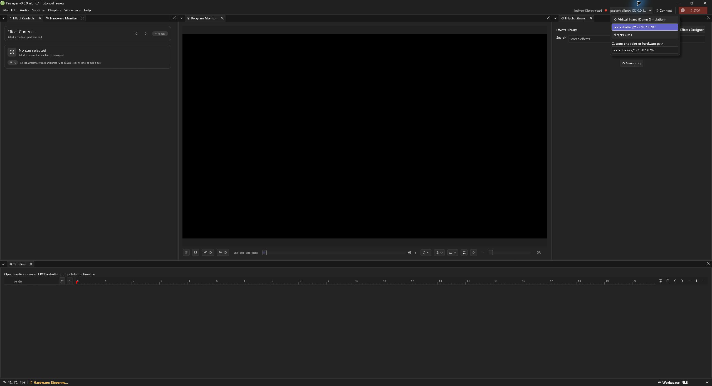
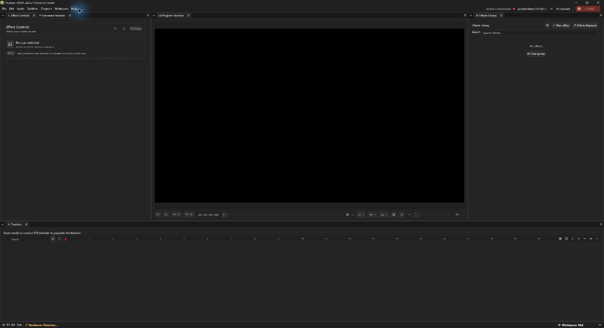

# 🧪 Pealayer v0.8.0-alpha.1 — Virtual Board Demo and canonical opcodes

A selectable Virtual Board Demo makes the 4D workflow explorable without physical hardware, alongside actionable errors and canonical controller opcode admission.

> [!NOTE]
> **[Historical alpha]** Backfilled on 10 November 2026 from the original source checkpoint. This is a retrospective development prerelease, with the exact package/CI limits below; it is not a newly certified stable build.

📦 [Downloads](https://github.com/ToghrolTP/pealayer/releases/tag/v0.8.0-alpha.1#assets) · 📚 [Version history](https://github.com/ToghrolTP/pealayer/blob/main/docs/releases/README.md) · 📝 [Changelog](https://github.com/ToghrolTP/pealayer/blob/main/CHANGELOG.md)

**🗓️ Source checkpoint:** 2026-10-30 (Asia/Tehran) · [`08626cf`](https://github.com/ToghrolTP/pealayer/commit/08626cf9dcee83dca110ba53075da0eb5e8dbf50) · [Full source changes](https://github.com/ToghrolTP/pealayer/compare/81ec22eacdccdc018889a8e2a6a71581c1e008fd...08626cf9dcee83dca110ba53075da0eb5e8dbf50)

## ✨ Added and implemented

- **[Added]** Explicit Virtual Board Demo with supervised virtual-board/coordinator processes, temporary isolated settings, a showcase timeline and lifecycle cleanup ([#207](https://github.com/ToghrolTP/pealayer/pull/207)).
- **[Added]** Demo endpoint selection stays separate from physical hardware discovery/autoconnect and does not replace a live selected peer ([#207](https://github.com/ToghrolTP/pealayer/pull/207)).
- **[Added]** Actionable toasts with inspectable original diagnostics ([#208](https://github.com/ToghrolTP/pealayer/pull/208)); grouped Rust/Web/Actions maintenance ([#209](https://github.com/ToghrolTP/pealayer/pull/209), [#211](https://github.com/ToghrolTP/pealayer/pull/211), [#213](https://github.com/ToghrolTP/pealayer/pull/213), [#214](https://github.com/ToghrolTP/pealayer/pull/214), [#215](https://github.com/ToghrolTP/pealayer/pull/215), [#221](https://github.com/ToghrolTP/pealayer/pull/221), [#222](https://github.com/ToghrolTP/pealayer/pull/222)).

## 🛠️ Fixes and improvements

- **[Fixed]** Use the pinned PCController-owned opcode registry and reject foreign namespaces instead of guessing numeric commands ([#223](https://github.com/ToghrolTP/pealayer/pull/223)).
- **[Fixed]** Double-clicking an Effects Library card opens Manage consistently ([#220](https://github.com/ToghrolTP/pealayer/pull/220)).
- **[Fixed]** Keep demo/direct endpoints out of coordinator-only preparation UI so the demo does not remain falsely stuck at Preparing hardware ([#207](https://github.com/ToghrolTP/pealayer/pull/207)).

## 🧪 Experimental features and later follow-ups

- **[Experimental]** The demo executes a simulation and depends on the companion PCController/virtual-board tools. It does not prove physical relay, motor, RF, sensor or edge timing acceptance ([#207](https://github.com/ToghrolTP/pealayer/pull/207), [#80](https://github.com/ToghrolTP/pealayer/issues/80)).
- **[Experimental]** Strip-preview dispatch was still being reconciled in [#212](https://github.com/ToghrolTP/pealayer/pull/212)/#218; the unified effect-play path is integrated with [#217](https://github.com/ToghrolTP/pealayer/pull/217) in v0.9.0-alpha.1. The closed duplicate [#212](https://github.com/ToghrolTP/pealayer/pull/212) is not counted as a merged release PR.
- **[Experimental]** Authored cue/track persistence is added after this tag on November 2 ([#224](https://github.com/ToghrolTP/pealayer/pull/224)), then included in v0.9.0-alpha.1. Full projects/scenes remain a separate draft ([#226](https://github.com/ToghrolTP/pealayer/issues/226), [#227](https://github.com/ToghrolTP/pealayer/pull/227)).

## 🐞 Bugs and problems in this build

- **[Known issue]** This build predates cue/template/track-state dirty tracking and unsaved-change protection from [#224](https://github.com/ToghrolTP/pealayer/pull/224); do not treat its earlier sidecar support as complete project persistence.
- **[Known issue]** Playback-clock admission, stale observations and exact-zero seek completion still require [#217](https://github.com/ToghrolTP/pealayer/pull/217) in v0.9.0-alpha.1.
- **[Known issue]** GPU/native video-surface work, full Web parity and physical/audio/soak acceptance remain in [#64](https://github.com/ToghrolTP/pealayer/issues/64), [#65](https://github.com/ToghrolTP/pealayer/issues/65), [#66](https://github.com/ToghrolTP/pealayer/issues/66), [#63](https://github.com/ToghrolTP/pealayer/issues/63) and [#80](https://github.com/ToghrolTP/pealayer/issues/80).

## 📦 Packages and verification

Recovered exact-source CI artifacts; original file bytes retained inside renamed containers. No new build or artifact attestation is claimed. Exact-source aggregate passed.

| Platform | Download | Recorded verification |
| --- | --- | --- |
| 🐧 Linux x86-64 | [⬇️ Download](https://github.com/ToghrolTP/pealayer/releases/download/v0.8.0-alpha.1/Pealayer-linux-x86_64-v0.8.0-alpha.1-08626cf.tar.gz) | [successful platform job](https://github.com/ToghrolTP/pealayer/actions/runs/41083888737); SHA-256 in manifest |
| 🪟 Windows x86-64 | [⬇️ Download](https://github.com/ToghrolTP/pealayer/releases/download/v0.8.0-alpha.1/Pealayer-windows-x86_64-v0.8.0-alpha.1-08626cf.zip) | [successful platform job](https://github.com/ToghrolTP/pealayer/actions/runs/41083888737); SHA-256 in manifest |
| 🍎 macOS Apple silicon | [⬇️ Download](https://github.com/ToghrolTP/pealayer/releases/download/v0.8.0-alpha.1/Pealayer-macos-aarch64-v0.8.0-alpha.1-08626cf.zip) | [successful platform job](https://github.com/ToghrolTP/pealayer/actions/runs/41083888737); SHA-256 in manifest |
| 🍎 macOS Intel | [⬇️ Download](https://github.com/ToghrolTP/pealayer/releases/download/v0.8.0-alpha.1/Pealayer-macos-x86_64-v0.8.0-alpha.1-08626cf.zip) | [successful platform job](https://github.com/ToghrolTP/pealayer/actions/runs/41083888737); SHA-256 in manifest |

- [Workflow 41083888737](https://github.com/ToghrolTP/pealayer/actions/runs/41083888737): **success**. All executed jobs succeeded.

Download `SHA256SUMS.txt` and verify the attached files with `sha256sum --check SHA256SUMS.txt`. The attached `release-manifest.json` records the source, original artifact IDs/digests, packaging and platform results. Archive directory names and executable permission bits are normalized; executable bytes and embedded Cargo versions are unchanged. These source-milestone versions do not rewrite the older binaries’ embedded `0.2.0` package version.

**🧭 [Acceptance]** Build/test/package success is separate from installed-device, human, audio, physical timing, GPU and soak acceptance. See [the current acceptance index](https://github.com/ToghrolTP/pealayer/blob/main/docs/verification/CURRENT-ACCEPTANCE.md).

## 📸 Screenshots

Actual archived or newly captured historical builds only. Captions identify the capture source; an earlier feature capture is not presented as the final tagged executable. No later UI is attributed to this version.

Actual native demo selector in the exact recovered package. The menu is open only; no demo or hardware connection was started. [Capture provenance](https://github.com/ToghrolTP/pealayer/blob/1e171e8bbd66348d00f9742704c5b78b006f6faf/docs/screenshots/releases/v0.8.0-alpha.1/manifest.json) · source [`08626cf`](https://github.com/ToghrolTP/pealayer/commit/08626cf9dcee83dca110ba53075da0eb5e8dbf50).

Actual native workspace in the exact recovered CI package, captured during this backfill with an isolated disconnected profile. No media/telemetry is fabricated. [Capture provenance](https://github.com/ToghrolTP/pealayer/blob/1e171e8bbd66348d00f9742704c5b78b006f6faf/docs/screenshots/releases/v0.8.0-alpha.1/manifest.json) · source [`08626cf`](https://github.com/ToghrolTP/pealayer/commit/08626cf9dcee83dca110ba53075da0eb5e8dbf50).

The `screenshots.zip` attachment preserves the inspected image bytes and `screenshot-provenance.json` lists their hashes and source references.

## 🔗 Pull requests and issues

🔀 All merged PRs first included in this milestone

- [#207](https://github.com/ToghrolTP/pealayer/pull/207) — feat(demo): add Virtual Board Demo mode for hardware-free simulation
- [#208](https://github.com/ToghrolTP/pealayer/pull/208) — feat: actionable toasts and inspectable error details
- [#209](https://github.com/ToghrolTP/pealayer/pull/209) — build(deps): bump the npm-dependencies group in /web_ui with 3 updates
- [#211](https://github.com/ToghrolTP/pealayer/pull/211) — build(deps): bump the actions group with 2 updates
- [#213](https://github.com/ToghrolTP/pealayer/pull/213) — build(deps): bump the cargo-dependencies group across 1 directory with 12 updates
- [#214](https://github.com/ToghrolTP/pealayer/pull/214) — build(deps): bump the npm-dependencies group in /web_ui with 2 updates
- [#215](https://github.com/ToghrolTP/pealayer/pull/215) — build(deps): bump the actions group with 3 updates
- [#220](https://github.com/ToghrolTP/pealayer/pull/220) — fix(effects): open Manage on library card double-click
- [#221](https://github.com/ToghrolTP/pealayer/pull/221) — build(deps): bump antd from 6.6.7 to 6.6.8 in /web_ui in the npm-dependencies group
- [#222](https://github.com/ToghrolTP/pealayer/pull/222) — build(deps): bump the cargo-dependencies group with 3 updates
- [#223](https://github.com/ToghrolTP/pealayer/pull/223) — fix: use canonical opcodes and reject foreign controller frames

**🔎 Related issues** (references do not imply closure): [#40](https://github.com/ToghrolTP/pealayer/issues/40), [#44](https://github.com/ToghrolTP/pealayer/issues/44), [#63](https://github.com/ToghrolTP/pealayer/issues/63), [#64](https://github.com/ToghrolTP/pealayer/issues/64), [#65](https://github.com/ToghrolTP/pealayer/issues/65), [#66](https://github.com/ToghrolTP/pealayer/issues/66), [#80](https://github.com/ToghrolTP/pealayer/issues/80), [#219](https://github.com/ToghrolTP/pealayer/issues/219), [#226](https://github.com/ToghrolTP/pealayer/issues/226).

[📚 Version index](https://github.com/ToghrolTP/pealayer/blob/main/docs/releases/README.md) · [📝 Changelog](https://github.com/ToghrolTP/pealayer/blob/main/CHANGELOG.md) · [← Previous: v0.7.0-alpha.1](https://github.com/ToghrolTP/pealayer/releases/tag/v0.7.0-alpha.1) · [Next →: v0.9.0-alpha.1](https://github.com/ToghrolTP/pealayer/releases/tag/v0.9.0-alpha.1)

<!-- pealayer-release-backfill:v0.8.0-alpha.1 -->
