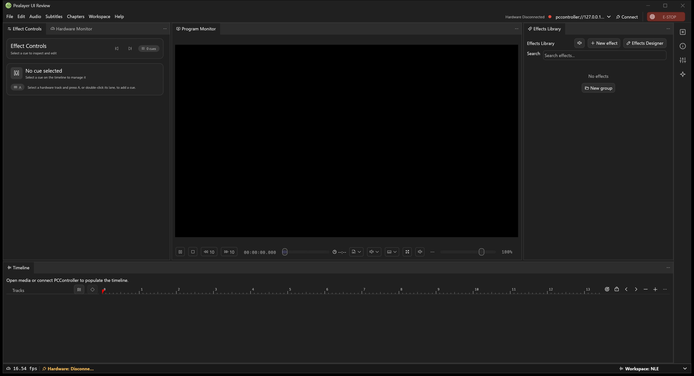
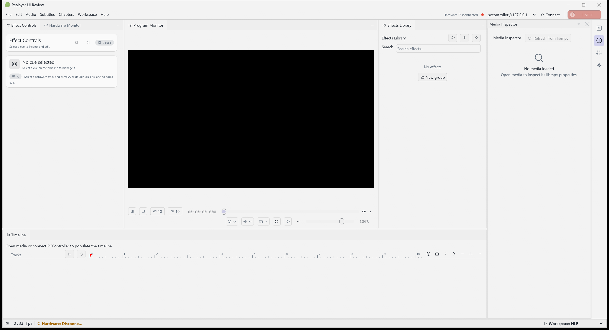
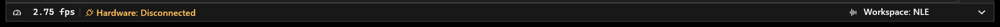

# 🗂️ Pealayer v0.9.0-alpha.1 — Persistent cues and CraftUI workspaces

Persistent authored cues and guarded playback clocks meet palette-aware CraftUI docking, property rails, native typography and a restored egui Dock alternative.

> [!NOTE]
> **[Historical alpha]** Backfilled on 10 November 2026 from the original source checkpoint. This is a retrospective development prerelease, with the exact package/CI limits below; it is not a newly certified stable build.

📦 [Downloads](https://github.com/ToghrolTP/pealayer/releases/tag/v0.9.0-alpha.1#assets) · 📚 [Version history](https://github.com/ToghrolTP/pealayer/blob/main/docs/releases/README.md) · 📝 [Changelog](https://github.com/ToghrolTP/pealayer/blob/main/CHANGELOG.md)

**🗓️ Source checkpoint:** 2026-11-05 (Asia/Tehran) · [`0ae407f`](https://github.com/ToghrolTP/pealayer/commit/0ae407f3c4576798cf408e6851d69116100b4391) · [Full source changes](https://github.com/ToghrolTP/pealayer/compare/08626cf9dcee83dca110ba53075da0eb5e8dbf50...0ae407f3c4576798cf408e6851d69116100b4391)

## ✨ Added and implemented

- **[Added]** Persist authored cues, templates, analog/keyframe tracks and mute/solo/lock state; Save shortcuts/menu, dirty baselines and non-destructive unsaved-change prompts ([#224](https://github.com/ToghrolTP/pealayer/pull/224)).
- **[Added]** CraftUI dock/floating/property-rail workspace with palette/density ownership, modal shielding and saved workspace round-trips ([#216](https://github.com/ToghrolTP/pealayer/pull/216)).
- **[Added]** Selectable workspace modes, grouped hardware authoring/preferences, native UI typography and a separate local Preferences host with owner live preview ([#225](https://github.com/ToghrolTP/pealayer/pull/225)).
- **[Added]** Host-owned segmented strip programs/designer and coordinated preview dispatch are integrated through [#218](https://github.com/ToghrolTP/pealayer/pull/218)/#217 and [#225](https://github.com/ToghrolTP/pealayer/pull/225).

## 🛠️ Fixes and improvements

- **[Fixed]** Keep a fresh monotonic decoder-clock anchor; bind hardware admission to actual paused/fresh state and current Play/cancel intent, retaining the 50 ms / 250 ms limits ([#217](https://github.com/ToghrolTP/pealayer/pull/217)).
- **[Fixed]** Exact-zero seeks complete from tagged native command/seek/restart events and publish the first displayable PTS; stale epochs, failures and queue loss revoke obsolete completion ([#217](https://github.com/ToghrolTP/pealayer/pull/217), [#219](https://github.com/ToghrolTP/pealayer/issues/219)).
- **[Fixed]** Restore egui Dock disclosure, palette, focus, menu/collapse behavior and floating-layer ownership after the renderer migration ([#231](https://github.com/ToghrolTP/pealayer/pull/231)).
- **[Fixed]** Measure status captions and visible glyphs, preserve variable-font weights and remove duplicate panel separators/layout settling; document genuine status/divider history ([#225](https://github.com/ToghrolTP/pealayer/pull/225), [#228](https://github.com/ToghrolTP/pealayer/issues/228)).
- **[Fixed]** Keep five density levels, precise hardware modifiers/shortcuts and bounded About/Preferences layout; preserve sidebar icon contrast ([#216](https://github.com/ToghrolTP/pealayer/pull/216), [#225](https://github.com/ToghrolTP/pealayer/pull/225)).

## 🧪 Experimental features and later follow-ups

- **[Experimental]** Cue/track persistence is implemented. Full project restore, scene snapshot execution and associated-media lifecycle remain in open draft [#227](https://github.com/ToghrolTP/pealayer/pull/227) / issue [#226](https://github.com/ToghrolTP/pealayer/issues/226); they are not shipped by this tag.
- **[Experimental]** Both workspace adapters remain available. Additional Dock seams and independent CraftUI pane controls are refined in v0.10.0-alpha.1 ([#236](https://github.com/ToghrolTP/pealayer/pull/236), [#254](https://github.com/ToghrolTP/pealayer/pull/254), [#261](https://github.com/ToghrolTP/pealayer/pull/261)).
- **[Experimental]** Default/native typography is present, but the FPS-width and digit-center follow-ups arrive later ([#274](https://github.com/ToghrolTP/pealayer/pull/274) in v0.11.0-alpha.1; [#278](https://github.com/ToghrolTP/pealayer/pull/278) remains unmerged at this backfill checkpoint).

## 🐞 Bugs and problems in this build

- **[Known issue]** Native minimized-window placement, Task View/Peek and repeated dynamic taskbar artwork still need the later Windows work ([#239](https://github.com/ToghrolTP/pealayer/pull/239), [#245](https://github.com/ToghrolTP/pealayer/pull/245)).
- **[Known issue]** External mpv pause/quit recovery, last-good-frame publication and remote-parent handling are refined in v0.10.0-alpha.1 ([#247](https://github.com/ToghrolTP/pealayer/pull/247), [#250](https://github.com/ToghrolTP/pealayer/pull/250), [#258](https://github.com/ToghrolTP/pealayer/pull/258), [#260](https://github.com/ToghrolTP/pealayer/pull/260)).
- **[Known issue]** Linux/macOS font visuals, physical timing/strip outputs, human/audio/GPU/soak and full Web parity remain separate gates ([#63](https://github.com/ToghrolTP/pealayer/issues/63), [#64](https://github.com/ToghrolTP/pealayer/issues/64), [#65](https://github.com/ToghrolTP/pealayer/issues/65), [#66](https://github.com/ToghrolTP/pealayer/issues/66), [#80](https://github.com/ToghrolTP/pealayer/issues/80)).
- **[Known issue]** Full-height/larger status dividers are backlog; the compact divider style is retained ([#228](https://github.com/ToghrolTP/pealayer/issues/228)).

## 📦 Packages and verification

Recovered exact-source CI artifacts; original file bytes retained inside renamed containers. No new build or artifact attestation is claimed. Exact-source aggregate passed.

| Platform | Download | Recorded verification |
| --- | --- | --- |
| 🐧 Linux x86-64 | [⬇️ Download](https://github.com/ToghrolTP/pealayer/releases/download/v0.9.0-alpha.1/Pealayer-linux-x86_64-v0.9.0-alpha.1-0ae407f.tar.gz) | [successful platform job](https://github.com/ToghrolTP/pealayer/actions/runs/42047533752); SHA-256 in manifest |
| 🪟 Windows x86-64 | [⬇️ Download](https://github.com/ToghrolTP/pealayer/releases/download/v0.9.0-alpha.1/Pealayer-windows-x86_64-v0.9.0-alpha.1-0ae407f.zip) | [successful platform job](https://github.com/ToghrolTP/pealayer/actions/runs/42047533752); SHA-256 in manifest |
| 🍎 macOS Apple silicon | [⬇️ Download](https://github.com/ToghrolTP/pealayer/releases/download/v0.9.0-alpha.1/Pealayer-macos-aarch64-v0.9.0-alpha.1-0ae407f.zip) | [successful platform job](https://github.com/ToghrolTP/pealayer/actions/runs/42047533752); SHA-256 in manifest |
| 🍎 macOS Intel | [⬇️ Download](https://github.com/ToghrolTP/pealayer/releases/download/v0.9.0-alpha.1/Pealayer-macos-x86_64-v0.9.0-alpha.1-0ae407f.zip) | [successful platform job](https://github.com/ToghrolTP/pealayer/actions/runs/42047533752); SHA-256 in manifest |

- [Workflow 42047533752](https://github.com/ToghrolTP/pealayer/actions/runs/42047533752): **success**. All executed jobs succeeded.

Download `SHA256SUMS.txt` and verify the attached files with `sha256sum --check SHA256SUMS.txt`. The attached `release-manifest.json` records the source, original artifact IDs/digests, packaging and platform results. Archive directory names and executable permission bits are normalized; executable bytes and embedded Cargo versions are unchanged. These source-milestone versions do not rewrite the older binaries’ embedded `0.2.0` package version.

**🧭 [Acceptance]** Build/test/package success is separate from installed-device, human, audio, physical timing, GPU and soak acceptance. See [the current acceptance index](https://github.com/ToghrolTP/pealayer/blob/main/docs/verification/CURRENT-ACCEPTANCE.md).

## 📸 Screenshots

Actual archived or newly captured historical builds only. Captions identify the capture source; an earlier feature capture is not presented as the final tagged executable. No later UI is attributed to this version.

Actual native dark CraftUI workspace from the #216 integration, without private media or board data; an ancestor capture, not an exact final-tag executable. [Capture provenance](https://github.com/ToghrolTP/pealayer/blob/1e171e8bbd66348d00f9742704c5b78b006f6faf/docs/verification/pr-reconciliation.md) · source [`b4cafb7`](https://github.com/ToghrolTP/pealayer/commit/b4cafb73709ec2b4ebeef4a52bc63ba67c67327d).

Actual native light workspace with Media Inspector rail from the same source. [Capture provenance](https://github.com/ToghrolTP/pealayer/blob/1e171e8bbd66348d00f9742704c5b78b006f6faf/docs/verification/pr-reconciliation.md) · source [`b4cafb7`](https://github.com/ToghrolTP/pealayer/commit/b4cafb73709ec2b4ebeef4a52bc63ba67c67327d).

Actual native status/divider repair included in this milestone; full source and executable provenance is linked. [Capture provenance](https://github.com/ToghrolTP/pealayer/blob/1e171e8bbd66348d00f9742704c5b78b006f6faf/docs/verification/status-bar-evolution.md) · source [`60389d3`](https://github.com/ToghrolTP/pealayer/commit/60389d3fbd3e10162492459bb7501fcf1b7e3922).

The `screenshots.zip` attachment preserves the inspected image bytes and `screenshot-provenance.json` lists their hashes and source references.

## 🔗 Pull requests and issues

🔀 All merged PRs first included in this milestone

- [#216](https://github.com/ToghrolTP/pealayer/pull/216) — Complete palette-aware docking and property rails
- [#217](https://github.com/ToghrolTP/pealayer/pull/217) — fix: retain fresh film clock timing for synchronized effects
- [#218](https://github.com/ToghrolTP/pealayer/pull/218) — feat: design and preview strip effects in the hardware workspace
- [#224](https://github.com/ToghrolTP/pealayer/pull/224) — feat(timeline): persist authored cues, templates, and track states
- [#225](https://github.com/ToghrolTP/pealayer/pull/225) — Unify workspace settings, hardware authoring and native UI presentation
- [#230](https://github.com/ToghrolTP/pealayer/pull/230) — build(deps): bump the cargo-dependencies group across 1 directory with 7 updates
- [#231](https://github.com/ToghrolTP/pealayer/pull/231) — Restore egui Dock chevrons, palette and header menus

**🔎 Related issues** (references do not imply closure): [#34](https://github.com/ToghrolTP/pealayer/issues/34), [#40](https://github.com/ToghrolTP/pealayer/issues/40), [#63](https://github.com/ToghrolTP/pealayer/issues/63), [#64](https://github.com/ToghrolTP/pealayer/issues/64), [#65](https://github.com/ToghrolTP/pealayer/issues/65), [#66](https://github.com/ToghrolTP/pealayer/issues/66), [#80](https://github.com/ToghrolTP/pealayer/issues/80), [#219](https://github.com/ToghrolTP/pealayer/issues/219), [#226](https://github.com/ToghrolTP/pealayer/issues/226), [#228](https://github.com/ToghrolTP/pealayer/issues/228), [#243](https://github.com/ToghrolTP/pealayer/issues/243).

[📚 Version index](https://github.com/ToghrolTP/pealayer/blob/main/docs/releases/README.md) · [📝 Changelog](https://github.com/ToghrolTP/pealayer/blob/main/CHANGELOG.md) · [← Previous: v0.8.0-alpha.1](https://github.com/ToghrolTP/pealayer/releases/tag/v0.8.0-alpha.1) · [Next →: v0.10.0-alpha.1](https://github.com/ToghrolTP/pealayer/releases/tag/v0.10.0-alpha.1)

<!-- pealayer-release-backfill:v0.9.0-alpha.1 -->
