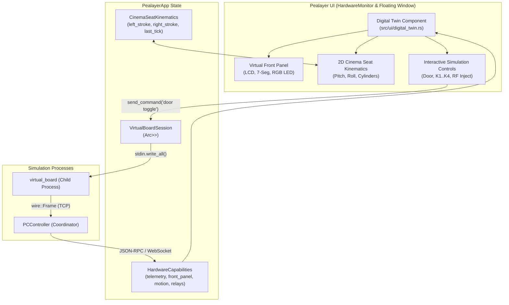

# Virtual Board Digital Twin & In-App Observability (Option B) Design Specification

**Status:** Approved  
**Author:** Antigravity Engineering & David  
**Target:** Pealayer 4D Cinema Engine & PCController Ecosystem  
**Date:** 2026-10-18  

---

## 1. Overview & Objectives

In Pealayer's Virtual Board Demo mode, authors can play back 4D cinema timelines with dual-axis seat motion, relay actuators, and PWM curves without physical hardware. However, without active in-app observability, the simulation state remains invisible in the background.

This specification defines **Option B (Digital Twin UI & Observability)**, providing an interactive, real-time simulation surface directly inside Pealayer:

1. **Virtual Front-Panel Cluster**:
   - 16x2 alphanumeric LCD matrix display simulating hardware firmware output.
   - 4-digit 7-segment LED display simulating TM1637 firmware messages (`BOOT`, `4D-1`, `PLAY`, `ERR`).
   - Tri-color Enclosure Status LED glow indicator.
2. **2D Cinema Seat Attitude & Actuator Gauge**:
   - Continuous numerical integrator tracking linear actuator stroke displacement ($L_t$ and $R_t \in [0.0, 1.0]$) at a physical slew rate ($0.40 \text{ / sec}$).
   - Dynamic real-time calculation and visual display of Pitch ($\theta \in [-15^\circ, +15^\circ]$) and Roll ($\phi \in [-10^\circ, +10^\circ]$) angles.
   - Vector wireframe seat profile that tilts smoothly with live extension shafts.
3. **Interactive Simulation Controls & Piped IPC**:
   - Non-blocking stdin console pipe on `VirtualBoardSession` supporting `send_command(&str)`.
   - UI safety interlock toggle: **Door Switch** (`CLOSED` / `OPEN`), which triggers hardware safety cutoffs and de-energizes motion relays.
   - Front panel pushbuttons: **Keys 1..4** (Click / Hold) for menu navigation.
   - Wireless simulation: **Inject RF Remote Cue** simulating handheld remote packets.
4. **Dockable Showcase Card & Floating Window**:
   - Prominently featured at the top of the `Hardware Monitor` tab when connected to `demo://virtual-board`.
   - Pop-out button allowing authors to detach the Digital Twin into an independent floating window while working in `Timeline` or `Program Monitor`.

---

## 2. Architecture & Component Decomposition



---

## 3. Data Structures & Interfaces

### 3.1 Kinematic Integrator (`src/four_d/seat_kinematics.rs`)

```rust
#[derive(Debug, Clone, Copy, PartialEq)]
pub struct CinemaSeatKinematics {
    pub left_stroke: f32,   // Range: 0.0 .. 1.0 (0.5 = neutral level)
    pub right_stroke: f32,  // Range: 0.0 .. 1.0 (0.5 = neutral level)
    pub last_tick_ms: u64,
}

impl Default for CinemaSeatKinematics {
    fn default() -> Self {
        Self {
            left_stroke: 0.5,
            right_stroke: 0.5,
            last_tick_ms: 0,
        }
    }
}

impl CinemaSeatKinematics {
    pub const SLEW_RATE_PER_SEC: f32 = 0.40; // 2.5 seconds full stroke

    /// Updates cylinder strokes based on active directions and elapsed time delta.
    pub fn update(&mut self, dt_seconds: f32, left_dir: f32, right_dir: f32, interlock_tripped: bool) {
        if interlock_tripped {
            return;
        }
        let dt = dt_seconds.clamp(0.0, 0.050);
        self.left_stroke = (self.left_stroke + left_dir * Self::SLEW_RATE_PER_SEC * dt).clamp(0.0, 1.0);
        self.right_stroke = (self.right_stroke + right_dir * Self::SLEW_RATE_PER_SEC * dt).clamp(0.0, 1.0);
    }

    /// Pitch angle in degrees: positive = tilt back, negative = tilt forward.
    pub fn pitch_degrees(&self) -> f32 {
        ((self.left_stroke + self.right_stroke) * 0.5 - 0.5) * 30.0
    }

    /// Roll angle in degrees: positive = roll right, negative = roll left.
    pub fn roll_degrees(&self) -> f32 {
        (self.right_stroke - self.left_stroke) * 20.0
    }
}
```

### 3.2 Piped Simulation Console (`src/four_d/virtual_board.rs`)

```rust
pub struct VirtualBoardSession {
    child: ManagedChild,
    port: u16,
    eeprom_path: PathBuf,
    stdin: Arc<Mutex<Option<ChildStdin>>>,
}

impl VirtualBoardSession {
    pub fn send_command(&self, command: &str) -> Result<(), String> {
        let mut guard = self.stdin.lock().map_err(|e| e.to_string())?;
        if let Some(stdin) = guard.as_mut() {
            use std::io::Write;
            writeln!(stdin, "{}", command).map_err(|e| e.to_string())?;
            stdin.flush().map_err(|e| e.to_string())?;
            Ok(())
        } else {
            Err("virtual board stdin unavailable".to_string())
        }
    }
}
```

### 3.3 Digital Twin UI Drawing Module (`src/ui/digital_twin.rs`)

```rust
pub fn draw_digital_twin_card(app: &mut PealayerApp, ui: &mut egui::Ui);
pub fn draw_digital_twin_window(app: &mut PealayerApp, ctx: &egui::Context);
```

---

## 4. UI/UX Specifications (`ui-ux-pro-max`)

- **Palette Alignment**:
  - Front-panel LCD background: Dark forest green `#0a1c0d` or dark amber `#1c1205` depending on active theme.
  - LCD Pixels: Matrix phosphor green `#22c55e` or amber `#f59e0b`.
  - 7-Segment Glyphs: Glowing segmented vector strokes or high-contrast tabular font.
  - Seat Wireframe: Slate stroke `#94a3b8` with subtle drop shadow; active cylinder pistons rendered in accent blue `#38bdf8` and emerald `#10b981`.
- **Interlock Feedback**:
  - Closed Door: Calm semantic emerald pill (`[ 🚪 Door: CLOSED ]`).
  - Open Door: Flashing amber/red hazard banner (`[ ⚠️ Door: OPEN - MOTION INHIBITED ]`).
- **Interaction Constraints**:
  - Respects non-reentrant egui context lock rules: snapshots inputs first, then performs IPC command dispatches.
  - Preserves standard density scaling (`Compact 24`, `Regular 28`, `Comfortable 32`, `Spacious 36`).
  - Pop-out floating window uses `ui::dialog::close_button` and standard bounded geometry.

---

## 5. Verification Strategy & Acceptance Criteria

1. **Unit Tests**:
   - `CinemaSeatKinematics` integration test: verifies slew limits, direction clamping, pitch/roll geometry, and door interlock freeze.
   - `VirtualBoardSession` piped console test: verifies sending console commands (`door toggle`, `status`) writes cleanly without hanging.
2. **Integration Tests**:
   - `tests/digital_twin_integration_test.rs`: Boots demo session, toggles door switch via stdin, verifies telemetry reflects `door_open: true` and relays de-energize.
3. **UI Geometry & Regression Tests**:
   - Verifies the Digital Twin card renders in `HardwareMonitor` when demo endpoint is selected, and disappears cleanly on physical serial endpoints.
   - Verifies floating window toggle, geometry bounds, and keyboard shortcuts.
4. **CI/CD Quality Gates**:
   - 0 whitespace errors (`git diff --check`).
   - Cross-platform check (`x86_64-pc-windows-gnu` and Linux).
   - 100% green CI matrix.
