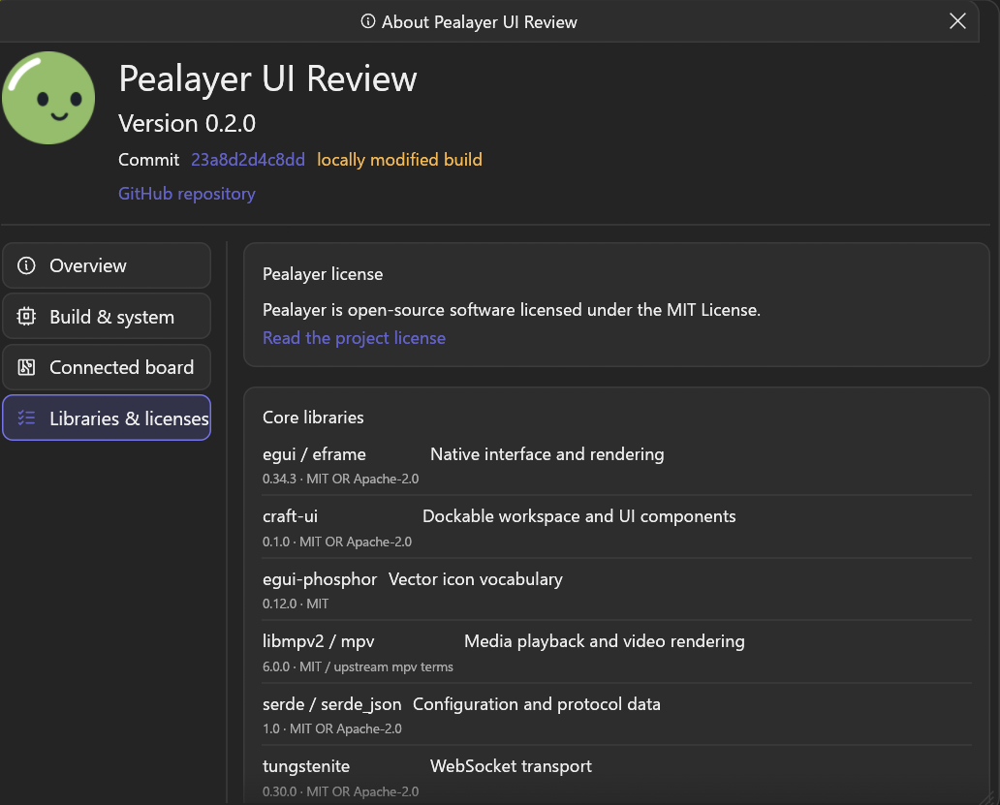
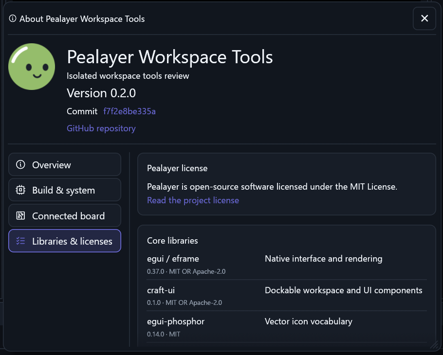

# About dialog layout

## Corrected geometry

- The body previously set its maximum width to the **outer** window width.
  Content could grow beyond the already allocated title bar. The dialog now
  respects the available inner width and uses the shared square Close control,
  with the title constrained to the space remaining beside it.
- The navigation previously reserved a fixed 144-point button width. The rail
  now measures the translated captions and includes both icon and trailing
  padding. Narrow windows use equal-width navigation cells; labels that genuinely
  cannot fit are ellipsized with a full tooltip, never clipped at the border.
- The library identity column previously used an allocation hint, not a reserved
  width. Short names reclaimed that space, moving each description to a different
  position. Every row now reserves the same column width and aligns at the top.
  Narrow content stacks identity, license and purpose rather than overflowing.
- Each About tab has independent scroll memory. Branding, resize/move behavior,
  links, board identity data and Escape-to-close are preserved.
- Library versions come from the package's Cargo.lock during the build. The
  libmpv2 version is explicitly identified as the Rust binding, not the runtime
  DLL version. Packaged dependency notices remain authoritative for licenses.

Historical source evidence: the outer-width assignment and per-row allocation
were introduced in `967b2971`; the fixed navigation widths came from `0ec9ffc2`
and remained when `434e2c4e` adopted the shared navigation control. These are
layout causes, not evidence of a particular host's installed state.

## API-driven review

The same local command is available over IPC/JSON and JSON-RPC/HTTP/WebSocket:

```json
{"command":"open_about","tab":"libraries"}
```

```json
{"jsonrpc":"2.0","id":1,"method":"pealayer.about.open","params":{"tab":"libraries"}}
```

Tabs are `overview` (default), `build`, `board`, and `libraries`. The command opens
and focuses the **local** native About dialog, including in a remote-client
instance. Invalid tabs are rejected locally, never relayed to the authority.
An accepted response means the UI request is queued, not proof it has rendered.
Opening About neither connects to a controller nor changes hardware outputs.

## Verification boundary

Five focused native/API tests pass, covering aligned library columns and narrow stacking, title and
navigation bounds across interaction states/scales, all four tabs' window bounds,
Escape, and local API routing/validation. Twenty shared dialog tests also pass, covering Close geometry,
theme tokens, focus and non-destructive modal behavior.

The earlier capture/package wait is superseded by the clean workspace-tools
package and this actual native review of its inherited About repair. Source
`f7f2e8be335a226b6e7469e9c301c84fba4c5376` runs in the isolated, disconnected
review; local `open_about` selected Libraries through the existing API. Read-only
PrintWindow capture confirmed the complete title surface, fitted navigation caption
and shared description column. No window input or hardware command was injected.

### Original reported layout



### Current actual native layout



The original is the unmodified user screenshot. The current image is an exact
`500,320,910,730` crop from a real 1912-by-1331 native window. It was inspected
before publication; nothing was redrawn or resampled. Branding, palette, library
versions and viewport differ, so this is a geometry comparison, not a historical
same-build or same-theme reconstruction. Full-capture SHA-256:
`0cec2cbbecf4d8704cf45548b5dbf41a71269edbf62ded3475e2e8612d252ec7`.
Crop SHA-256: `2c9e4ca781bb73f3a12e40ee943517159c957eb3baec3779dc6d17ee9b5acd0d`.

The package's local installation/smoke receipt is in `workspace-tools.md`. The
fresh combined native library suite passes 1,301 tests, with six opt-in checks
ignored; that includes the existing About geometry tests. Cafe delivery remains
explicitly user-deferred/offline; no physical hardware acceptance is implied.
