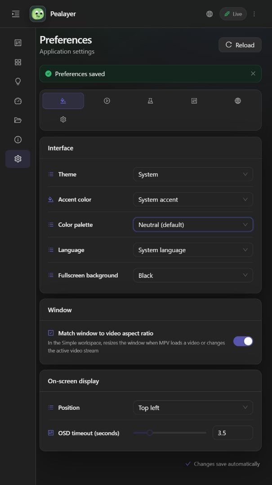
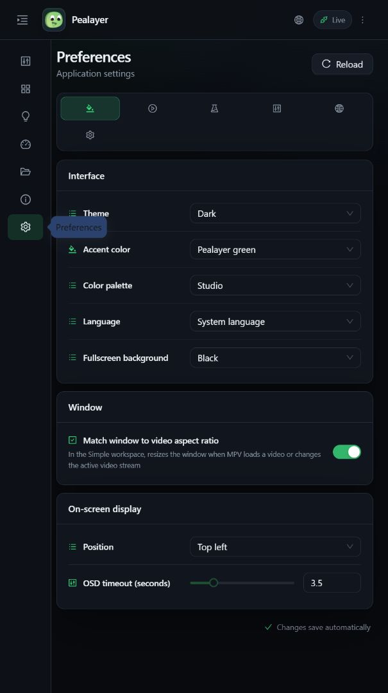
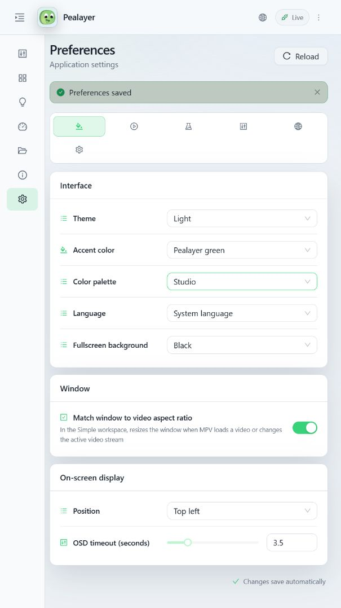

# Appearance palettes and live synchronization

## Choose a palette

In desktop or Web **Preferences → Appearance → Interface → Color palette**, choose **Neutral (default)** for the original gray palette, **Studio** for blue-gray surfaces, or **Pastel** for slate and lavender surfaces with lilac-to-rose gradients. Theme mode and accent remain independent settings.

## Raised Pastel controls

Pastel uses its original slate and lavender surfaces. Framed buttons and checkboxes have solid faces, a light edge and a short shadow. Pressing a control reduces its shadow without changing the hit target. Checked boxes use the current accent and a contrasting checkmark. The header uses a solid surface, with the original accent divider below it.

| Surface | Before | Raised controls |
| --- | --- | --- |
| Windows Open Location | [Before](../screenshots/pastel-controls-native-before.png) | [After](../screenshots/pastel-controls-native-after.png) |
| Web Download Center | [Before](../screenshots/pastel-controls-web-before.png) | [After](../screenshots/pastel-controls-web-after.png) |

The Windows comparison uses a disconnected review instance at 150% scale. The before capture uses the clean `769b995` build. The after capture uses the local release build of the native changes committed as `e66d2e7`. Its manifest records `ac0aa5a` with pending changes because compilation began before that commit. Chromium ran the actual `ac0aa5a` and `c1e1a35` Web bundles at 1200 × 720 with a synthetic URL and an empty queue. The browser verified that the checkbox and button kept their bounds and that the checkbox switched between raised and inset shadows.

The native paint and pointer test covers light, dark, right-to-left layout, and switching back to the default control style. The shared Download Center tests, Web appearance tests, TypeScript check, and Web application parity guardrails passed.

## Earlier Pastel previews

The earlier pass deepened Pastel's surfaces and added the indigo-to-plum header gradient. The media strips and chart colors in those captures were already part of Pastel.

| Surface | Before | After |
| --- | --- | --- |
| Desktop, dark | [Original](appearance-palettes/pastel-native-dark.png) | [Refined](../screenshots/pastel-refined-native-dark.png) |
| Desktop, light | [Original](appearance-palettes/pastel-native-light.png) | [Refined](../screenshots/pastel-refined-native-light.png) |
| Web, dark | [Original](appearance-palettes/pastel-web-dark.png) | [Refined](../screenshots/pastel-refined-web-dark.png) |
| Web, light | [Original](appearance-palettes/pastel-web-light.png) | [Refined](../screenshots/pastel-refined-web-light.png) |

The Windows captures use the same 800 × 600 logical-point NLE viewport at 150% scale. The Web captures use the same 1418 × 822 viewport. Both use the same paused sample at the start of the clip. The refined native capture ran the clean `769b995` build, and the Web capture used the `b18744d` bundle through the app's Web root override.

Live preview switched both clients between light and dark. Returning to Studio cleared Pastel's Web colors and gradients. The enabled Web control menu used its new hover border with the same bounds before and during hover. Canceling the native light preview restored the saved dark appearance.

## Original Studio and Neutral rollout

This section records the verification for [PR #46](https://github.com/ToghrolTP/pealayer/pull/46) at `019d32828427ad2e02882e400b5e48e960856364`.

The local instance was left on Neutral, with its existing System theme and System accent. Changing factory defaults does not overwrite an explicitly saved Studio preference on another installation.

## Causes and corrections

- egui uses the active-widget foreground for ordinary bold captions. Pealayer green previously made that foreground nearly black on dark panels. Active controls now use an accent tint with palette-appropriate text; saturated selections and primary buttons retain contrasting selection text. Geometry and widget sizes were not changed.
- Runtime config snapshots previously started from disk, potentially reverting a live accent preview during an unrelated update. They now start from the authoritative live config.
- Appearance changes bypass the normal broadcast interval. Status advertises the host's resolved theme and accent, so a browser on a different OS does not independently choose a conflicting system theme.
- Open Web Preferences controls follow shared appearance changes. Native drafts reconcile external appearance without losing unrelated unsaved edits. Discard cannot undo a newer appearance committed by another client.
- Windows titlebar caption/text colors derive from the same palette roles, with proper RGB-to-COLORREF conversion. Changing palette repaints the titlebar even when dark/light mode is unchanged. Native decoration colors remain subject to the user's DWM theming preference.

## Verification

- Web build, type checking, and installable/offline PWA verification passed.
- Three focused Web appearance tests passed (defaults, shared preview merging, and host-resolved system theme/accent).
- Filtered Rust UI tests passed; additional focused tests cover palette persistence, bold-text contrast of at least 4.5:1 on ordinary/active surfaces in both palettes and both modes, readable green selections, dirty-draft reconciliation, and all four Windows titlebar palette/mode combinations.
- Packaged using the configured DAVID-PC libmpv profile with `-SkipTests -NoUpx`. Replaced only after graceful `--quit` IPC completion. Canonical process and `/healthz` were responsive; `/api/update/manifest` reported the exact code commit above and `git_dirty: false`.
- Sent a native `preview_config` command through `/api/ipc`: Web Preferences displayed dark Studio / Pealayer green. Disk retained the previous saved preferences during this preview.
- Sent `cancel_preview_config`: open Web controls returned to System theme/accent without a reload.
- Selected Neutral in Web Preferences: `/api/player/status`, `/api/config`, and the persisted JSON all reported `color_palette: native`.
- Previewed light Studio / green: the already-open Web Preferences controls and page changed without a reload. Host status and browser DOM agreed on light mode, accent `#38d27a`, surface `#f8fafc`, and text `#17202b`. Canceled this preview; final Neutral dark resolved colors are surface `#202020` and text `#eeeeee`.

Native screenshot verification for that rollout was blocked: Windows.Graphics.Capture failed twice with `IGraphicsCaptureItemInterop.CreateForMonitor ... 0x8007041D`. The screenshots above are real browser captures, not native egui proof. No physical hardware was actuated, no remote deployment is claimed, and PR #46 remains unmerged.
