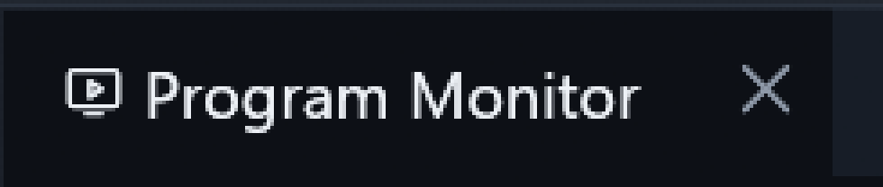
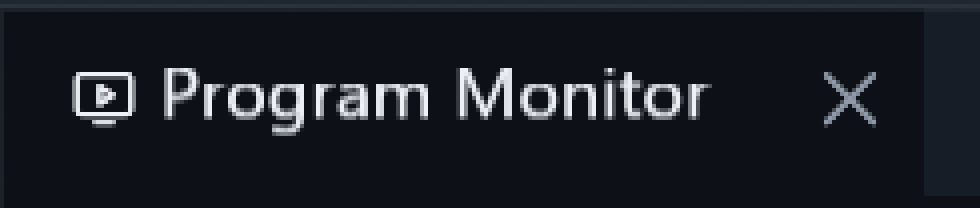
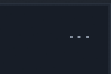

# CraftUI pane header actions

Owner: [issue #80](https://github.com/ToghrolTP/pealayer/issues/80).

The requested header behavior supersedes the earlier menu-chevron decision:

| Control | Action | Default |
| --- | --- | --- |
| × beside each visible tab title | Close that specific panel, retaining its restore location | Shown |
| Three dots at the end of the tab strip | Open the contextual panel menu | Shown |
| Chevron beside the menu | Collapse or expand the panel group; never open a menu | Hidden |

Appearance → Workspace panels exposes separate **Show CraftUI panel close
buttons** and **Show CraftUI collapse buttons** settings. Both use the shared
Preferences contract, live appearance preview and the existing configuration
API (`craft_show_close_buttons`, `craft_show_collapse_buttons`). The egui Dock
adapter keeps its own native controls and geometry.

Close controls use actual visible upstream tab responses and current title
paint, including the floating layer and clip. Hidden overflow tabs get no
invisible close target. A fixed title gutter and inside focus outline keep
hover/press from shifting the title or its neighbors. An inactive tab's × closes
that tab, not the group's selected panel. Lock and modal shielding remain in
effect.

## Header alignment

CraftUI originally centered the combined icon/title line box while the
application's close control centered its visible glyph. Icon fallback fonts
and the UI text font have different baseline and line-gap metrics, so the
three visible elements could sit at slightly different heights.

The adapter now centers the final painted icon and caption independently on
the actual tab rectangle, sharing the close button's centerline. It uses the
visible glyph geometry after truncation, including RTL shaping, rather than a
font-specific vertical offset. Logical text, tab widths, horizontal placement,
hit targets and drag/close/menu behavior keep their existing ownership. Titles
are aligned even when the optional close button is hidden. Floating tabs use
their own layer and rectangle.

The regression measures the separately painted icon and caption against the
actual upstream tab rectangle in both languages, themes and four display scales,
with docked/floating panels and close controls shown/hidden. Existing pointer,
lock/modal, inactive-tab close, overflow and collapse tests remain required.
All nine CraftUI tests and twelve egui Dock regressions passed. Actual wide and
narrow native captures were inspected with the same Studio dark palette and
1.5× display scale. These header crops are enlarged 4× using nearest-neighbor
presentation; their UI pixels and geometry are otherwise unchanged.

Before:

After:

The clean package at `832f77b7c1ea72b247fe3c682bacdb218ca5fa05` passed its
libmpv/runtime, resource, downloader and Web/PWA package checks. Executable SHA-256:
`a3036be1469197c50099b10b93c892d074a465bbe5834381de2b8831ba181efb`.
The process-local authoring gate was clean before the guarded updater ran.
The restarted canonical application acknowledged that exact build and digest,
retaining paused playback at 578286 ms and its existing libmpv runtime digest
`e56ce67cd00f06a59dc7ed5b97a49a9182a381554c755dc4570a52af1ef30e65`.
Cafe delivery remains user-deferred while its normal connection is unavailable.

## Collapse behavior

Collapse is not Close. Existing dock groups and floating windows use Craft's
minimization action. Split-tree tab groups retain their panel membership and
normal split dimensions; a persisted local view projects collapsed rows to
header height. Side-by-side cells retain their columns. Expansion restores the
original split dimensions, and explicit panel reveal expands the complete tab
group. The three-dot menu also exposes Expand/Collapse, so hiding the optional
chevron cannot strand a collapsed panel. Workspace/session snapshots retain the
view state through the existing egui persistence path.

## Verification

The native pointer/paint suite covers individual and inactive tab close,
three-dot menu activation, lock/modal guards, theme/scale/RTL alignment,
visibility defaults, exact collapse/expand geometry and explicit reveal.
Shared Preferences tests cover serialized values and cross-window preview.
The egui Dock regressions are run alongside these tests, not assumed unaffected.

All 56 focused native tests passed, including the shared Preferences contract,
egui Dock and CraftUI layout/header suites. Narrow-header checks cover 160, 240,
420, 900 and 1440 logical pixels in both directions. Header interaction checks
also cover both themes and display scales from 1× to 2×. Tests use isolated
configuration/instance identity and the command-free in-memory engine.

The Windows package passed the native/runtime and downloader smoke probes,
quick-action resource checks and Web/PWA bundle verification. Its guarded
updater installed and acknowledged source
`e163a4ce9d84b1993ba5c4e451095afb39b974b0`, executable SHA-256
`ec42e0cd89683ae0e73d3a8525b48e28bf030705311ae4aa44cd71384580c778`.
The destination libmpv remains SHA-256
`e56ce67cd00f06a59dc7ed5b97a49a9182a381554c755dc4570a52af1ef30e65`.
The fresh authoring inspection was clean before replacement. The restarted app
retained its 3002 × 1796-pixel window, workspace, paused media and position.

Installed `/api/preferences` exposes both controls with their correct group and
icons. Narrow `/api/config` updates were visually checked in both directions:
the chevron appeared when enabled, and the per-tab × disappeared when disabled.
Both settings were then restored to the requested **close shown / collapse
hidden** defaults and confirmed by a fresh API read. The app remains running.
Actual user clicking, not just these API changes, is covered separately by the
native pointer tests above; no human-interaction pass is inferred from capture.

### Actual native before and after

These read-only Win32 captures use the same Studio/dark palette, window bounds
and 1.5× display scale. The title crops are enlarged 2× and menu crops 3× using
nearest-neighbor capture presentation, not a mockup or altered UI geometry.
Only non-private header pixels are published.

Before (group-only close was far from the individual title):

After (the tab owns its close control):

Separate three-dot menu, with the default-hidden chevron absent:

Optional collapse/expand control enabled for verification, then restored hidden:

Cafe deployment remains
user-deferred while its normal connection is unavailable. No hardware actuation
is needed to verify these controls. The separate taskbar-artwork gate in
[PR #260](https://github.com/ToghrolTP/pealayer/pull/260) remains unresolved.
