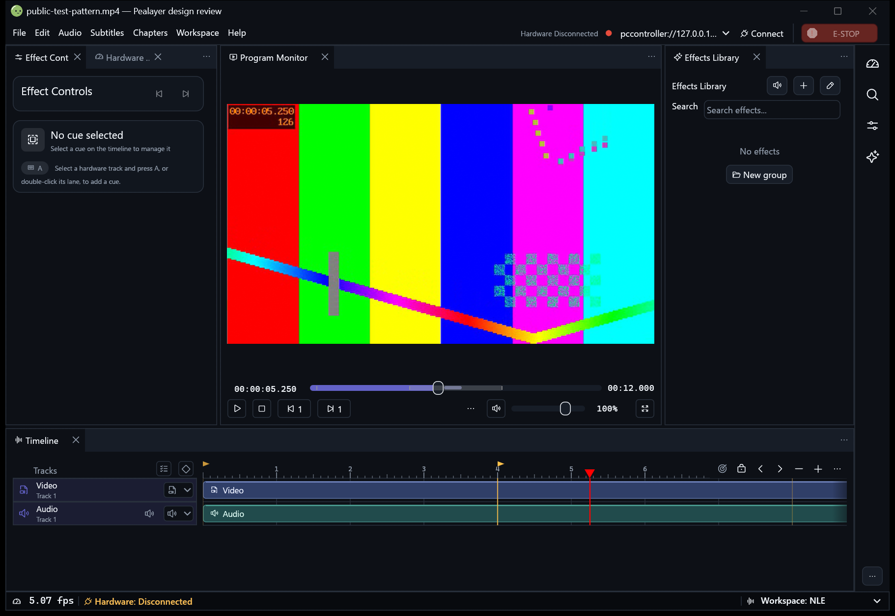
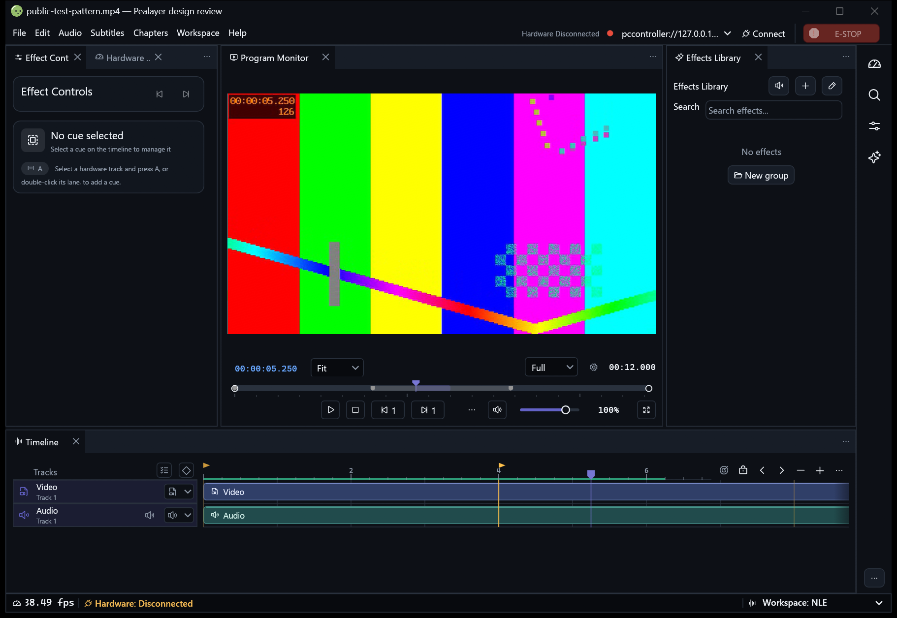
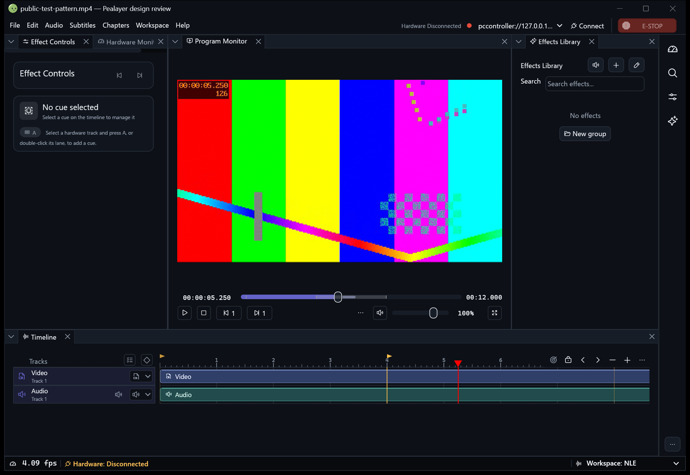
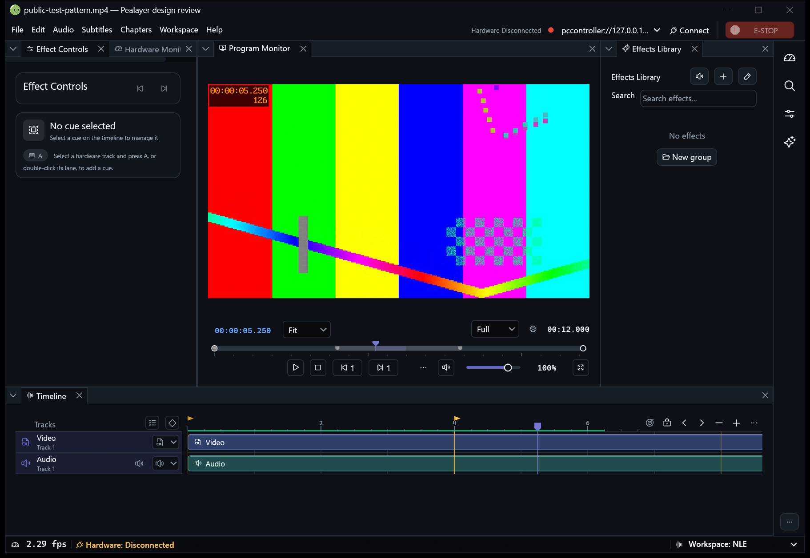

# FilmCraft preservation audit and restoration

Owner: [PR #248](https://github.com/ToghrolTP/pealayer/pull/248).
**Draft and unmerged: explicit user approval is still required.**

## What went wrong

The integration merge `dbfc34a64d15040c0eb1252e1ce725f2328cae70`
retained the original commit ancestry but replaced the custom Program Monitor
implementation with shared control groups. Its subsequent review treated source
remaining in history or unused helpers as preservation. That was insufficient:
the original mini-timeline/playhead/marker presentation and volume art no longer
ran, the Simple seekbar/timecode additions were omitted, and the Fit/resolution
selectors were dropped instead of repaired.

The reasons recorded then were real problems—pointer/keyboard accessibility,
inconsistent seek coordinates, metadata mutation and an inert resolution menu—
but reducing the feature was not the required remedy. This restoration keeps the
design and repairs its integration. A small final PR diff is also partly due to
merging main: unrelated main changes disappear from the comparison. That does
not explain away the real removals above.

The eight original author commits remain ancestors. No history was rewritten,
no source was force-reset and the user's existing workspace/runtime is untouched.

## Original additions: disposition and live ownership

| Original addition | Restoration / retained behavior |
| --- | --- |
| `dcd40a7`: remove rail/drawer | Existing configurable rail remains available; users can hide it. Do not erase another requested workspace feature to simplify FilmCraft. |
| `88dcbc2`: token-aware CraftUI IconButton helpers/call sites | Helpers and the existing dialog/color/RF/status call sites retained. Restored monitor settings uses the shared token-aware helper too. |
| `657a313`: frame ruler and pentagonal playhead | Retained as optional FilmCraft timeline style, using actual fractional media FPS, bounded paint and unchanged timeline interaction. |
| Same commit: zoom-thumb algorithms | Original helper implementation and tests retained. Neither original integration nor the reduced review wired a live zoom scrollbar; this is not claimed as an already-delivered interactive feature. |
| `bcb46c8`: seek ladder and blue timecode | Restored for the Simple transport as an independent saved Compact/FilmCraft choice, and retained for FilmCraft Program Monitor. |
| `81c235d`: two-point ruler overview | Restored in FilmCraft. Its actual source is **buffered media**, not rendered frames; absent buffer data never invents progress. |
| `864384b`: mini-timeline and volume design | Live pentagonal playhead/stem, terminal rings, chapter/keyframe pentagons and ring-thumb volume restored. They use the actual accessible slider's value range; marker colors and exact chapter seeking stay configured. |
| `d941b97`: three-tier monitor and selectors | Retained measured clock/seek/transport tiers, with live Fit/aspect and Full/half/quarter/eighth preview selectors plus the settings menu. Narrow reflow, RTL, volume movement, overflow and Fullscreen ownership remain. |
| `267522b`: merge main | Preserved normally in ancestry; no wholesale file checkout or reversion of unrelated fixes. |

The resolution selector now changes the actual private preview FBO dimensions.
It does not claim decoder downscaling or change external mpv's output. Aspect
selection is separate from decoder-owned source aspect; Fit restores that source.
Changing either does not seek, resume playback or rewrite media metadata.

## Configuration and safety

- Existing Compact monitor, Compact Simple transport and Standard ruler remain
  defaults. FilmCraft options work with egui Dock and CraftUI.
- Shared Preferences/API settings: `native_monitor_style`,
  `native_transport_style`, `native_timeline_style`,
  `monitor_preview.aspect` (`source/wide/classic/cinema`) and
  `monitor_preview.resolution` (`full/half/quarter/eighth`).
- All use the normal saved configuration and live preview/apply path. Presentation
  choices do not replace workspace state, hide user actions or change channels.
- Cosmetic slider paint wraps real egui slider input/focus/accessibility.
  It does not install a second pointer mapping. Simple's existing controls and
  default presentation remain available; volume stays with its saved Mute group.
- The original multicolored chapter styling is reconciled with user-configured
  marker colors rather than hardcoding a replacement palette.
- Original inert selectors were completed, not reinstated as misleading stubs.
  The zoom-helper-only addition is explicitly distinguished from live UI.

## Verification

The restoration adds persistent-choice/API validation, actual preview render-size
checks, pointer selection of both real dropdown menus without source-aspect or
playhead mutation, live pentagon/ring paint checks, and volume drag/reorder tests
in both presentations and both directions. Existing seek/keyboard, marker,
hover-thumbnail, responsive footer, workspace/sidebar and palette regressions remain.

- Full native suite at restoration checkpoint `cfc4ffa`: **1,252 passed, zero
  failed, four ignored**, serial run with a private configuration file.
- Final `f2e08c0` focused FilmCraft suite: **16 passed, zero failed**. This adds
  the final live blue-timecode correction and capture freshness guard; the full
  suite result above belongs to the preceding checkpoint, not this later one.
- Web appearance tests: seven passed; application parity contracts: 53 passed;
  control-bar contracts passed. TypeScript, Vite and PWA integrity passed during
  the package build. These are not browser-interaction evidence.
- Earlier reruns exposed the existing global asset-review snapshot race and a
  remote-parent socket fixture timeout. The subsequent full serial run passed;
  those failures are not silently relabeled as clean parallel passes.
- Native release compilation and isolated DLL smoke test passed. The seven
  QuickAction icon resources were checked in the preceding review build.

### Reconciliation with subsequent main changes

`56479d9` merges main `7547b97` without rewriting either history. Both conflicting
additions were retained: the FilmCraft Preferences preservation test alongside
the newer workspace-tools tests, and both acceptance-note sections. New terminal,
rail, typography and release-history work remains present. GitHub subsequently
reported the PR mergeable, still draft and unmerged.

After that merge, all **eight** current Web appearance tests, 53 parity contracts
and control-bar contracts passed. The native suite did **not** run: rustc/LLVM
failed during compilation with `out of memory`/allocation failure, accompanied by
a Windows pagefile-limit error. TypeScript's native executable also could not
start (`spawnSync ... UNKNOWN`). These are explicit post-merge verification
blockers, not passing test results. No pagefile/settings changes, process kills
or further heavyweight builds were used to work around resource pressure.

The gallery below remains the inspected FilmCraft-restoration checkpoint,
accurately identified in each manifest; it is not relabeled as a capture of the
subsequent main integration. Before merge approval, rerun native/TypeScript
checks and build/capture the integrated head when resources are available.

### Review identity and packaging limit

The inspected executable is source `f2e08c0c2a15a5563246862e293d549f9a668b17`,
SHA-256 `f185bd51eece43c86fde8bf36c77ac9624dae894595c7a55e3b7866b8421282e`.
Its build-info honestly reports `dirty: true`: generated `web_ui/dist` outputs
from the attempted package remain different. All authored source outside that
generated directory was verified identical to the committed checkpoint before
capture. The flag was not overridden to manufacture a clean-package claim.

The official packaging workflow compiled the application and Web assets but
could not replace its shared packaging-cache executable (Windows access denied).
That protected target was not removed or bypassed. A fresh, isolated review copy
of the compiled executable and matching libmpv DLLs supplied these captures; it
is **not a completed production package**. Generated-output cleanup was separately
denied by tool policy and remains a worktree-hygiene gate, not missing source.

## Updated native screenshots

The superseded gallery is removed from the current tree at the user's request;
Git history retains it. Replacement captures use the maintained
`scripts/review-design-variants.ps1` fixture with synthetic media and three named
chapters, matching Studio dark palette, Compact density and viewport/DPI.

The fixture explicitly pauses and seeks to **5.25 seconds**, waits for settled
seek readback and records playback state in every capture manifest. Zero-position
or unsettled captures are not accepted. Compact/Standard baseline and restored
FilmCraft are captured from the same review executable in both workspace renderers;
“before” means the preserved presentation, not a fabricated historical build.

All eight PNGs below were inspected individually: current nonblank native UI,
synthetic video visibly at 5.250 seconds, settled paused readback, matching
Studio dark palette, 150% display scale and 1,200/720-point viewports. The wide
views also show the nonzero main-timeline playhead; in narrow views it is outside
the deliberately unchanged timeline viewport. The custom monitor playhead remains
visible. Sidebar and existing standard controls remain present.

One earlier private capture showed a stale first video frame despite correct API
readback and was rejected, not published. The fixture now forces a real placement
change before capture; this is a capture freshness guard, not a GPU-soak fix.
Manifests retain their original machine-generated `inspected: false` field; this
paragraph records the subsequent actual inspection rather than rewriting provenance.

### CraftUI: preserved Compact/Standard

### CraftUI: restored optional FilmCraft

### egui Dock: preserved Compact/Standard

### egui Dock: restored optional FilmCraft

### Narrow views and capture provenance

| Renderer | Preserved Compact/Standard | Restored FilmCraft | Original manifests |
| --- | --- | --- | --- |
| CraftUI | [720-point capture](../screenshots/pr248/preserved-compact-craft_ui-720.png) | [720-point capture](../screenshots/pr248/final-filmcraft-craft_ui-720.png) | [Compact](../screenshots/pr248/preserved-compact-craft_ui-manifest.json), [FilmCraft](../screenshots/pr248/final-filmcraft-craft_ui-manifest.json) |
| egui Dock | [720-point capture](../screenshots/pr248/preserved-compact-egui_dock-720.png) | [720-point capture](../screenshots/pr248/final-filmcraft-egui_dock-720.png) | [Compact](../screenshots/pr248/preserved-compact-egui_dock-manifest.json), [FilmCraft](../screenshots/pr248/final-filmcraft-egui_dock-manifest.json) |

This is an isolated PR review build, not a replacement of the regular application
or another review session. Production/Cafe deployment is deferred for the user's
explicit PR review hold and incomplete production package. Physical hardware,
GPU soak, final user acceptance and the merge decision remain separate gates.
