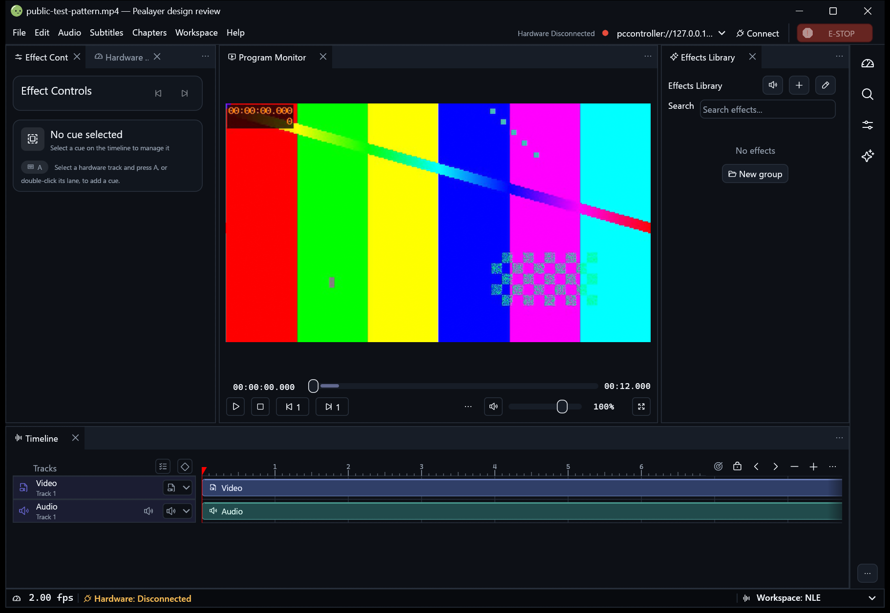
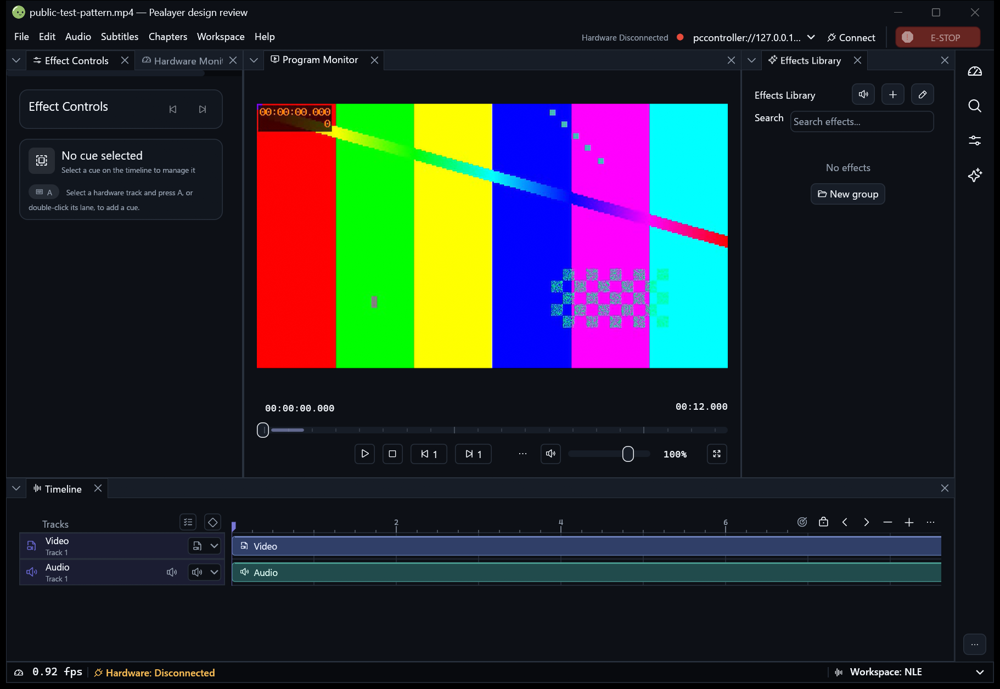

# Native presentation review

Owner: [PR #248](https://github.com/ToghrolTP/pealayer/pull/248).
The PR remains unmerged until the user explicitly requests its merge.

## Preservation and choices

The existing compact Program Monitor and standard timeline remain available.
FilmCraft is an independently selectable presentation for each, alongside the
existing egui Dock / CraftUI workspace renderer choice. Sidebar shortcuts,
saved workspace state, action customization, input behavior and accessibility
remain application features rather than presentation-dependent removals.

## Full review and preservation

The original PR head `267522b30f304300876bea5817b4d47af053a934`
changed 17 files. Its eight commits remain ancestors of the revised branch;
the current main stack was merged into that branch without rebasing or squashing
the author's work. The existing sidebar, SVG loader dependency, workspace
configuration, tab ownership/restoration, menus and regression tests are retained.

| Original shortcoming | Revised behavior |
| --- | --- |
| Sidebar and saved controls removed | Existing configurable rail/drawer and all current shortcut behavior retained |
| Monitor/ruler replacement forced globally | Independent persisted `native_monitor_style` and `native_timeline_style` controls in Appearance → Workspace panels |
| Playback-resolution selector always reports 1/2 and does nothing | Nonfunctional selector omitted; its original source remains in PR history |
| Fit menu overwrites decoder-owned source aspect | Omitted unsafe control; natural source fitting remains owned by the renderer |
| Pointer-only volume slider | Existing accessible native slider and movable volume group retained |
| Hover and click seeking use different coordinate ranges | Shared actual slider, preview, markers and seek mapping in both layouts |
| Chapter colors/visibility and active highlighting replaced | Existing configured chapter/keyframe behavior retained |
| Fixed row sizes and overflowing paint | Measured tier slots, bounded ruler/seek paint, shared density and RTL geometry |
| Demux cache labeled as rendered frames | Existing factual buffering display retained; no invented render-status stripe |
| Native-services test annotation removed | Test restored and included in the native suite |

The default remains **Compact** monitor controls and the **Standard** timeline
ruler. **FilmCraft** can be selected independently for either surface, in either
CraftUI or egui Dock. Switching does not replace the workspace, discard saved
action order/visibility, seek media or alter the hardware timeline. The shared
Preferences API, configuration and live appearance preview expose both choices.
FilmCraft retains the author's frame ladder, pentagonal timeline playhead and
three-tier monitor structure while using existing production control semantics.

The removed inactive stubs are not claimed as implemented resolution/aspect
features. The retained zoom-thumb and marker helpers remain available in the
source; the native seekbar keeps its established interaction and accessibility.

## Reproducible native captures

Use `scripts/review-design-variants.ps1` with the exact executable under review.
It creates a fresh private offline profile, uses Pealayer's HTTP APIs for
configuration and placement, and calls the maintained read-only Win32 capture
helper. It does not copy production settings or send desktop mouse/keyboard
input. Normal shutdown checks the fixture's identity and draft state first.

Example, from the repository, with output under the private verification root:

```powershell
.\scripts\review-design-variants.ps1 -Executable $reviewExecutable -OutputDirectory $captureDirectory -Label before -Baseline -WorkspaceUi egui_dock -SyntheticMedia
.\scripts\review-design-variants.ps1 -Executable $reviewExecutable -OutputDirectory $captureDirectory -Label after-compact -WorkspaceUi egui_dock -MonitorStyle compact -TimelineStyle standard -SyntheticMedia
.\scripts\review-design-variants.ps1 -Executable $reviewExecutable -OutputDirectory $captureDirectory -Label after-filmcraft -WorkspaceUi egui_dock -MonitorStyle film_craft -TimelineStyle film_craft -SyntheticMedia
```

Repeat for `-WorkspaceUi craft_ui`. Use the same palette, density, language,
window dimensions and generated media across both sides. Defaults are Studio,
dark, accent `#6362c7`, Compact density, English and 720/1200/1800 by 800 logical
points. Capture manifests record source/executable/image hashes, observed DPI
and dimensions. Baseline mode never sends new presentation keys to old builds.

PrintWindow can return blank or stale content on some GPU drivers. Inspect
every image, check the visible application identity, and reject failed captures.
Use a user-visible, unobscured window and the maintained foreground capture
helper if necessary. Never replace actual screenshots with rendered mockups.

Only inspected public fixture screenshots and their manifests belong in
`docs/screenshots/`. Keep fixture configuration, generated media and logs under
the private program verification directory. Post pinned raw image links in the
existing PR so comparisons remain visible without downloading an artifact.

## Before / after gallery

The retained baseline `85993976d334eb5c858af3ec4c6d54c797c81f66` has four
inspected native captures: egui Dock and CraftUI at 1200 and 720 by 800 logical
points, 150% display scale. Each shows the same paused synthetic test pattern,
Studio dark palette and compact controls without a toast overlay. Both isolated
processes exited through the process-local API after clean authoring inspection.
Executable SHA-256:
`59a6e37c8390d4d77011f413d7eb5f25b0b082247062c9f807ffeeb969acda98`.
The images and capture manifests are published in `../screenshots/pr248/`.

The clean reviewed build `dbfc34a64d15040c0eb1252e1ce725f2328cae70`
has eight inspected native captures at the same two dimensions: Compact/Standard
and FilmCraft/FilmCraft in each workspace renderer. Executable SHA-256:
`2c475243b1082a0ff16d5014577e74e123fa8fa248a005fc3ee9c95faae3a501`.
The existing presentation retains the matched baseline layout; FilmCraft uses
separate clock, full-width seek and transport tiers. Sidebar shortcuts, pane
chrome, hidden track pickers, volume and trailing Fullscreen remain visible as
configured. No new monitor/ruler cutoff or paint bleed was observed in these
captures. Existing narrow side-panel text elision also appears in the baseline.

All four reviewed-build fixture processes confirmed live presentation values
through the configuration API, saved the corresponding values to their isolated
configuration files, and exited normally after clean authoring inspection. The
fixture port was no longer listening afterward. Production settings and hardware
were untouched. These are full-resolution native screenshots, not mockups.
The capture manifests retain their original automated `inspected: false` field;
the subsequent visual review is recorded here rather than rewriting capture
provenance. Screenshot inspection alone does not establish hardware acceptance.

| Comparison | egui Dock | CraftUI |
| --- | --- | --- |
| Existing presentation before | [Wide](../screenshots/pr248/before-clean-egui_dock-1200.png) · [Narrow](../screenshots/pr248/before-clean-egui_dock-720.png) | [Wide](../screenshots/pr248/before-clean-craft_ui-1200.png) · [Narrow](../screenshots/pr248/before-clean-craft_ui-720.png) |
| Existing presentation after integration | [Wide](../screenshots/pr248/after-compact-egui_dock-1200.png) · [Narrow](../screenshots/pr248/after-compact-egui_dock-720.png) | [Wide](../screenshots/pr248/after-compact-craft_ui-1200.png) · [Narrow](../screenshots/pr248/after-compact-craft_ui-720.png) |
| Optional FilmCraft monitor and timeline | [Wide](../screenshots/pr248/after-filmcraft-egui_dock-1200.png) · [Narrow](../screenshots/pr248/after-filmcraft-egui_dock-720.png) | [Wide](../screenshots/pr248/after-filmcraft-craft_ui-1200.png) · [Narrow](../screenshots/pr248/after-filmcraft-craft_ui-720.png) |

### CraftUI: before → optional FilmCraft




### egui Dock: before → optional FilmCraft




## Regression and package results

Reviewed source: `dbfc34a64d15040c0eb1252e1ce725f2328cae70`, clean build.

| Check | Result |
| --- | --- |
| Full native suite | 1,248 passed, 0 failed, 4 opt-in tests ignored |
| Actual decoder thumbnail without seeking | Separately enabled and passed |
| Actual internal playback resume at pending exact frame | Separately enabled and passed |
| Web appearance tests | 7 passed |
| Shared application parity | All 53 contracts passed |
| Web control-bar checks and TypeScript | Passed |
| Windows release package | Built; libmpv smoke, resource identity, seven Jump List icons, downloader smoke and PWA integrity passed |
| Native visual fixtures | 12 inspected captures, two renderers, two widths, matching palette/media/DPI |

Coverage includes native pointer/keyboard seek, shared preview coordinates,
volume and overflow controls, RTL/tier geometry, palette and font-size behavior,
independent configuration round trips and live appearance preview/reversion.
Frame-ruler tests also cover fractional rates and distinct subsecond labels.
The other two opt-in tests (external mpv duplex and GPU failed-render recovery)
were not run in this pass; those implementation paths were not changed.

The package is an isolated review build, not a production deployment. The regular
installation and preserved historical comparison were not replaced. Cross-platform
CI was still running when this evidence was published; local Windows results do
not substitute for completion of that matrix.

## Acceptance ledger

- [x] Preserve sidebar implementation, configuration and saved workspace behavior.
- [x] Verify both presentation selections persist independently of workspace renderer.
- [x] Inspect matched full-resolution native captures, including monitor and ruler.
- [x] Check density/font/RTL geometry in tests and Studio/narrow rendering in captures.
- [x] Exercise seek/marker mapping and actual decoder thumbnail/exact resume paths.
- [x] Retain native accessible volume and test keyboard/action/overflow behavior.
- [x] Reconcile removed or weakened tests and run meaningful regression coverage.
- [x] Record source/package/runtime identity and deployment status separately.
- [ ] Complete the remaining cross-platform CI matrix.
- [ ] Obtain the user's explicit approval before merging PR #248.

Cafe deployment remains a separate acceptance gate while its connection is
user-deferred. No fixture capture establishes physical hardware acceptance.
