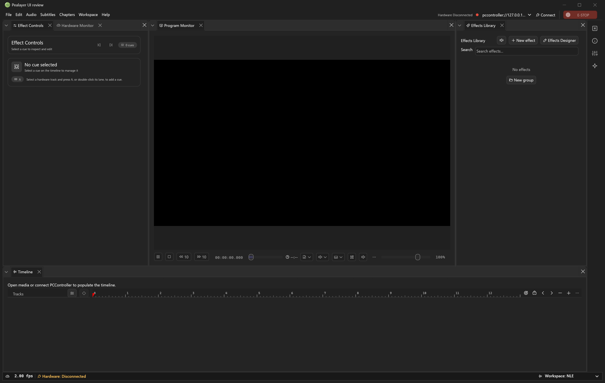

# egui Dock: restore application chrome and header interactions

## Cause

The original renderer customized more than its tab content. It supplied the
application palette, Phosphor disclosure carets, a focused-panel outline, tab
response geometry, and an empty-header context menu.

- `967b297` introduced the shared disclosure icons.
- `0ec9ffc` retained the empty-header panel menu.
- The CraftUI renderer migration (`37c8acb`) removed those egui Dock hooks.
- The selectable egui Dock adapter (`1fbed60`) brought the renderer back with
  stock `Style::from_egui`, without restoring those hooks. Tab-specific context
  menus survived; right-clicking unused header space did not.

These are source-history findings, not evidence that the user's settings or
custom icon assets were deleted. The adapter omitted their presentation paths.

## Restored behavior

- egui Dock reads the same live application palette as CraftUI: tab surfaces,
  text, separators, hover, close controls, focus and active-panel outline.
- The Phosphor right/down caret replaces the stock filled triangle, while the
  existing upstream hit target and collapse behavior remain intact. Header
  height grows for larger UI fonts. Floating panels paint on their own layer.
- Right-click unused tab-bar space to show/hide panels or reset the workspace.
  Right-click a tab for its contextual actions, Preferences, docking and Close.
  The empty-header menu does not claim body clicks or neighboring panels just
  because they share the same vertical coordinates.
- Explicit panel reveal expands collapsed ancestors and queues a repaint.
- Modal dialogs retain input ownership, and locking prevents detach via the
  tab menu. Custom chrome remains painted underneath a modal backdrop.

CraftUI remains selectable and unchanged. Both renderers still use one canonical
workspace, panel implementation and hidden-panel restore model. There is no new
persisted layout schema, reset-on-upgrade or dependency/theme replacement.

## Verification and remaining delivery gates

Native tests exercise actual egui pointer events and paint output, not only
configuration flags: both tab/header menus, body-click isolation, collapse and
reveal, floating layers, hide/restore, modal ownership, and existing workspace
projection invariants. Caret containment is checked in light/dark at 100%, 125%
and 200% display scale. Fixtures use a parent-selected isolated configuration
and the memory-only hardware engine; they do not actuate outputs.

The full native library suite passed: **1,069 passed, zero failed, one ignored**,
including all nine Dock tests. The Windows package built from clean source
`ba0b121e742cbf94051889d97265c35c61f53c4b`; libmpv smoke, standalone utility smoke,
native resources/quick-action icons and Web/PWA bundle integrity checks passed.
Packaging skipped duplicate regression runs; the library result is a separate
run, and no local Web behavioral suite is claimed for this native-only change.

The isolated review process reported that exact clean commit and `egui_dock`
through its APIs. Its real native window was captured read-only and inspected:
the Phosphor carets, matching headers and panel boundaries are present. It has
no media loaded and automatic hardware connection disabled. This is a genuine
runtime screenshot, not a reconstruction or hardware/playing-state proof.

The canonical local updater launch was blocked by tool execution policy; the
user was given the verified graceful-update command. Until API readback confirms
the replacement, the running review build is not the installed production app.
Cafe-PC's configured SSH route also refused the connection. Those are explicit
deployment blockers, not successful installations. Live menu acceptance and
remote delivery remain open; rendered interaction tests are not user acceptance.

## Follow-up from live review

The user confirmed the empty-header context menu opens. The original Dock
adapter omitted the close-all button's separate border and keyboard-focus colors;
upstream consequently painted a dark vertical rule beside ×. The Dock-only
adapter now removes that border, maps hover/focus colors to the active palette,
and paints the application icon glyphs centered by visible ink within the
existing clickable slots. The change preserves upstream click handling and the
separate CraftUI renderer. Pointer and geometry tests cover both themes and
multiple display scales. Broader visual comparison of every historical state
remains open; this targeted correction is not a claim of complete parity.

The user ran the graceful updater and the canonical process reported the
restoration commit afterward. This does not establish Cafe deployment or live
acceptance of the later close-button refinements.

## Pre-CraftUI comparison and remaining geometry correction

This pass compares **both** the first parent of the CraftUI merge (`41ef0ae`,
before PR #216) and the last egui Dock renderer inside that PR (`4b264ca`, before
`37c8acb`). They are different checkpoints: the latter had already adopted Craft
palette tokens. It is not an untouched pre-PR baseline.

| Area | Historical source | Current finding and correction |
| --- | --- | --- |
| Header height | Pre-PR `Style::from_egui` used the upstream 24-point bar. The in-PR token adapter changed it to 32. | The selectable adapter had retained CraftUI's 32-point geometry. egui Dock now restores its own 24-point baseline, growing only for the actual Button font. CraftUI remains 32 points. |
| Disclosure | Application Phosphor caret painted over a retained 24-point upstream hit slot. | Restored and preserved. No replacement collapse implementation. |
| Caption alignment | Upstream centers the font line box, including its font-dependent gap. | Normalize the Dock title galley's visible ink inside that same line box. Width, text, accessibility, drag preview and click target remain owned by upstream. |
| Close controls | Separate tab-close and close-all controls, with upstream targets. | Paint the glyph inside the actual registered close response, not an estimated full-height gutter. Large fonts retain a centered square target. |
| Unwanted rule | Upstream close-all has an independent left-border color, not the tab outline. | Its transparent override was already restored; new paint-output tests guard the actual rule in light/dark and hovered states. |
| Overflow | Native titles were clipped by the tab scroller. | Custom close glyphs were using the entire leaf as their clip and could draw over neighboring controls. They now use the tab's actual clipped interaction rectangle. |
| Menus and focus | Tab menu, unused-header menu, caret collapse and reveal existed before migration. | Retained rendered pointer tests cover all of them, hide/restore and focused-panel outlines. |
| Floating/modal/locked state | Independent surfaces and modal/input ownership. | Preserve the existing floating-layer, modal shielding, locked-docking and shared-layout tests; no panel or workspace schema changes. |

An [earlier real native capture](../screenshots/pealayer-en-dark.png) shows the
compact Dock arrangement. It is from the recorded screenshot manifest, **not** a
new rendering of the immediate pre-merge checkpoint. The restored screenshot
above is likewise historical. New source/paint tests must not be presented as
new installed screenshots.

All implementation changes for this correction are confined to the egui Dock
adapter. The CraftUI renderer, its 32-point header, palette, property rails and
shared panel contents are not being restyled or rolled back. Verification and
new package/live-capture results will be recorded with their actual boundaries.

All eleven Dock tests passed after this correction. The added geometry matrix
covers light/dark, English/Persian, 100/125/150/200% scale, and normal/large fonts.
The overflow fixture checks actual paint clipping and the absence of a visible
close-all left rule, including hover. Existing pointer tests continue to cover
menus, collapse/reveal, hidden-panel restoration, floating layers and modal
ownership. These are rendered fixtures, not an installed screenshot claim.
