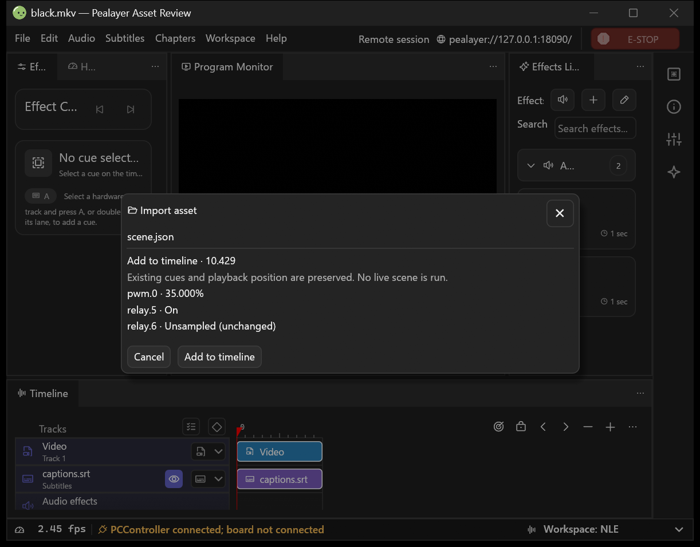
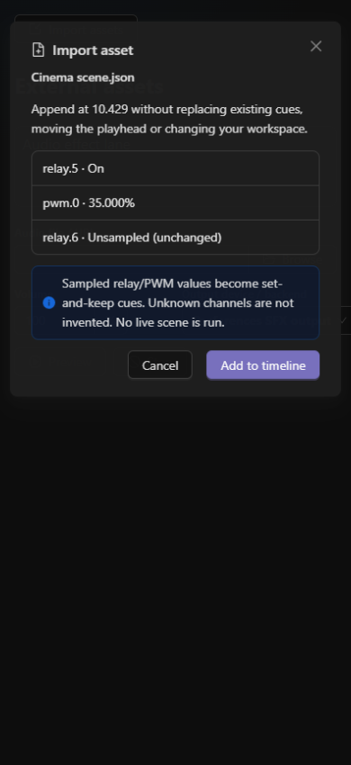
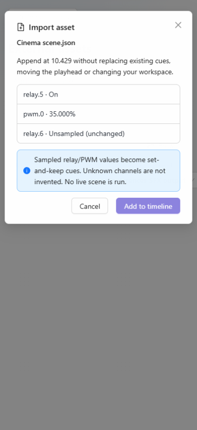

# External asset imports — implementation and verification

The resumed feature includes the Hardware Monitor disconnected-state fix, rather
than losing that intervening work. Source checks and real-browser verification
are complete; packaging/runtime and deployment receipts are recorded separately
below. Cafe deployment is deferred at the user's request until it returns.

## Implemented source

- One off-thread native/API import path; browser/remote files use bounded ordered
  uploads to the authority rather than sending client-local paths as server paths.
- Audio uses the existing SFX probe, library and playback engine. Timeline drops
  retain integer-millisecond placement. Import failures carry the audio identity.
- Subtitles reuse mpv's track-loading path; movie files reuse existing playback.
- Reviewed timeline fragments append with remapped identities without replacing
  existing cues, media, viewport or playback position.
- Reviewed scenes become set-and-keep relay/PWM cues, not live scene commands.
  Unknown/motion/unsupported mappings fail closed and board identity is checked.
- Effect definitions open the existing designer and use its Save/Publish path;
  PCController continues owning hardware programs. Web has an import button too.
- Import queues/reviews participate in native authoring/draft inspection.

## Existing owner contract

`src/projects.rs` was recovered from the preserved project-persistence draft
PR #227 (`feat/project-scene-persistence`). Its data types, validation, path
resolution and tests are reused rather than defining another scene format.
The RPC adapter and scene capture (which depended on draft-only telemetry fields)
are deliberately not brought over. This does not finish project restore, scene
actuation, workspace restoration or the outstanding acceptance work in that PR.
Reconcile this shared model when the owning draft continues; do not merge a
second independent format or replace its pending application adapter blindly.

## Verification and remaining gates

- Full final native library suite: 1,104 passed, one ignored. Seventeen focused asset tests
  additionally cover rendered review/values, typed RPC and exact panned geometry.
- Browser ordered transfer, failure, command rejection and cancellation checks,
  TypeScript and complete Web prebuild checks passed.
- The Windows flush regression is fixed and its actual upload test passes.
- A real installed-browser fixture exercises the actual drop/source/review
  controls at 390/768/1440 widths in both themes. No overflow, automatic commands,
  duplicate source import or page exceptions occurred. These are real controls
  with isolated memory-only transport, not physical-device proof.
- Batch cancellation removes registered partial and completed unretained files.
  Inputs are retained before final command submission: an acknowledgement lost
  after queuing must not delete files the importer may already be using.
- Transfer owner receipts pin the immutable destination. Reordered chunks,
  path traversal, reserved device names, overruns and incomplete finalization
  fail closed. Native consumers transfer files rather than forwarding local paths.
- Movie/subtitle drops wait for FileLoaded for the requested media. An unrelated
  movie cannot receive the pending subtitle, and failed loads expire the queue.
- The first real runtime probe found that no-media mpv reports unpaused. Offline
  placement now checks for actual loaded media before requiring Pause. The
  previous candidate saved its SFX but rejected placement; it is not accepted as
  the final runtime build.
- The next real probe confirmed SFX placement and timeline append, then reached
  the unsaved-media guard. Mixed subtitles now remain queued for their requested
  movie while Save/Discard/Cancel is pending; Cancel removes them without touching
  cues or playhead. Native, consumer, Web and RPC choices reuse one resolver.
  The dialog and its transient state are not restored from browser storage.
- The two-instance transfer passed, but cleanup exposed a pre-existing missing
  consumer sidecar baseline. Acknowledged media/timeline replicas now install
  their baseline after both fields, while unchanged server snapshots do not
  clean pending local edits. Native local-window confirmations remain local;
  only server-owned confirmations are forwarded. The final consumer acceptance
  includes clean authoring inspection and graceful exit without closing authority.
- Current PCController EffectDescriptor/effects.json exports adapt into the
  existing typed designer payload, retaining steps, engine, repeats and properties.
  The RPC name validator now allows the same printable punctuation as native
  Save (including slashes in real catalog names), while retaining length/control
  character bounds. Full group-style/empty-group catalog replacement remains
  PCController's existing import workflow, not a silent side effect of a drop.
- Scene review displays real sampled/unsampled values. Missing/incompatible
  channels or board identity reject the whole scene without partial placement.
  Imported motion is not silently converted into output. Cached channel catalogs
  support offline authoring; unknown mappings require a valid catalog first.
- Existing curves keep their channel policies; colliding times and locked
  channels reject the transaction. External effect definitions open as new
  identities and the Save path refuses to overwrite an occupied controller ID.

## Explicit boundaries

The original project-persistence draft remains separate. This importer does not
restore projects, run scenes or publish/execute imported hardware programs.
Saved/published effect cards use the existing timeline drag path after review;
opening a JSON definition is not automatically executing or publishing it.
Relative audio dependencies must accompany browser/consumer uploads in the same
batch. A process crash can leave unretained upload files on disk; ordinary cancel
and failure cleanup is verified, not cross-crash disk garbage collection.
No human listening, physical board output or production CPU soak is claimed.

## Packaging/runtime checkpoint

- Clean source package: `d61401e1b6160e954290120135c9423153ec3722`, `git_dirty=false`.
  Executable SHA-256: `90F0A9D6C748601B5F514678E4D0C06C1D0748B62657704A3BC18CC2CF4DF9E0`.
- Reused canonical staging `staging/preferences-organization` and the existing
  Windows host profile/runtime. libmpv smoke, Windows resources, quick actions,
  bundled Web/PWA integrity and standalone utility smoke passed. The packager
  skipped its regression suites because those were run separately, not twice.
- The final compiled Rust test artifact was reused for its full library run;
  it passed 1,104 tests with one ignored. Native wire consumer ownership check
  and complete Web prebuild checks also passed.
- Actual staged API/decoder run passed ordered upload/retention, one-second SFX
  probing, exact cue placement at 10,429 ms and append at 30,429 ms, deferred mixed
  movie/subtitle loading after explicit Discard of this test's exported cues,
  subtitle track discovery and the real scene review values.
- Two actual loopback Pealayer processes passed the native-consumer import. The
  authority stored/probed transferred bytes at a new authoring path, not the
  consumer's supplied path. Hardware stayed disconnected and playback stayed
  paused. Consumer authoring inspection reported clean. It quit normally through
  the process-local API while the authority remained running. The authority's
  generated scene review was cancelled and it also exited cleanly through API.
- The earlier consumer fixture's missing baseline blocked graceful exit. After
  diagnostics, only that owned isolated fixture process was stopped; it contained
  generated mirrored test data, not user edits. The final build's normal-exit
  proof supersedes this failure. No regular application was terminated/replaced.
- Native scene review screenshot is from the actual final consumer executable,
  using read-only Win32 capture. Phone images use actual Web controls with an
  explicitly isolated fixture transport. Neither is physical board proof.
- Cafe deployment remains deferred by the user. The canonical installed binary
  was not replaced by this pass; this is a verified staging/runtime checkpoint.

## Separate observed follow-up

The native consumer status caption still labels its Pealayer peer transport as
PCController connectivity. The screenshot preserves that real observation;
API checks confirmed PCController/board disconnected. Correct this caption in
the existing connection/parity tracker, not by inventing hardware state here.

The connected production application, its private configuration and hardware
outputs were not used as fixtures. No successful Cafe deployment is claimed.
