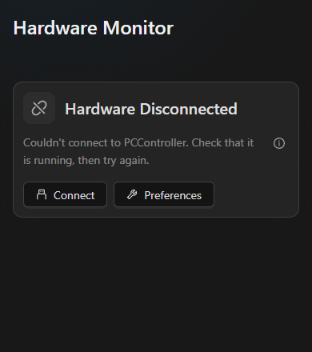
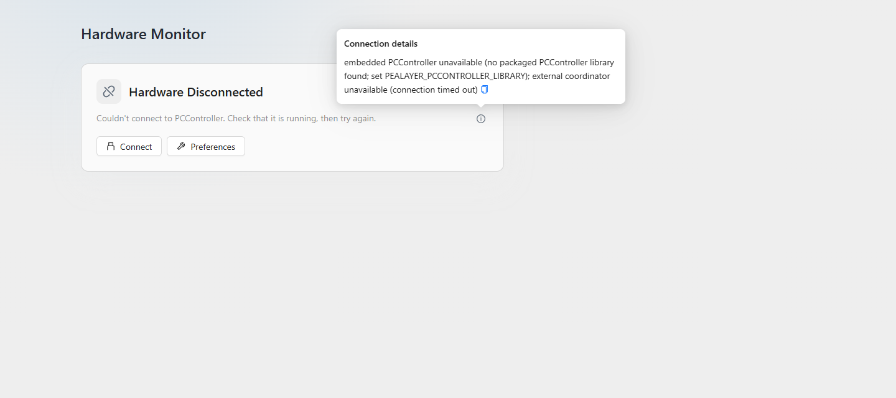

# Plain-language hardware connection messages

Hardware Monitor previously placed the engine's complete connection diagnostic
directly into the empty-state card. The local-library probe and external
connection failure can both be useful diagnostic evidence, but DLL names,
environment variables and nested transport errors are not default user copy.

The disconnected/retrying card now says:

> Couldn't connect to PCController. Check that it is running, then try again.

A connected controller whose controls could not be loaded instead says:

> Couldn't load the hardware controls. Try refreshing the connection.

The choice comes from existing connection/catalog state, not English error-text
parsing. Board absence and programming/recovery remain separate states; this
change does not claim a physical USB disconnection from a failed host connection.

A circled information control exposes the original diagnostic on hover or click.
Click keeps it available for reading/selecting/copying on touch and keyboard
interfaces too. The native menu and Web popover are width/height bounded and
the diagnostic is copyable. No original error is discarded, and there is no
new RPC contract, connection attempt, output command or polling timer.
English and Persian application copy are maintained on both surfaces.

## Verification

- Four native Hardware Monitor tests pass, including actual info-button clicks
  at 220/320/640-point widths in both themes, hidden-by-default diagnostics,
  retained originals, catalog/transport distinction and command-free rendering.
- Web model/controller-error checks and TypeScript passed.
- The real headless-browser fixture passes five unavailable states at
  390/768/1440 widths in both themes. It opens the info control, checks full
  diagnostics, verifies no overflow and confirms that no command was sent.
  It uses isolated fixture data, not a production board or connection.

These are actual browser captures of that isolated fixture, not production
connection/board evidence:

Package, full-suite and installation receipts follow below after verification.
Cafe deployment remains user-deferred until its normal connection returns.
