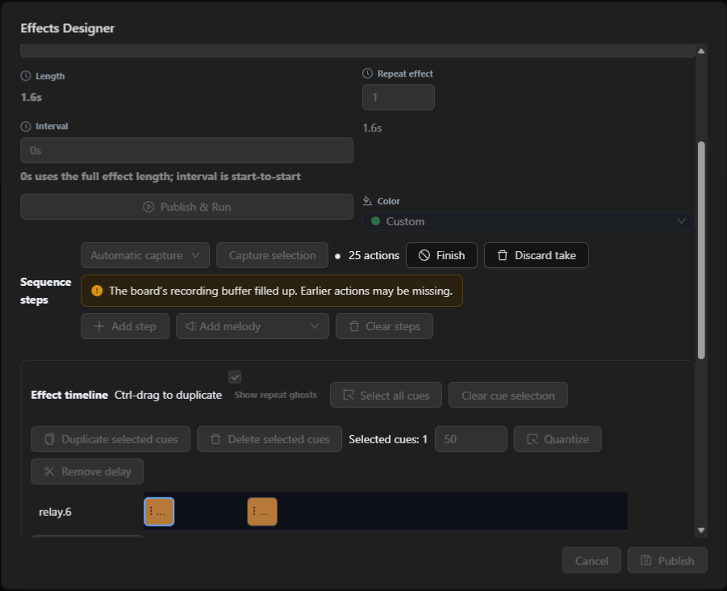
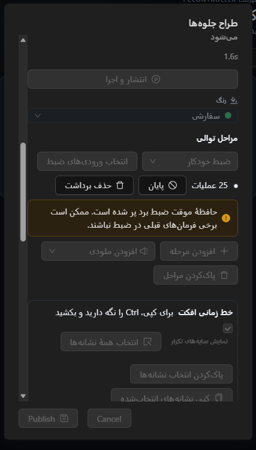

# Live media and board recording retention

Media controls present a non-seekable RTSP, RTMP, SRT or other recognized live
transport as live even when the demuxer reports a duration for its window.
Seekable finite media and ordinary finite media with seeking unavailable retain
their existing controls and status.

The Effects Designer now warns during board-retained capture when PCController
reports overflow. The earlier board actions may be missing from the saved take.
The integrated editor still shows current steps and keeps the existing Finish
and Discard actions. The capture contract and controller behavior are unchanged.

The archived source remains available at
[remote live media](https://github.com/ToghrolTP/pealayer/tree/archive/remote-live-media)
and [live recording](https://github.com/ToghrolTP/pealayer/tree/archive/live-recording-checkpoint).

## Verification

- Focused Rust tests exercised the production media classification function for
  pending metadata, durationless media, a non-seekable live stream with a
  positive duration, a seekable RTSP recording, and a locked finite HTTP file.
- The focused native regression passed against actual egui paint output for an
  active, overflowed board recording and for within-capacity, host and inactive
  capture states.
- The Web test renders the production Effects Designer in Edge with simulated
  controller snapshots. It verifies warning visibility, icon and bounds in
  English desktop and Persian mobile layouts, and absence in the three
  other capture states. No board commands were sent.
- Physical board and private streaming-source verification are tracked in
  [#40](https://github.com/ToghrolTP/pealayer/issues/40) and
  [#80](https://github.com/ToghrolTP/pealayer/issues/80).

