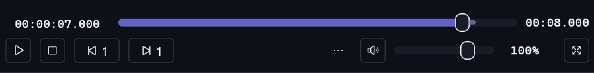
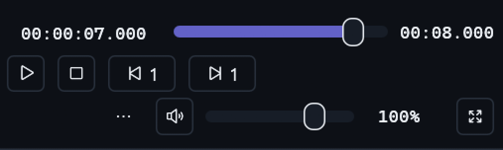

# Movable Program Monitor volume and focused defaults

Owner: [issue #80](https://github.com/ToghrolTP/pealayer/issues/80).

## Correction

The volume slider was painted in a separate fixed footer slot, outside the
shared customizable action bar. Moving the speaker moved only Mute, not its
slider. That also forced volume to remain after Fullscreen regardless of saved
action ordering.

Program Monitor now renders speaker, slider and percentage as one group owned
by the existing saved Mute action. Drag the speaker to reorder or move the
group between leading/trailing controls; its context menu calls it Volume.
Dragging or wheeling the slider still changes volume, not the workspace order.
The same current action identities, indexed flags, commands and narrow CAS
preference saves remain in use: no new layout format or migration is needed.

The native responsive footer measures this group as part of its chosen side.
When narrow it places leading and trailing groups on separate rows, retains a
full-width seeking row, and exposes genuinely omitted controls through overflow.
An overflowed volume group has working volume controls in that menu.

Monitor defaults hide Video/Audio/Subtitle pickers because NLE already exposes
them through track controls. They remain available in Show / hide actions.
Fullscreen is the final configured action; the overflow button precedes the
trailing group, and the terminal Fullscreen target stays inline when it fits.
Simple's independent layout and volume presentation are unchanged.

Web uses the same grouped action/order/visibility model. Slider pointer-down
cannot start its enclosing action's HTML drag. Mute retains its correct command
and accessible name rather than becoming a fake Volume command.

## Verification and instance settings

- 26 focused native tests passed: real speaker drag across groups, slider
  gestures without action drag, unchanged Simple layout, default visibility,
  Fullscreen/menu/volume ordering, RTL, every density, bounded 240/400/700/1400
  layouts, existing popups, and seek-preview behavior.
- An additional opt-in native test hovered the real preview path, decoded a
  finite synthetic video into a 320×180 texture, and retained the paused
  position without creating a seek.
- TypeScript checking and Web control-bar, media-control and responsive
  guardrails passed.
- Existing instance preferences were updated through the narrow, checked peer
  configuration API: hide the three monitor pickers, move Fullscreen last, and
  enable both monitor and Simple seekbar hover thumbnails. No default thumbnail
  preference or unrelated user settings were changed.
- The live thumbnail endpoint returned HTTP 200 with a 320×180 image from the
  currently loaded media, preserving its paused state and position. Private
  media and thumbnails are not published.

## Native captures

Actual isolated native rendering with Studio colors and synthetic media, using
the requested control layout. No private-production media appears here.

Medium: seeking owns its row; the movable volume group precedes Fullscreen.

Narrow: trailing controls retain their group on a third row.

Wide: one row, with Fullscreen at the outer edge.

The [earlier footer capture](../screenshots/nle-transport-medium.png) documents
the fixed-volume/visible-picker presentation before this correction.

## Delivered checkpoint

- [PR #259](https://github.com/ToghrolTP/pealayer/pull/259), implementation
  `056707fcc60b0d8e10c3a45f944519b9f5a24f47`, clean packaged source.
- Web/PWA integrity, native resources, all seven quick-action icons, libmpv smoke
  and standalone downloader resource/headless smoke passed. Duplicate package
  regression suites were skipped; the separate focused test results above are
  the executed tests.
- Graceful canonical update acknowledged in 15.7 seconds. Installed source and
  executable digest match the candidate:
  `d71f83f7e0bea3bf604ae3fc639b35a374ea48d9f8156c16cee27713da047668`.
- The application remains running and paused with no pending seek. Requested
  picker visibility, final Fullscreen ordering and both hover-thumbnail flags
  were independently read back after restart. The historical comparison was
  not replaced; the isolated review exited through its own process API.
- Native captures were inspected at 720, 1200 and 1800 logical window widths.
  React type/contract/responsive checks are not claimed as a new live browser
  gesture acceptance pass.
- Cafe deployment remains deferred by the user while its normal connection is
  unavailable. Local delivery does not claim remote deployment or user
  acceptance of the new drag interaction.
