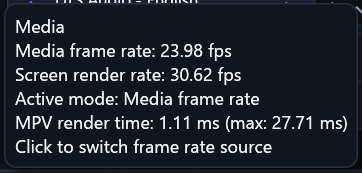
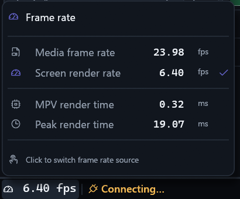

# Native FPS tooltip: published comparison

Owning repair: [PR #253](https://github.com/ToghrolTP/pealayer/pull/253).
History: [issue #228](https://github.com/ToghrolTP/pealayer/issues/228).

## Before

The original supplied screenshot shows the plain text tooltip, duplicated mode
narration and unaligned metrics. It is preserved without modification.

## After

This is an unretouched crop from the final installed native capture, not a Web
fixture or a reconstructed UI. The card has semantic source icons, aligned numeric
lanes, muted labels/units, dividers, one active-source check and a single hint.
The status counter below it uses regular weight. The factual live values and
selected source differ from the before image; this is not a performance benchmark.

The full capture contains private production movie context and is not published.
`scripts/crop-native-capture-windows.ps1` extracted the original pixel rectangle
`20,1410,410,340`, without redrawing, scaling or changing the source file. Original
capture SHA-256: `24902966320c8ea76bb7c443d9b46724371623a7660ee5dfcfe1b6bdbd8a3487`.
Published crop SHA-256: `c85bbbb48bc94960777974061fe3bcf2b391e9e2d1611766f6119bf132c09d61`.

The captured installed source is `a47b1063238c9dce67ec8667be489131ccd8bf09`;
its executable receipt is retained in the owning PR. The 27 native status tests
cover real popup geometry, changing values, mixed fonts, direction and fractional
scale. A static image does not independently prove sustained motion stability.
This publication closes the missing public-image step, not remote deployment or
human/physical acceptance. The full chronological status-bar gallery remains in
issue #228; this pair is the later tooltip repair, not a replacement for history.
