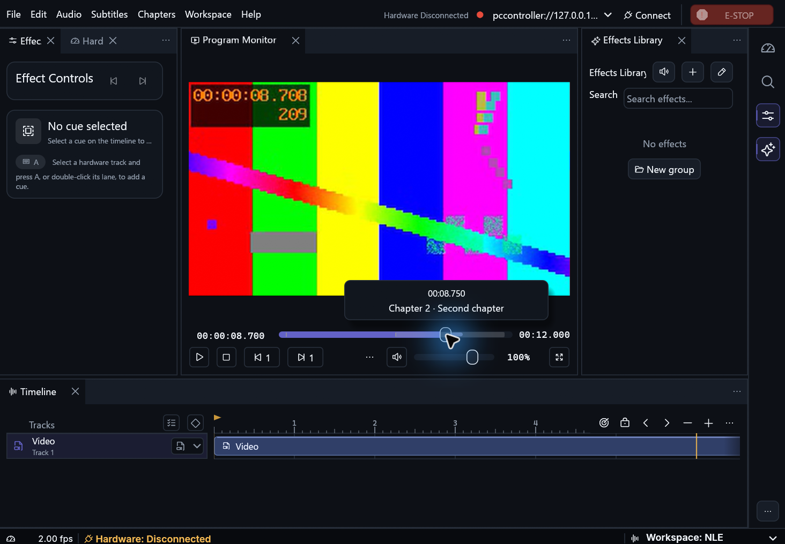
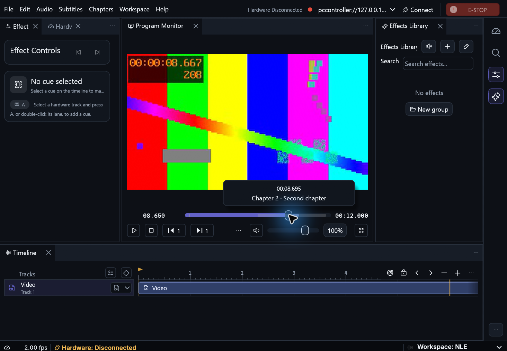

# Main player window flashes during seeking

The Windows report concerned the entire main player window. Pointer movement
alone stopped reproducing it, but seeking reproduced it in the
installed build.

The Simple and NLE seekbars now submit an exact seek on release without
queueing another preview in the same pass. Direct seeks share the scrub
pause/resume lifecycle and submit only the exact target. Preview seeks still
run while the pointer is held and moving. The Windows shell clears the legacy
thumbnail clip once per window or shell reinitialization. The app also clears
its client surface with the active opaque panel color before drawing.

## Windows verification

- Installed build `e2c9e06e` and candidate `12d0c481` both settled ten paused
  seeks, including zero and sub-frame positions. Both resumed from the final
  target after a series of scrub previews. Neither reported a libmpv render or
  update error during that sequence.
- The focused Windows seek test run passed 52 tests. The opt-in thumbnail
  decoder test was skipped.
- The same synthetic media, Studio dark palette, NVIDIA OpenGL renderer and
  980 × 680 logical-point client were used for the native seekbar comparison.
  The user repeated the seek on the candidate and reported no flash.
- ASUS GPU Tweak's OpenGL overlay was loaded in both tests. Its role in the
  reported flash was not established.
- The thumbnail helper's existing rectangle argument was retained for callers.
  The legacy shell call now depends on the window identity, while the rectangle
  still determines whether the custom video thumbnail should be enabled.

The captures show the settled UI after a native drag. They do not capture the
transient flash itself.

| Installed | Candidate |
| --- | --- |
|  |  |
