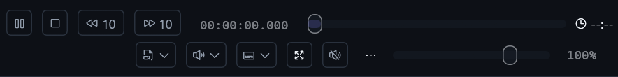
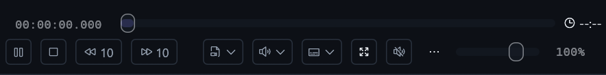
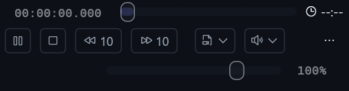
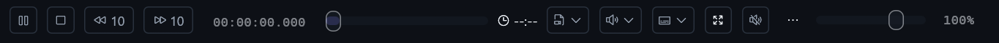

# NLE transport: measured reflow and working overflow

The earlier two-row layout kept transport beside a compressed seekbar, then put
selectors and volume on a trailing second row. Smaller monitors fell through to
four rows, and wide custom action sets silently scrolled horizontally.

The revised layout measures the current action configuration and control density:

| Available panel space | Layout |
| --- | --- |
| Wide | One row: leading transport, elastic seekbar/time, trailing selectors and volume |
| Medium | Dedicated full-width seekbar/time row; transport left, selectors/volume right below |
| Narrow | Seekbar/time row, balanced action row with real overflow, trailing volume row |

Breakpoints come from measured group widths, not screen/device names. The video
reserves exactly the chosen footer height. RTL mirrors the clusters, and changes
in row count retain widget/drag identities and user action ordering/visibility.
Buttons that do not fit a narrow monitor group are available as real commands in
its trailing overflow menu, not clipped or stranded in an invisible scroller.

The first real native narrow capture also exposed an allocator shrinking the
action lane to its visible prefix, leaving the overflow button short of the pane
edge. The lane now reserves its exact measured bounds. A rendered trailing-edge
assertion guards it across densities and RTL, and medium rows reserve a distinct
inter-cluster gutter rather than packing transport against the track selectors.

## Three-dot failure and regression

The left-click `Popup::menu` and secondary-click `Response::context_menu` both used
the response's default popup ID. The secondary handler closed the primary popup
on the same click. A rendered-pointer regression reproduced this failure before
the fix (`left-click overflow menu disappeared on Monitor`). Primary and secondary
menus now have independent identities on Simple and NLE surfaces, matching the
existing media-track selector fix. Menu painting never invokes transport.

Focused tests cover real menu clicks after reflow, use of an omitted command,
custom action sets, exact-fit boundaries, bounded footer geometry and RTL. Live
native captures and installed-runtime receipts are recorded in the owning PR;
tests alone do not establish visual or playing-video acceptance.

The earlier isolated review was closed normally after the user closed its
Preferences window and a fresh authoring read reported clean. Regular settings
and hardware were not used as fixtures. Cafe deployment remains user-deferred
until its normal connection returns.

## Native gallery and delivered checkpoint

These are actual Win32 captures, not mockups: Studio/dark, the same NLE workspace,
no media, hardware auto-connect disabled, 150% display scale. Medium before/after
captures use identical 1200 × 800 logical window dimensions and the same crop.
Narrow and wide windows use 720 × 800 and 1800 × 800 respectively. Pixel values
were not recolored or composited; captures were cropped to the transport region.

Before (earlier running toolbar):

Medium, with seek/time above the separated leading/trailing clusters:

Narrow, with a trailing overflow target and retained horizontal volume control:

Wide, when the measured controls and timeline fit in a single row:

- Installed source: `c7c2a186fb5400801f62da00ebfd67bc927641c7`.
- Installed/package executable SHA-256:
  `5f1f5051da83af9ee1ab465757824738f33bd61652bc8e866bddcaa46a2654c4`.
- 8 NLE layout tests and 7 control-bar tests passed; the old primary overflow
  failure was reproduced before the popup-ID fix. Parent sidebar (29) and
  Preferences (68) suites also passed; those suites overlap other filters.
- Package checks verified TypeScript/Web/PWA, resources, task icons, libmpv smoke
  and standalone utility smoke. Duplicate full regression suites were skipped.
- Local peer update used a fresh clean authoring gate, gracefully restarted and
  reports the matching installed source. The isolated review was cleanly quit.
  Its embedded Preferences fixture was used to inspect Sidebar rail settings;
  the regular application's native-dialog preference was not changed.
- This checkpoint includes the sidebar feature from PR #256. Its former local
  review-lock blocker is resolved. Cafe deployment is still user-deferred.
