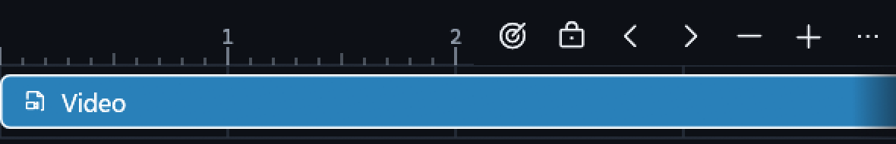

# Paused playback and truthful timeline state

Owner: [issue #80](https://github.com/ToghrolTP/pealayer/issues/80).
This follows the NLE transport work; it does not replace the earlier renderer,
taskbar, or exact-zero-seek fixes.

## Causes and corrections

| Symptom | Cause | Correction |
| --- | --- | --- |
| External clock jumps on pause/resume | Projection reused its last sample's timestamp after changing pause, buffering, seeking or rate flags. Resume could add time spent paused, and pause could expose an older raw time sample. | Re-anchor before changing clock flags. Fetch one factual time-position over the existing serialized IPC writer after a transition. Match its request and revision; discard superseded or replaced-media replies. No periodic property polling or second connection is added. |
| Dual preview changes while paused | Every unrelated notification could compare the preview to an old raw time and issue another exact seek. | Wait for the transition's confirmed clock. Use projected time during playback, frame-aware tolerance while paused, and at most one successful correction per unchanged paused target. |
| Internal resume can abandon the selected frame | Explicit Play unconditionally reset/cancelled a pending exact scrub commit. | Retain that commit and record resume intent; the existing decoder-completion and hardware-readiness gates still own resuming. Explicit Pause cancels that resume intent. Ordinary Play does not add a new seek. |
| Selected video/audio strips look inactive | External processing drained native property events and adopted the remote catalog, but omitted its selected video/audio/subtitle IDs. Timeline activity uses those IDs. | Adopt the authority's cached IDs without issuing new RPC reads. Keep legitimate unselected/disabled, mute/solo/lock and repeat-ghost presentation. No workspace reset or transparency preference mutation. |
| Reveal-playhead is always available | The action fell through the toolbar's unconditional enabled branch. | Calculate visibility from the actual painted position, including an active scrub target and seven-point ruler handle. Dim and prevent invoking the button and its ruler-menu counterpart when already visible; retain customization/dragging. |

The external bridge omission traces to its original integration, rather than
the recent footer reflow. The old fixes for paused sub-frame authoring and
the renderer's committed last-good texture remain intact.

Source lineage: the [external integration](https://github.com/ToghrolTP/pealayer/commit/945207bcb75930eb7c5451c59d1baa5bee7c2c2a)
introduced the external clock/mirror paths; [timeline state synchronization](https://github.com/ToghrolTP/pealayer/commit/ce859047860a3c30e3b90d58eddbc3ee50af9dd0)
added the unconditional scrub reset in Play. This follow-up preserves that reset
for ordinary playback while keeping a still-pending exact commit alive.

## Verification

- Focused clock/toolbar/visibility/resume tests, including actual toolbar pointer
  input and dimmed versus available glyph paint.
- Real libmpv, finite 25 fps Y4M file, null audio/video outputs: paused position
  stays fixed; Play issued before a second exact commit finishes resumes at
  that committed frame rather than the previous paused position.
- Real external mpv over Windows named-pipe JSON IPC: paused authority position
  equals the client clock and remains unchanged; the selected video track is
  active/enabled; dual preview holds its decoded position across unrelated
  volume notifications; attach/detach preserves an externally owned player.
- Test files and configuration are isolated. No production media, hardware
  outputs or historical comparison installation are used by these tests.
- Native moving-GPU/user visual acceptance and Cafe deployment remain distinct
  from null-output decoder tests. Cafe is deferred at the user's request while
  its normal connection is unavailable.

## Native captures

Actual enlarged native captures from the isolated, hardware-disconnected dual
player, using the same Studio palette and a synthetic media file. These are not
mockups or private-production media captures.

Complete playhead visible: the target/reveal action is dimmed; the selected
video strip remains solid (1200-point window).

Playhead offscreen: the action is available without moving the viewport or
seeking automatically (720-point window).

## Delivered checkpoint

- [PR #258](https://github.com/ToghrolTP/pealayer/pull/258), implementation
  `4012c24412c842d0c73f11beb07361b08c3f9165`, clean packaged source.
- 207 focused tests passed; the separate real internal decoder and real external
  named-pipe/dual-preview tests both passed. Package duplicate test suites were
  deliberately skipped, not counted as rerun.
- Web/PWA bundle integrity, native resources, seven quick-action icons, libmpv
  smoke and standalone-downloader identity/headless smoke passed.
- Canonical executable updated through the graceful peer updater, with restart
  acknowledgement in 15.9 seconds. Installed source and executable digest match
  the staged candidate:
  `f914fbf2305c05a87d044e29eeb5f3e679e0478e71313c3d28d548162ae6a0c9`.
- Host libmpv retained:
  `e56ce67cd00f06a59dc7ed5b97a49a9182a381554c755dc4570a52af1ef30e65`.
- The regular application is running with the same media and paused position,
  no pending seek. The historical comparison remains untouched. Review and
  owned external test player exited through their own APIs/IPC after capture.
- Actual native dual-preview rendering and toolbar appearance were inspected.
  The user's own external-player pause/internal-resume acceptance remains a
  separate feedback gate; no broad moving-GPU soak or Cafe deployment is claimed.
