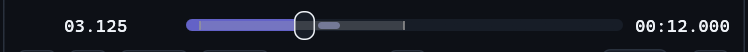
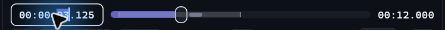
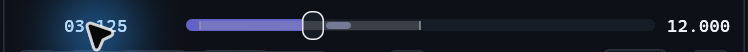

# Native playback interaction follow-up

Continues [#80](https://github.com/ToghrolTP/pealayer/issues/80) and the Simple
playback work in [#291](https://github.com/ToghrolTP/pealayer/pull/291).

## Changes and causes

| Report | Cause and correction |
| --- | --- |
| Text following the FPS value is not vertically centered | The unit inherited the digit baseline, including the `p` descender. Paint the numeric value with its stable digit reference and center the separate regular-weight `fps` unit by visible ink, like the icon and surrounding status captions. Slot budgeting remains stable. |
| Cannot type a volume value | The percentage was a Label, not an input; Simple had only a slider. Native transports now have a bounded editable percentage. Slider and numeric edits use the same SetVolume command, preserving the speaker's existing reorder ownership. |
| Elapsed field clipped at the bottom | A 22-point allocation conflicted with actual monospace metrics, margins and density. Measure the complete edit mask and reserve the same font-aware row in the Program Monitor footer. Display and edit states retain the same outer metrics. |
| Unnecessary leading elapsed groups | The elapsed display, elapsed editor, duration, and remaining time omit hours for sub-hour media and minutes for sub-minute media. The visible groups keep their separators and can be selected directly. Copy uses the visible timestamp. An explicit fractional paste preserves its seek precision. |
| Clicks in the monitor letterbox toggle playback | Input used the full available panel while the video was fitted to a smaller rectangle later. Rendering and gesture hit testing now share one fitted rectangle. `video_click_frame_only` defaults true; Preferences → Input → Video surface allows the entire monitor instead. Native and Web use the same contain geometry. |
| Upper-right hardware context menu has no effect | The menu-bar status caption was a hover-only Label with no context handler. It now has real Hardware Monitor, exact Hardware Preferences navigation and Copy endpoint actions. The bottom connection widget also has Hardware Preferences; its existing menu passes real secondary-click/choice tests. |
| Browser links cannot be dropped | The OLE target only requested CF_HDROP and required COPY. It now accepts bounded Unicode URL/text formats, ASCII/UTF-8 URL text and LINK-only sources, releases each STGMEDIUM, rejects non-media schemes/malformed data, and dispatches one typed Open command. File URLs become local paths. Remote links use the established owner/proxy/draft/external-player path, not filesystem import; the hint is Open link without signed query details. |

## Media keys: observed facts and correction

Read-only inspection of the regular installation found the correct HWND hook,
media present and media keys enabled. Windows' published session matched paused
state, exact position, duration, rate, title and artwork. Thus this was not an
absent/disabled native media session.

The existing paths handled WM_APPCOMMAND and the Shell-selected SMTC session,
but did not claim foreground VK_MEDIA keyboard messages before default Windows
processing. The focused HWND now handles Play/Pause, Stop, Previous and Next
before that fallback. It consumes repeat/release without issuing duplicate
toggles, retains dispatch-time scope validation and leaves volume/ordinary keys
OS-owned. This adds neither a global keyboard grab nor another SMTC registration.
Two non-sensitive diagnostic counters distinguish foreground keys and app-command
messages at `/api/player/taskbar-preview` → `shell_commands`.

Windows documents the conversion of media keys by DefWindowProc in its
[keyboard input overview](https://learn.microsoft.com/en-us/windows/win32/inputdev/about-keyboard-input).
The source correction and message-policy tests do **not** prove which path this
physical keyboard takes; focused real-key acceptance after installation remains
required. No production playback/hardware output was actuated to test it.

## Typography deliberately deferred

[#292](https://github.com/ToghrolTP/pealayer/issues/292) tracks proportional,
tabular-figure elapsed/duration typography, including editing, pointer selection,
locale, font overrides, native/Web parity and before/after evidence. As requested,
this pass fixes clipping without prematurely replacing that editing font.

## Verification and delivery gates

- Full isolated native library pass: **1,360 passed, 0 failed, 6 opt-in ignored**.
- Subsequent refinements passed the 27 transport/input checks, two actual COM
  file/URL drop checks and the drop-feedback privacy check; the final Open-route
  reuse is rechecked through the existing dropped-file dispatcher regression.
- Actual pointer tests cover volume typing, shortened-time group selection,
  font/DPI clipping, picture versus letterbox actions, the trailing hardware menu
  and opening/rendering the exact Hardware Preferences page from the upper label.
- TypeScript and Web media policy/picture hit tests, control-bar, elapsed mask and
  status-widget contracts pass. These are not a real browser-to-window drag or
  physical-key screenshot receipt.
- No final native screenshots or installed-build acceptance are claimed yet.
  Packaging must run from the committed clean source; the prior user invocation
  safely refused while this new follow-up was being edited. The earlier shared
  staging replacement denial remains a separate possible blocker, not resolved
  by compilation or that clean-source refusal.
- Current-instance `video_click_frame_only=true` must be applied/read back through
  the configuration API after that runtime supports the field. The older running
  installation has not been silently changed to disable all clicks instead.
- Cafe deployment remains explicitly user-deferred/offline. Existing review and
  historical applications, private media and hardware outputs remain preserved.

## Compact elapsed editing

The Windows comparison used the same 12-second synthetic clip at `03.125` in
builds `99db8840` and `0aecc948`. The elapsed text now keeps the same format
on focus, and the duration reads `12.000`. Typing into the selected seconds
group and pressing Enter settled playback at exactly `07.125`. The focused
Windows runs passed 30 transport controls and 12 Program Monitor tests.

| Build | Display | Editing |
| --- | --- | --- |
| Before |  |  |
| After |  |  |
