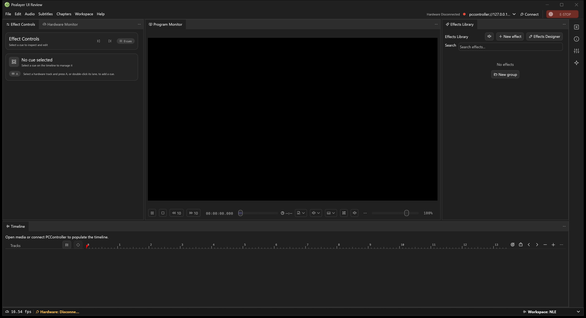
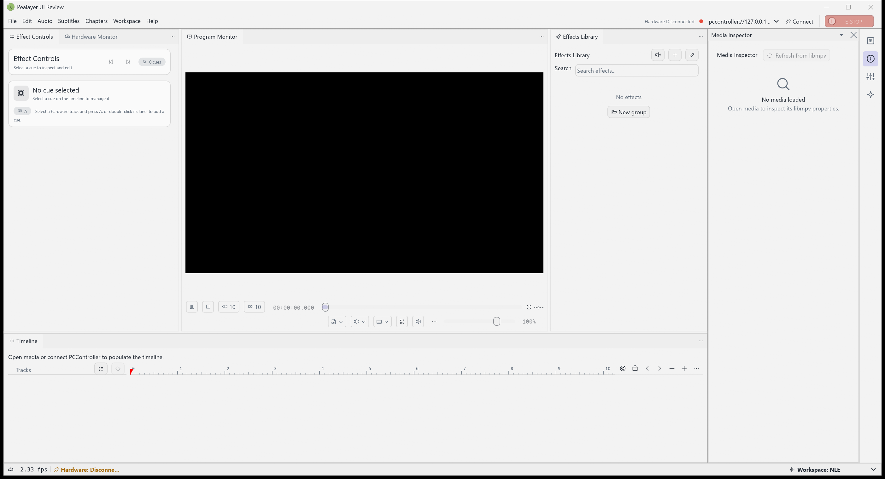

# Pull-request integration and remaining acceptance

Owner: [issue #80](https://github.com/ToghrolTP/pealayer/issues/80).
This is a source-integration ledger, not an installation or physical acceptance receipt.

## Reviewed integrations

| Change | Source disposition | Verification boundary |
| --- | --- | --- |
| Native opcode admission, #223 | Merged; immutable PCController-owned source and generated views retained | Both complete exact-head native/Web matrices and CodeQL passed; local generated-source check passed. Local raw GitHub fetch timed out, while hosted immutable upstream verification passed. |
| Effects Library double-click, #220 | Merged; shared Manage path, action-gutter and inline-draft guards retained | Both complete native/Web matrices and CodeQL passed, including real pointer-event coverage. |
| Ant Design patch, #221 | Merged; reviewed manifest, integrity lock and unchanged MIT license | Complete native/Web/PWA and CodeQL checks passed. |
| Cargo updates, #222 | Merged; reviewed uuid/zip/notify and platform transitive changes | Complete four-platform native/Web and CodeQL checks passed. |
| Decoder clock and exact-zero seek, #217 | Merged after the paired PCController reservation contract in #701 | Both complete combined-head matrices and CodeQL passed. The 50 ms execution/read and 250 ms freshness limits remain unchanged. |
| Strip preview command, #212 | Preserved on main through #217; duplicate draft closed | The unified `effect play` command is verified in merged source. Its old failed aggregate followed a cancelled duplicate; another complete exact-head matrix passed. |
| Strip designer and deliberate probes, #218 | Automatically marked merged when #217 included its complete history | Designer/probe/UI modules match; the remaining layout difference is the later reviewed double-click improvement. Optical/human and installed acceptance remain separate. |
| Craft UI docking, #216 | Current-main integration completed; final hosted checks pending | Native/workspace/Web/PWA checks, actual light/dark captures and a host-compatible package passed. Final review added mode-only profile ownership coverage; the replacement package and complete exact-head platform checks remain required. |

## Craft docking repairs

- Preserve both the fork's CoreText dependency and notify's CoreServices dependency
  when resolving the lockfile overlap; retain current opcode admission and the
  merged library-card interactions.
- Keep pane chrome Close/resize authoritative over stale pre-render state, while
  retaining the content callback that docks a pane back into the workspace.
- Save changes to pane visibility, selection, rail enablement and width. Coalesce
  pointer-driven layout saves until release; unchanged frames do not write.
- The docking library already activates a visible requested tab. Report actual
  layout/selection changes so that callers persist those changes too.
- A disabled rail is not a visible panel, and must not swallow a request to open
  that panel in the dock. Reject rail moves when workspace permissions reject
  removing the docked panel, rather than rendering duplicate owners.
- Adapt Craft surfaces/text to the selected Pealayer palette and select stored
  light/dark tokens from the active context theme, including live System changes.
- Handle the host-owned Maximize and Auto-collapse menu events instead of dropping
  them. Preserve their local state in the existing egui workspace/session memory,
  clear maximization for closed panels and retain a compact per-group Panels menu.
- Pass the existing modal-layer input shield into DockArea, including cancellation
  of a pre-existing drag when a modal takes input ownership.
- Preserve document scrolling that the former docking engine supplied. Effect
  Controls keeps its wheel scroller; fitted video and independently scrolling
  Hardware Monitor/Effects Library/Media Inspector do not get a second scroller.
- Require the current workspace envelope before deserializing. Upstream serde
  defaults must not turn unrelated/malformed objects into an empty layout and
  silently close every panel. Runtime reload rejects invalid layouts before
  changing preferences, preserving the last valid workspace. No legacy adapter
  or format migration is introduced; installation still needs private backup and
  explicit workspace-format acceptance.

New regressions cover pane Close versus stale state, Dock to Workspace with resize,
disabled-rail ownership, existing-tab activation, palette/theme selection,
host-owned menu-state round trips, real tall-form wheel input and nine
viewport/scale render combinations. Selected icons use contrast ink, not accent
ink on an identical accent fill.
Rust parse, whitespace, generated-opcode and low-write policy checks passed locally.
Dependencies now use the existing shared cache. A local full native run reproduced
the hosted failure: the test computed a raw tuple ID whereas the fork's ScrollArea
first wraps that tuple in IdSalt. Corrected readback still requires actual wheel
scrolling. The combined branch subsequently passed 1,016 native unit tests and the
entire workspace integration suite, including all 13 public workspace tests and
the transfer regressions. The additional sidebar raster regression brings the
latest pre-review native unit result to 1,017 passed, one explicitly ignored external-mpv
acceptance test, and no failures.

The Web regression/build/PWA pipeline passed with the exact npm lock dependencies
after refreshing stale installed packages. Its 52 contract checks and responsive
guards are automated source evidence, not a phone/tablet touch acceptance claim.

Actual native capture found black sidebar icons: standalone SVG `currentColor`
defaults to black, which stays black under Rail's multiplicative tint. White
alpha masks now let the live light/dark/theme tint work. A real SVG raster test
checks nonempty transparent masks and white premultiplied ink for every icon.

Native visual review uses isolated settings, no media, no hardware connection and
the maintained read-only capture utility. A third-party GPU Tweak OpenGL overlay
initially crashed the process; Windows identified `GTIII-OSD64-GL.dll`. After the
user authorized closing the unresponsive overlay application, the native window,
health endpoint and paused/disconnected status became available. No ASUS service,
GPU tuning setting or startup preference was changed. New hosted exact-head
platform checks remain a separate mandatory merge gate.

The normal current-main merge also includes #224's timeline cue persistence and
unsaved-change protection. Its close-request check runs before the retained
pointer-release layout-save coalescing; neither side is discarded.

### Reviewer ownership and navigation follow-up

The completed automated review identified five additional real interaction gaps.
All are repaired without removing relay recording or panel functionality:

- Disable PaneHost's donor F6 handler. Pealayer's existing shortcut dispatcher
  remains the sole owner of the F1-F8 relay-recording shortcuts.
- Process explicit reveals before building the dock. Clear a different maximized
  panel and persist that view state so the requested panel is actually visible.
- Forward the final explicit reveal to `DockArea::raise_panel`. Requests made by
  panel bodies survive until the following render instead of being drained after
  the builder has already run. Floating placement is retained.
- Capture and restore rail open/enabled/width state with named workspace profiles
  and the automatic session snapshot. Restore dock/rail ownership transactionally;
  an unrelated previously open rail cannot steal a restored panel.
- Route menu pane opening through the application helper: enter the editor from
  Simple mode and respect locked dock ownership before changing visible state.
- Mode-only profiles without a saved dock arrangement retain the current dock
  and rail together. Changing Simple/NLE mode must not strand a panel by clearing
  only its rail owner; captured profiles still restore their full arrangement.

New input/model/profile regressions pass in the full local native unit suite:
1,022 passed, zero failed, one opt-in external-mpv test ignored. The full workspace
suite passed before the final mode-only profile regression; its final rerun and
hosted checks remain required. An earlier package attempt was canceled rather than
publishing a superseded build; the repaired package subsequently passed resource,
runtime-identity and smoke verification and is being refreshed for the final fix.

The isolated packaged application's live RPC path also created, captured, changed
and restored a named rail profile. Readback verified its enabled state, owner and
420-point width; the temporary test profile was then deleted. Synthetic local
video decoding, advancing elapsed time, Pause and exact-zero seek settlement were
observed without a controller or physical outputs. This does not establish
production-host, audio or taskbar/GPU acceptance.

## Remaining branch history

The current-main integration retains the already-applied model/native-service
and strip-dispatch histories through normal, zero-tree-change merges. It does not
rewrite or force-push their owners' work.

| Retained source | Current disposition | Follow-up owner |
| --- | --- | --- |
| Remote/live-media investigation | Current media classification, credential redaction, RTSP TCP preference, seekability and buffer projection are present and covered by current tests | Exact old head retained as `archive/remote-live-media`; do not reintroduce its obsolete application structure |
| Unified-control-port investigation | Current HTTP/WebSocket/NDJSON/native-IPC routing supersedes the earlier split-port changes | Exact old head retained as `archive/unified-control-port`; keep one current shared typed contract |
| Windows-readiness stash recovery and exact stash archive | Old source and generated assets are preserved, not silently overlaid on the current application | Exact tags `archive/windows-readiness-review` and `archive/windows-readiness-exact-stash`; #30 / #80 own any individually useful recovery |
| Live-recording checkpoint | Current isolated catalog refresh, recording preview and event-triggered refresh preserve its central behavior | Exact tag `archive/live-recording-checkpoint`; #40 / #141 retain recording and physical acceptance requirements |
| DirectComposition experiment | Intentionally not merged: it carries a separate native-renderer topology and unaccepted overlay, taskbar, minimized/paused-frame and device-loss behavior | #64 / #65 / #66; preserve the branch until deliberate renderer integration is verified |

The renderer branch also carries unique non-renderer work, including configurable
double-click/hold deferral, richer subtitle placement/color policy and PWM
envelopes. These are not declared delivered merely because the branch is durable.
Port them against the current shared Preferences, startup, media-clock admission
and authoring contracts in focused changes; old constructors and raw unpause
paths must not bypass today's coordinator readiness handshake.

Each archival tag was published and independently checked against the original
remote head before retiring that obsolete branch. No source or generated recovery
asset was deleted from Git history. This is preservation, not a claim that every
historical hunk is appropriate for today's application.

## Native visual evidence

These are actual read-only captures of the isolated current native application,
not mockups. They contain no user media, saved effects or physical board data.
The light capture also shows the Media Inspector in its resizable property rail.
Real content, GPU playback, physical control and touch acceptance remain separate.

## Preserved boundaries

The three existing stashes and the detached timeline-toolbar worktree are retained.
No production executable, settings, media draft, firmware, physical output or
PCController/PakarController source is changed by this reconciliation pass.
Platform builds after merges are tracked separately from the reviewed PR matrices.
Cafe deployment is blocked in this pass: its configured SSH endpoint refuses the
connection. No production replacement, draft discard or physical test is implied
by the successful isolated local build and native capture.
