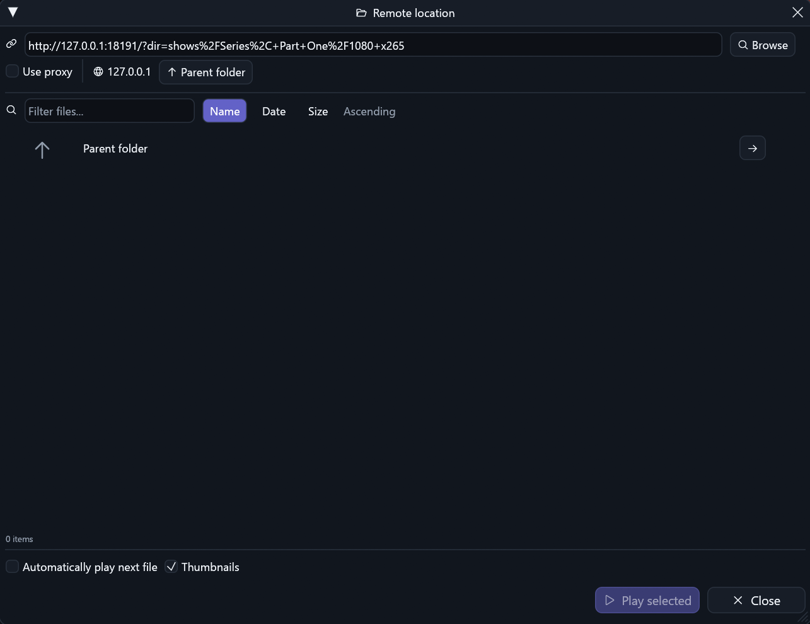
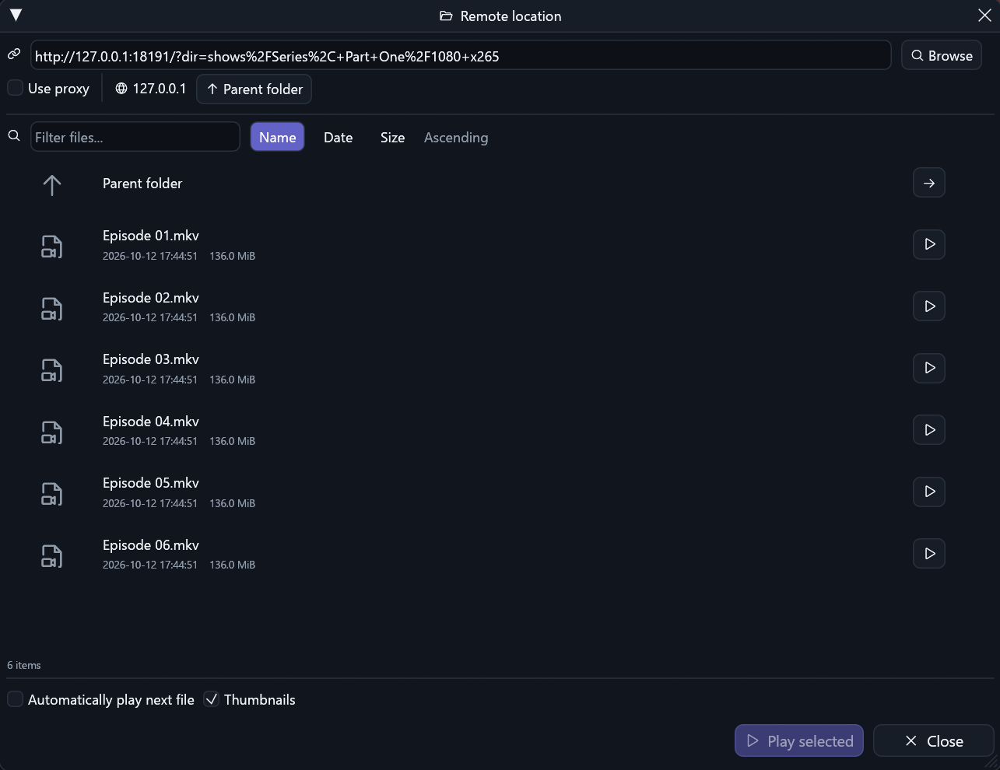

# Remote directory URL encoding

Owner: [PR #275](https://github.com/ToghrolTP/pealayer/pull/275),
part of [#80](https://github.com/ToghrolTP/pealayer/issues/80).

## Cause and correction

The server already exposed ordinary HTML file links. The shared browser instead
discarded every entry when a query-based directory used punctuation whose URL
spelling differed from its file links: `Series, One` versus `Series%2C%20One`.
The virtual-directory conversion and serialized-prefix comparison originated in
the initial shared browser (`9cbb0c08`); the later parent-navigation repair did
not introduce that comparison. Existing fixtures covered spaces but not escaped
punctuation in directory names.

Compare decoded path **segments**, not serialized strings or a fully decoded
path prefix. Query form decoding happens once; physical path decoding happens
once and never treats a literal plus as a space. Literal percent sequences and
non-UTF-8 path bytes retain their identities. Same-origin, immediate-child and
credential checks remain enforced; encoded separators and traversal segments
cannot become accepted file names. Parent verification uses the same identity
comparison, retaining its actual-request availability check.

Both native and Web browsers consume this shared discovery result. No second
scraper, server-specific hostname rule or presentation-only workaround was added.

## Verification and local delivery

- The synthetic comma/space query regression fails before the fix: zero items
  instead of one. All **19 focused remote-browser tests pass** after correction.
  They include encoded punctuation, percent/plus preservation, Unicode, path
  scope, metadata, ordering, unavailable parents, redirects and stale requests.
- Clean code checkpoint: `db2b6a96b33db3c266b818ab7779d026313001b7`.
  Cached release compilation took 3m 04s. Web compilation/PWA integrity, native
  runtime smoke probes, downloader identity and Windows action-icon checks pass.
  Full regression suites and hosted CI were not waited on for local delivery.
- Fresh native authoring inspection was clean. The canonical app acknowledged
  its graceful peer update in 17.5 seconds. Installed and packaged executable
  SHA-256 both equal
  `708d4b3012733f9b6a80aa7d083c695a4531145978479af7071259e48e68c314`.
- The user's actual clipboard directory now returns and visibly renders **six
  playable files**, each with size and date, plus verified parent navigation.
  Real thumbnails began appearing. Its URL, names and production captures remain
  private. Browsing did not start a file or change the existing paused media:
  position 578.286 seconds, duration 5688.662 seconds, volume 57% were preserved.
- The actual native captures below use the same synthetic HTTP listing, palette,
  scale, viewport and crop on the installed before/after builds. Synthetic files
  deliberately contain no video data, so their placeholder icons do not claim
  thumbnail decoding. The original clipboard directory was restored afterward.
- Cafe deployment remains **user-deferred/offline**, not delivered or verified.
  Historical/review instances and their editor/terminal state remain untouched.

## Native comparison

Before: a recognized directory incorrectly appears empty.

After: all six entries appear with metadata and playback actions.

