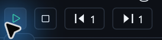
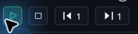
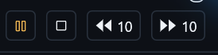
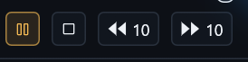
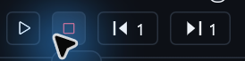
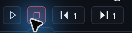
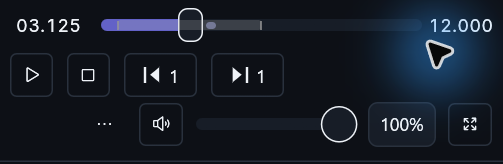
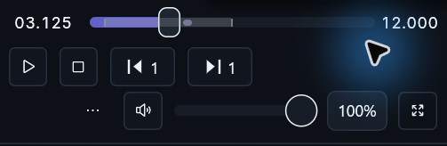

# Native transport semantic frames

[The shared bar sizing change](https://github.com/ToghrolTP/pealayer/pull/167#issuecomment-6782806218)
made Play/Pause and Stop use the same density for both dimensions.
[The frame refactor](https://github.com/ToghrolTP/pealayer/pull/216#issuecomment-6782806299)
kept semantic glyph ink while taking the fill and stroke from the generic
CraftUI style. [Extra compact](https://github.com/ToghrolTP/pealayer/pull/225#issuecomment-6782806233)
and [the later reflow](https://github.com/ToghrolTP/pealayer/pull/268#issuecomment-6782806226)
retained density ownership.

The transport paints the glyph, one-point inside stroke, and subtle fill from
the same role for hover, press, and active playback states. The keyboard focus
ring is inset so it can appear alongside the semantic stroke. Disabled actions
have dimmed ink and chrome. Idle actions use a neutral fill by default.
**Appearance → Advanced tweaks → Show idle transport button backgrounds**
controls that fill for Program Monitor and Simple.

## Matched native captures

Both builds ran the same 12-second synthetic clip at 150% Windows scale with
the Studio dark palette and the same window client height. The wide client
is 1000 × 680 logical points at Compact density. The narrow client is
710 × 680 logical points at Regular density. The hover pairs are paused
at 3.125 seconds. The Pause pair captures live playback at 0.25× from
the same starting seek. The images are unscaled crops aligned to the controls.

| State | Before | After |
| --- | --- | --- |
| Paused, Play hovered |  |  |
| Playing, Pause active without hover |  |  |
| Paused, Stop hovered |  |  |
| Narrow, paused at Regular density |  |  |

## Measured targets

The native render test measured the complete square hit target in logical
points, including the font-driven minimum. The measurement uses the test
renderer font metrics. The Windows captures show the visible frame and have
different font and pixel-rounding metrics.

| Density | Shared minimum | Measured square | With 26-point Button text |
| --- | ---: | ---: | ---: |
| Extra compact | 18 | 19 × 19 | 37 × 37 |
| Compact | 24 | 27 × 27 | 45 × 45 |
| Regular | 28 | 31 × 31 | 49 × 49 |

A horizontal pixel sample measured the same 38-pixel Compact frame and
43-pixel Regular frame before and after, including antialiasing. At 260 points
the large-text test also verified that a volume group which cannot fit stays
reachable through overflow. The render tests check frame and text ink, pointer
hit rectangles, focus inset, and reflow in both directions. The Simple bar
runs the same paint tests with its optional Stop action enabled.
