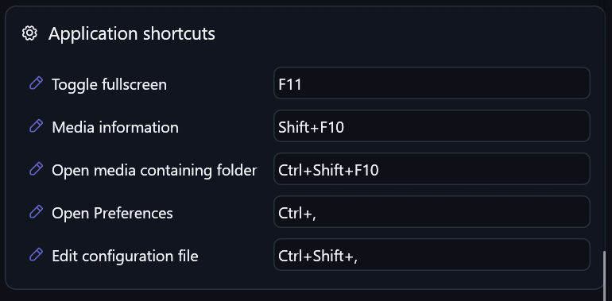
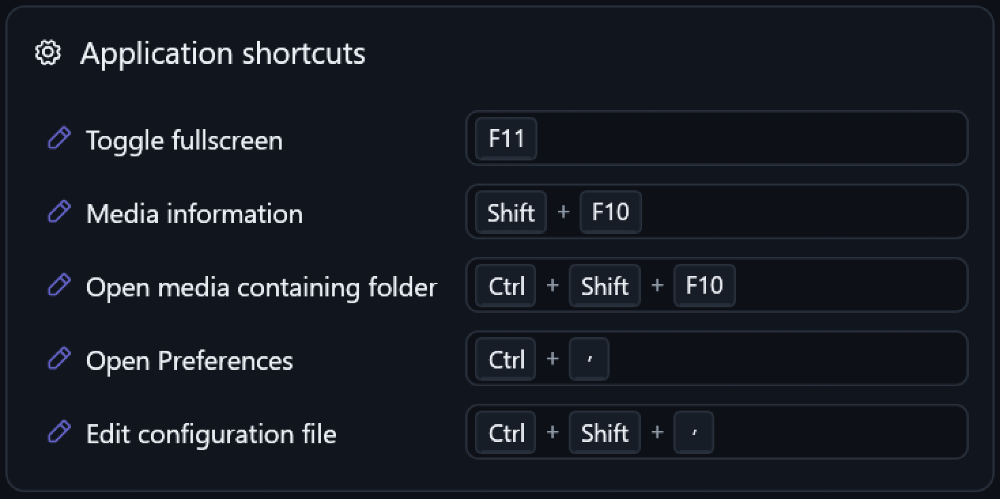

# Shortcut field keycaps

Owner: [issue #80](https://github.com/ToghrolTP/pealayer/issues/80).

Application shortcut values now display as individual keyboard keycaps inside
their input fields. Modifiers and the final key use a quiet raised-key surface,
rounded border and lower lip; plus separators use muted ink. The native painter
uses the current palette, UI font and shared control density, with visible-ink
vertical centering and bounded clipping/ellipsis for narrow fields. Chords retain
their logical left-to-right order in right-anchored RTL fields.

These are decorative keycaps, not extra focus targets or a new binding recorder.
Clicking or tabbing into the field restores its existing text editor, including
copy/paste, selection, typing and accessible raw value. Focus/blur alone does not
change the shortcut or dirty Preferences. Existing binding strings, validation,
save behavior, defaults, global registration and dispatch are unchanged. Other
text fields remain ordinary inputs. Web Preferences uses equivalent keycaps and
reveals its standard input on focus without changing its dimensions.

## Verification

- Complete native UI suite: **566 passed**, one intentionally ignored.
- The three focused keycap tests cover labels/punctuation, actual pointer focus,
  select/copy/paste/changed flags, and 160 native theme/palette/density/font/RTL/
  width combinations at fractional display scale. Caps/ink are centered and
  clipped, and rendering never rewrites the stored value.
- Web: TypeScript checking and existing preference-file checks passed. The real
  isolated Edge fixture passed 24 theme/palette/RTL/phone/tablet/desktop cases,
  with centered keycaps, unchanged blur, text entry, one commit and fixed geometry.
  It never accesses production configuration or the OS clipboard.

## Before

User-provided native screenshot:

## After

Actual installed native Preferences capture, enlarged 2x for inspection:

The Input page and its scroll position were opened through
`pealayer.preferences.navigate`, not mouse automation. The maintained read-only
capture utility targeted the helper's independently enumerated visible HWND.
The native capture verifies all five rows, centered keys, muted separators and
consistent field borders. Preferences remains open for user review; no shortcut
was edited or saved to stage this screenshot.

## Installed-build receipt

Clean packaged source: `b006b9be2787c1ce3c6352dffea9df0a345e5a3e`.
Acknowledged executable SHA-256:
`e91babf2993d9363b2351d4488d18d1064f53a6f2cf6c1f714413969cb213099`.
The destination libmpv remains
`e56ce67cd00f06a59dc7ed5b97a49a9182a381554c755dc4570a52af1ef30e65`.
Web bundle integrity, native resources, all seven quick-action icon resources,
downloader smoke and libmpv smoke passed. Packaging skipped duplicate regression
runs after the separately completed native/Web checks above.

The fresh authoring inspection was clean/safe before the graceful peer update.
The post-restart process API independently matched the package source/hash.
Shortcut configuration, workspace/profile/session and selected appearance fields
compared unchanged; loaded playback remained paused at its exact prior position.
No hardware command, normal placement change or layout reset was requested.

After opening Preferences for the screenshot, its helper's authoring inspection
reports `unknown`; it must not be treated as clean or bypassed for a subsequent
replacement. The helper is left intact, without discarding any draft. This does
not change the earlier clean pre-update gate or the captured keycap rendering.

Cafe deployment remains user-deferred while its normal route is offline.
