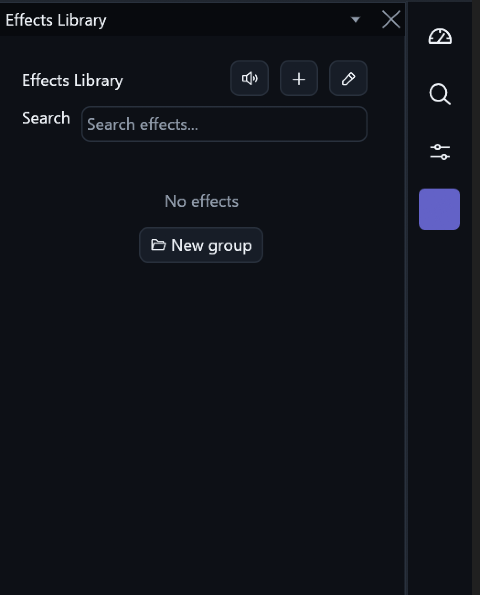
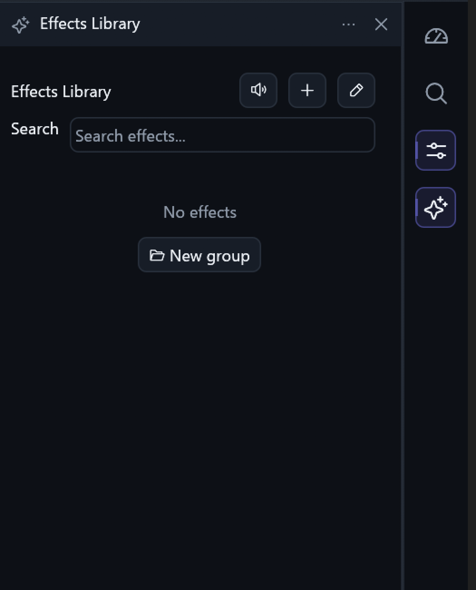
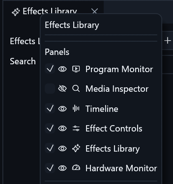
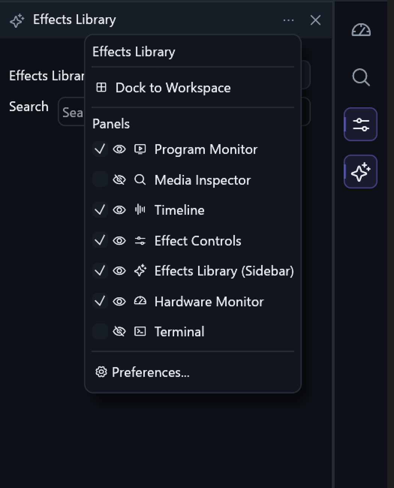

# Sidebar panel placement and native chrome

Owner: [PR #276](https://github.com/ToghrolTP/pealayer/pull/276),
part of [#80](https://github.com/ToghrolTP/pealayer/issues/80).
The [behavior and process-local API](sidebar-rail-shortcuts.md) remain the contract.

## What was wrong

1. Rail activation explicitly called `open_sidebar_pane`, which removed an
   existing docked panel. It did not implement a location-preserving toggle.
2. Panel drops used `OpenAt`/`Move` with an ordinary split. That chose the default
   half split instead of using the remembered location/size.
3. The selected icon used `selection.bg_fill`, over a selected background painted
   in that same accent. This was foreground/background collision, not a missing
   icon asset or SVG-loader problem.
4. The sidebar retained PaneHost's donor title/menu chevron while workspace
   headers used Pealayer chrome. PaneHost still owns resizing and focus; its
   title bar is now disabled and Pealayer draws the actual shared-style controls.
5. Panel menus unconditionally separated both the title and an empty action
   section. Effects Library had no section actions, producing adjacent rules.
   Empty sections no longer introduce an extra divider.

No icon assets, renderer mode or panel capability was removed. An inactive or
collapsed tab is revealed before it can be toggled off; hiding a shortcut is
still independent of hiding a panel. Visibility/order defaults are unchanged.

## Verification

- **63 distinct focused tests pass**, with 64 executions across sidebar,
  CraftUI-header, egui-Dock-header and workspace-control suites. These include
  actual pointer clicks/drags/menu/close events, exact dock-tree restoration,
  per-pane width persistence, side-to-dock current-width preservation, tab-group
  size memory, rejected-drop atomicity, API validation, locks and modal guards.
- Actual glyph/background and fixed-geometry paint checks cover both palettes,
  light/dark, RTL, 1×/1.25×/2× scale, and normal/selected/hover/pressed/focus/disabled
  states. Native captures below independently confirm that active icons remain
  visible and the donor chevron is gone.
- Clean installed code: `41d06685f9ef234a45b91876ccde76718489ed7c`.
  Cached release compilation took 3m 46s; Web/PWA integrity, native runtime smoke,
  downloader identity and all Windows task-action resources passed packaging.
  Full hosted CI is a separate merge gate and was not waited on for local delivery.
- Fresh authoring inspection was clean. The canonical executable acknowledged
  its graceful peer update in 16.7 seconds. Packaged and installed SHA-256 match:
  `527976670aa574cf8e0c2a0c8c18d41883ad10113ba4a50355a91e95ce4f43c3`.
- Live API checks hide/show the sidebar, retain an explicitly assigned 420-point
  width, return to its recorded dock location, and hide/show that docked panel
  without changing its location/size. A JSON-RPC request opens the real sidebar
  menu. The original complete dock-layout string was independently equal after
  restoration, not merely the same number of panels. Temporary screenshot width
  was returned to the original 300 points.
- The existing movie remained paused at 578.286 seconds with volume 57%.
  No hardware actuation or shell session was used. Isolated review/historical
  apps and their authoring/session state were not replaced.
- Cafe deployment is **user-deferred/offline**, not delivered or verified.

## Native screenshots

The before/after pair is captured from the canonical installed native window,
at the same Studio palette, 300-point sidebar, 1.5 pixels/point and identical
physical crop. Both crops use 2× nearest-neighbor enlargement for clear native
edges. No UI was reconstructed; private production content stays outside the crop.

### Before

### After

### Reported duplicate-divider menu

The supplied Dock-menu report contains two adjacent rules above Panels:

### Installed sidebar menu

This is the actual sidebar menu, which additionally has a meaningful Dock to
Workspace action section; its dividers separate real sections. The shared Dock
menu's absence of an empty section is also checked by the actual-paint regression.

