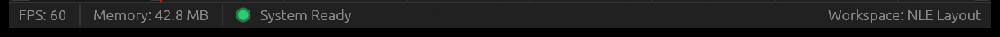
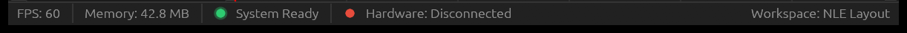
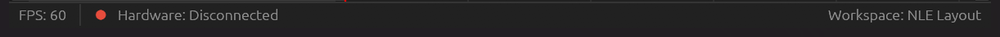
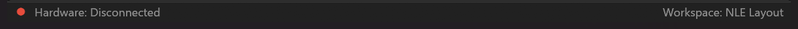
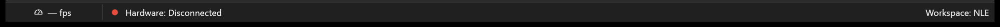
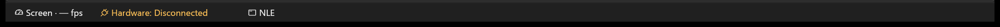
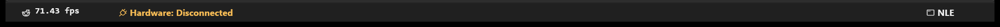
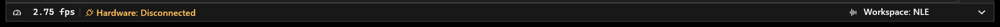

# Status bar: readable captions and balanced typography

Tracker: [status-bar evolution](https://github.com/ToghrolTP/pealayer/issues/228).
Implementation: [workspace and typography PR](https://github.com/ToghrolTP/pealayer/pull/225).

## Regressions and repairs

### Frame-rate detail card

The FPS hover is now a compact palette-aware detail card rather than concatenated
plain text. One heading, source icons and an active-source check replace the
repeated mode narration. Labels/units use muted ink; measured numeric lanes share
right-aligned, regular-weight monospace values. Horizontal dividers separate
rates, optional mpv timing and the single interaction hint. Native hover and
context-menu details use the same renderer and typed cached measurements, never
parse a tooltip string or perform fresh media/GPU probes. Unavailable rates remain
unknown, and unloaded media does not expose stale renderer timings. Counter
weight, source selection/cycling and telemetry cadence are unchanged.

The Web footer uses a matching hover/focus card with shared theme roles and
aligned tabular values. It shows existing media/UI snapshots only: mpv render
diagnostics are not advertised by its current status contract and are not
invented locally. Both the button and parent widget omit the native browser
`title`, preventing a second plain tooltip from appearing over the card.

Focused native regressions check source behavior, missing/non-finite samples,
value columns, separators, unique narration, narrow bounds, light/dark, RTL and
display scale. Real Edge tests cover both palettes at 390/768/1440 pixels in
light/dark and English/Persian, plus focus, source cycling and unknown samples.
The installed native capture exposed a desktop-wide separator expansion that
content-only paint tests missed. The card now bounds its actual width, with
padding included before label wrapping. The regression renders the real egui
tooltip container on both narrow and 3002-point viewports rather than testing
only its inner rows.
Live numeric rows reserve a measured digit lane and share a fixed font-derived,
pixel-snapped digit baseline. Per-value glyph-ink centering can shift by a pixel
when the displayed digits change, so it is intentionally not used for these
updating values. A real-popup regression changes digit counts and unavailable
samples in place with system/bundled monospace fonts, LTR/RTL and four display
scales, checking stationary popup bounds, numeric endpoints and baselines.
Fixture captures remain private; they are not historical screenshots or proof
of the user's live native tooltip. Installed evidence is in the owning PR.

The connection widget had a fixed 148-point slot (252 with transport shown).
Changing the UI typeface to the native semibold face made “Hardware:
Disconnected” wider, but the slot never used the otherwise empty bar. The slot
now measures its actual localized caption, icon and selected font. Both anchored
groups reserve that width, bounded by the remaining space. Narrow bars retain
truncation/tooltips and horizontal group scrolling; numeric telemetry slots and
the trailing workspace anchor remain stable.

The React footer had the same 148/252-pixel ceiling. Its connection widget now
uses intrinsic content width and may shrink within the scrollable group. Only
the caption ellipsizes under real space pressure; its icon cannot shrink.

FPS used vertical line-box centering. Different ascenders, descenders and line
gaps in native monospace faces put the painted glyphs off-center even when the
layout box was centered. Status captions and FPS now center their visible glyph
bounds; no font-specific pixel offset is used.

Windows does not expose a desktop monospace preference in NONCLIENTMETRICS.
The generic DirectWrite monospace match can resolve to Courier New. System mode
now chooses an installed Segoe UI Mono / Segoe Monospace, Cascadia Mono, or
Consolas in that order, with the generic fallback only if none exists. Custom
overrides remain available. Linux desktop and macOS fixed-pitch preferences are
unchanged. Fontique's requested weight is explicitly carried into egui's `wght`
axis, clamped to the actual face's range; this also repairs installed YekanBakh
VF falling back to its thin default. No private font is bundled.

The [divider investigation](status-bar-history-audit.md#divider-history-two-different-boundaries)
traces the original full-height native separators, their omission during the
reorderable rewrite, and their reintroduction as 12-point lines. The specific
five-point endpoint insets are code choices in the compact rewrite; the PR gives
no separate justification for shortening the original separators. The user has
chosen to keep compact styling for now and track full-height/larger options for
later rather than changing that default again.

CraftUI's status frame also accidentally retained egui's automatic panel
separator. Both painted adjacent top edges; disabling the automatic separator
leaves a single themed frame boundary and removes its extra reserved point.
The panel now derives its height from the existing 22-point slots plus the frame
margins/stroke and explicitly disables panel resizing. Previously its centered
contents converged over several frames from a density-dependent default height;
at Spacious density this moved the row while the pointer hovered. This fix
removes that settling drift and the unintended resize-edge affordance. No new
font-size or physical-pixel constant is introduced; display scaling still applies.
Widget dividers now explicitly use the same active separator token.

Web dividers were full-height borders inside each widget, unlike native lines.
They now occupy their own 1-by-12-pixel flex slot between actually rendered
widgets. This matches the retained compact native style, preserves text width,
and leaves drag-insertion pseudo-elements independent. Show dividers still
controls both surfaces; no divider appears before the first visible item of
either anchored group.

## Verification

- 21 status-bar tests pass, including native/bundled visible-glyph centering
  and unelided hardware-caption checks at 100%, 125%, 150% and 200% scale; LTR,
  RTL, start/end placements and narrow bars are covered.
- The new divider test paints the actual bar at 100%, 125%, 150% and 200% scale,
  dark/light themes, LTR/RTL and Extra compact/Spacious density. It checks the
  single frame boundary, first-frame/hover slot stability, inset divider geometry
  and color, and Show dividers on/off with no leading/trailing orphan lines.
- 4 font tests pass, including installed variable weight coordinates, modern
  Windows family selection, monospace advances and fallback preservation.
- Test processes use an isolated configuration supplied before startup. UI
  fixtures use the memory-only engine, never a live hardware worker.
- Web status-widget and responsive-layout guardrails and TypeScript no-emit pass.
  These source checks are not browser screenshot or touch-device acceptance.

## Genuine visual history

The original gallery covered only late revisions of the same compact design.
That was not the requested full history. The [complete source audit](status-bar-history-audit.md)
now accounts for every component change, its first actual integration, relevant
changes in other files and branch reconciliation. The gallery begins below with
the original application, not with October's compact-widget implementation.

### Original dock status bar

First running integration, `e8e6b9676d0deee93928e794ec39ddf729d95e3c`.
The component existed at `dc49b29` but was not called yet. The screenshot's
Memory: 42.8 MB and System Ready were historical placeholders, not measurements.
UI FPS is a real render-loop observation. No hardware or media was connected.

### Hardware status joins the original bar

`3bc0e0872739b736ab942bfe9ae216004cc04462`: red disconnected indicator and
hardware caption added alongside the old placeholders. E-STOP appears only
when active; it was not activated for this capture.

### Truthful connection status replaces the placeholders

`bab90c8bb243465bc2e0068678097e854b099a74`, PR #25: removes memory and
System Ready, retains the UI FPS counter, introduces a real connecting state.

### Capability-driven, configurable status bar

`0ec9ffc2dcd535ca31bfdce0502696f41bbe713f`, PR #46: real media FPS replaces
the UI counter and is correctly absent with no media loaded. The RGB/telemetry/
warning widgets are capability-driven and absent while disconnected. Their
history and per-item context-menu changes are recorded in the audit, not
fabricated in this idle screenshot.

These four early applications were freshly built from unmodified tracked source
and each original Cargo.lock. All used their original 800 × 600 logical default
window at 150% desktop scale (1222 × 956 physical window, 1222 × 46 public
bottom crop). The first two predate configuration persistence and control APIs;
the third used an isolated portable profile and had no established controller
connection. The fourth used an explicit isolated config with auto-connect off.
The user authorized normal window-close requests for these isolated historical
instances. The old applications were closed before the next build; no forced
termination or private production settings were used.

Executable SHA-256 values, in the same order:

- Original dock: `cf016ff319dcb24e207c74f63c0aa59305529b93c8a385937074a8f26a2dd9a2`.
- Hardware addition: `cc48bf69748e2618d670c95c659cea42642e48b112a6382bb45b7a4dbbaa31ee`.
- Truthful connection: `8932eb4c9b4ac123808cf137234fcc8f468ab8a2ed1cbc7ca573efb00201735b`.
- Capability era: `a2344ce36177c0bf350576f97defa8f8b7ab4df298ddc5078630655c60917744`.

### Explicit media/screen FPS selection

`c1b15be070b300fdef9ca55d08227c8e4a1a1865`, PR #90: distinct mode icon,
click-to-toggle and context-menu selection. The review profile selects Screen.
This revision displays a dash after reactive idle when its live sample expires;
that is an actual unavailable reading, not an invented zero or media frame rate.

### First rearrangeable widget strip

`a242919404d15815d1648e41c8b7333a343b719b`, PR #149: Screen is named
explicitly; hardware has its semantic-colored icon; workspace joins the same
left-hand strip. Drag ordering, operation progress, HOT and charts appear here.
The screenshot shows the default ordering, not an artificially rearranged bar.

### Stable slots and the workspace restored to the end

`3fb294e63cfd9d9d059d9260d4b4f053123ab3f7`, PR #150: strong monospace
FPS, fixed numeric slots and workspace anchored right again. The preceding
idle-rate repair keeps a real sample available; this capture reports 71.43 fps
from the UI, not from a movie. FPS icon/text separation was refined immediately
afterward in `634abe3`; the later compact captures include that refinement.
The full hardware caption still fits in this version's 200-point slot.

These three builds used unmodified tracked source and their lockfiles. Their
local process API reported the exact revisions above and `git_dirty: false`.
They used an isolated profile, Screen FPS mode, no media and no hardware
connection. All three windows were 2002 × 1346 physical pixels; crops are
2002 × 56. Each was closed through its Quit API before the next build.

Executable SHA-256 values:

- Dual FPS: `5960ba92c8da3a8710243d0dbae10d61c8774b623ad563d6230a8be1c9679d50`.
- Rearrangeable: `d4fae27d8044c5d8be2ea9caefd985ea2be454b361a0325c5847cdb53740ee29`.
- Fixed slots: `bbbe47874984205af9bdef65516a483535dc7c0e523694d4a0e046a55f5d18b9`.

### Late-stage comparison and repaired typography

Compact two-sided widgets (`48fd59c`, PR #166), CraftUI surface styling
(`9610177`, PR #216), native typography (`d6feabf`, PR #225; status
implementation introduced in `1fbed60`) and the repaired result follow the
earlier designs above. They are deliberately not represented as the whole history.

Historical screenshots come only from real compiled applications, never a
current widget with a reconstructed theme. Use a separate explicit profile with
hardware auto-connect and last-media restoration disabled, the same dark theme
and 1320 × 860 logical window geometry. Idle screen-FPS readings are real and
will differ between captures. No board values or media are fabricated.

`scripts/start-status-review.ps1` launches an already built executable with that
profile and a loopback-only listener. `capture-visible-window-windows.ps1`
captures the real window through read-only Win32 PrintWindow. Crop only the
status bar for public comparison; inspect for private data before publishing.
Use the existing detached comparison worktree and shared build cache, with its
already-generated host configuration (do not add a duplicate Cargo config).
Do not copy another machine's libmpv or publish executables/private profiles.

The following four late-stage captures complete the gallery. These two historical rebuilds used
unmodified tracked source and their locked dependencies; the process-local API
confirmed the expected commit before capture. All windows were 2002 × 1346
physical pixels; the public images are the bottom 56 pixels, unretouched.

| Milestone | Source | Capture | Screenshot-only discussion |
| --- | --- | --- | --- |
| Compact two-sided widgets | `48fd59ce65022b039d28570288ff967bf52bca8e` | [Status bar](../screenshots/status-bar-compact.png) | [PR #166](https://github.com/ToghrolTP/pealayer/pull/166#issuecomment-6647123702) |
| CraftUI surfaces | `9610177510c02f393c56bd024625c70b21442c99` | [Status bar](../screenshots/status-bar-craft.png) | [PR #216](https://github.com/ToghrolTP/pealayer/pull/216#issuecomment-6647068767) |
| Native typography before repair | `d6feabf8c0956523aa5050bf978975cee8b6c431` | [Status bar](../screenshots/status-bar-native-before.png) | [PR #225](https://github.com/ToghrolTP/pealayer/pull/225#issuecomment-6647048566) |
| Repaired native layout | `af070c1cd3161514ea035dc2da2ed0a46485f7f5` | [Status bar](../screenshots/status-bar-fixed.png) | [PR #225](https://github.com/ToghrolTP/pealayer/pull/225#issuecomment-6647251132) |

### Screenshot-only discussion index

- [Original dock — commit discussion](https://github.com/ToghrolTP/pealayer/commit/e8e6b9676d0deee93928e794ec39ddf729d95e3c#commitcomment-208218747)
- [Hardware addition — commit discussion](https://github.com/ToghrolTP/pealayer/commit/3bc0e0872739b736ab942bfe9ae216004cc04462#commitcomment-208218751)
- [Truthful connection — PR #25](https://github.com/ToghrolTP/pealayer/pull/25#issuecomment-6647465792)
- [Capability-driven media status — PR #46](https://github.com/ToghrolTP/pealayer/pull/46#issuecomment-6647466182)
- [Selectable media/screen FPS — PR #90](https://github.com/ToghrolTP/pealayer/pull/90#issuecomment-6647590130)
- [Rearrangeable widgets — PR #149](https://github.com/ToghrolTP/pealayer/pull/149#issuecomment-6647590482)
- [Stable slots and trailing workspace — PR #150](https://github.com/ToghrolTP/pealayer/pull/150#issuecomment-6647590876)
- [Compact layout and divider comparison — PR #166](https://github.com/ToghrolTP/pealayer/pull/166#issuecomment-6647123702)
- [CraftUI surface — PR #216](https://github.com/ToghrolTP/pealayer/pull/216#issuecomment-6647068767)
- [Native typography before repair — PR #225](https://github.com/ToghrolTP/pealayer/pull/225#issuecomment-6647048566)
- [Repaired typography — PR #225](https://github.com/ToghrolTP/pealayer/pull/225#issuecomment-6647251132)

The unused-space ellipsis is present in all three late pre-repair captures: the fixed slot predates the
native font work. FPS typeface/baseline and the trailing workspace presentation
did change. No historical playback-rate or CPU claim is inferred from the idle
FPS readings in these screenshots.

Executable SHA-256 provenance for the fresh historical builds:

- Compact: `406fe80e7d890faf8464606471bfca8ce43a3ba3d4593450d7d73684750b0847`.
- CraftUI: `59b265ac0fddac383e38c082392bb593283b5469f8a4a906c64f950e32ed8ee0`.

The repaired native package passed host-libmpv, utility, icon-resource and Web
bundle/PWA checks, and reported the clean source revision through the API. The
actual capture shows the full hardware caption and centered FPS using Cascadia
Mono on this installation. The follow-up Web width repair is separately covered
by the status-widget guardrail and TypeScript/bundle checks.

Compilation and screenshots are not production deployment proof; the Cafe SSH
endpoint refused connection during this pass.

### Divider repair and stable panel sizing

Actual package built from clean source
`60389d3fbd3e10162492459bb7501fcf1b7e3922`. The local process API confirmed
that revision, `git_dirty: false`, no loaded media, no hardware connection and
zero clock updates. Its native authoring state was clean before graceful Quit.
The window was 2002 × 1346 physical pixels at 150%; this is the unretouched
2002 × 56 bottom crop. The review profile uses System UI and System monospace
(installed Cascadia Mono here). The real idle Screen FPS is not a media rate or
performance benchmark.

Executable SHA-256:
`b53a49ed303444457db7c8ae2c8e9f28201fc52439b1c867ce63c478e1b8286e`.
Runtime SHA-256:
`e56ce67cd00f06a59dc7ed5b97a49a9182a381554c755dc4570a52af1ef30e65`.
The host-compatible package passed its libmpv smoke, utility, icon-resource and
Web bundle/PWA verification. Source checks remain 21 status tests, 4 font tests,
Web status/responsive guardrails and TypeScript. Existing deprecation/unused-code
warnings remain; they are not claimed as resolved by this focused repair.
The comparison worktree was restored to its original detached revision, and the
shared release cache now contains the current repair rather than a historical
executable. Cafe deployment remains blocked by the refused SSH endpoint; this
capture is local native verification, not production or browser acceptance.
