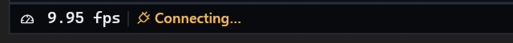
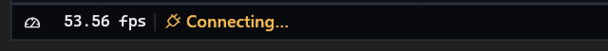

# Native FPS sizing and clipping

The FPS item reserved a fixed 88-point slot, including a 19-point icon gutter,
regardless of the selected font's measured advance. Optical digit-height matching
could enlarge the monospace face, leaving three-digit captions wider than the
remaining number clip. Earlier tests checked slot stability and vertical centering,
not whether the entire number actually fitted its horizontal clip.

The native counter now keeps the user's selected family and regular weight but
uses a secondary text size, at most 11 points, below the surrounding 12-point
status captions. Tooltip typography and other status widget fonts are unchanged.

FPS allocation measures the actual font, its widest digit and glyph overhangs.
It reserves a stable three-digit caption even while showing a shorter value;
larger factual values can grow the slot rather than disappear under its clip.
Painting and both status groups' width budgets use that same calculation.
The existing 88-point minimum remains a floor, not a clipping ceiling.

## Focused verification

All 29 native status-bar tests pass. The added real-paint regression checks
9.99, 99.99, 100.00, 144.12, 999.99, 1000.00 and 9999.99 against their actual
shape clip, with system/bundled faces, proportional/monospace choices, both text
directions and 1/1.25/1.5/2 display scales. It also checks the smaller font size,
visible vertical centering and stationary neighboring slots through three digits.
Existing source switching, regular weight, tooltip stability, menus, drag ordering,
Workspace placement and hardware/status tests remain passing.

## Native package and installed comparison

The clean package from `8ba8891bfd2f071707f05d1e00a22485d2a3cb43` passed runtime
smoke, Windows resources/quick actions and Web/PWA integrity. Release compilation
took 3m 42s, using the existing shared cache and packaging directory; no duplicate
worktree or additional staging package was created. Full regression suites were
not repeated by packaging after the focused native pass above.

The graceful canonical update was acknowledged in 16.8 s. Installed/package
executable SHA-256 independently matches:
`b56b0916d12e0f2b9d20d56be332f1199302080c2c7d21bd84539e7d0d993851`.
The restarted API reports the clean source above. Loaded media remained paused
at 578.286 s with volume 57%; the normal window stayed 3002 by 1756 pixels.
No playback/settings changes were made to stage this comparison.

### Before

### After

These are actual native read-only captures, cropped to the leading 640 by 54
physical pixels and enlarged exactly 2x for inspection. Palette, display scale
and neighboring caption style are unchanged. Factual live FPS differs; these
images illustrate typography, not a benchmark or fabricated three-digit reading.
Three/four-digit containment is verified by the actual-paint regression above.
Private full-window movie captures are not published.

Cafe deployment remains explicitly user-deferred/offline; cross-platform CI is
separate from this installed native result. This fix does not claim the broader
status-history or production/hardware acceptance complete.
