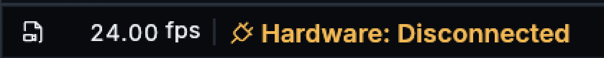
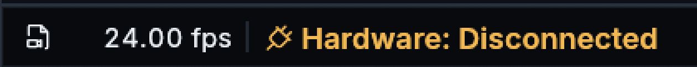
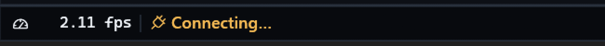
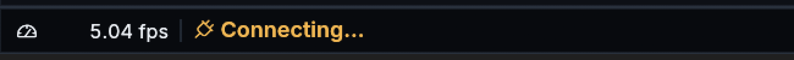

# Status typography, numeric alignment and monospace audit

Owner: [delivery #80](https://github.com/ToghrolTP/pealayer/issues/80).

## Alignment and numeric layout

FPS previously centered the complete `value fps` mesh, including the descender
in `p`, while centering its separate icon independently. That is not the same
visual reference as the digit body. Earlier tests verified the caption against
its own rectangle but did not compare the icon and numeric center in every mode.
Use a stable `0123456789` visible reference, including its actual selected font
and size, for the number baseline. The icon shares that vertical center. No
face-specific Y offset or font-size increase is applied. FPS stays regular and
at most 11 points, with three-digit reservation and growth for larger values.

The status bar now lays out the digits and `fps` on one baseline. The earlier
split paint centered the letters by their own ink and moved the unit two
physical pixels above its baseline in the Windows comparison. Both captures
use Studio dark, the same paused 24 FPS sample, and 150% Windows scaling.
The glyph center of the value is within half a physical pixel of the icon in
both captures. The after capture uses the clean `339d39e` build.

`ui::numeric_text` gives digits equal advances while keeping letters and ordinary
words proportional and preserving logical/copy text. Native egui's pinned
TextFormat supports variation axes but **does not expose OpenType feature
selection**. This is deliberate application-owned tabular spacing, not a claim
that native `tnum` substitutions are applied. Web uses `font-variant-numeric:
tabular-nums`. The helper is shared by FPS, tooltip values, fitting status
telemetry, update percentages, RF reception counts and hover-preview timestamps.

## Platform policy and overrides

| Surface | Default proportional status face |
| --- | --- |
| Windows native/Web | Bundled Inter, regular 400; meaningful caption emphasis 600 |
| macOS native | Existing CoreText system UI resolution; SF supplied by macOS, never bundled |
| macOS/iOS browser | Apple system UI stack |
| Linux/other native | Installed Roboto, then existing DE/fontconfig system UI selection |
| Other browser | Installed Roboto, system UI, bundled Inter fallback |

An explicit custom UI face remains first. Global UI and monospace controls are
not overwritten. YekanBakh stays host-only; Persian fallback and icon coverage
remain in the chains. New status defaults do not require monospace; the existing
per-widget option remains available and round-trips independently of visibility
or placement. Inter's unmodified source, digest and OFL notice are recorded in
[font assets](../../assets/fonts/README.md). Its notice is visible in About and
included in package artifacts.

## Where monospace remains

Audit used the actual source expressions `monospace`, `FontFamily::Monospace`
and `TextStyle::Monospace`, not visual guesses. Test assertions and family setup
are not additional user-facing controls. These are retained intentionally,
not automatically converted by replacing the global family.

| Files under `src/ui` | Actual use / decision |
| --- | --- |
| `terminal.rs`, `terminal_screen.rs` | VT100 cell grid, terminal prompt/entry: true fixed pitch required |
| `controls.rs`, `monitor_controls.rs` | Always-formatted elapsed editor, duration display and matching transport measurement: retain until cursor/group selection and width reservation migrate together |
| `layout.rs` | Timeline ruler/axis labels, cue/HUD values and fixed-format editor metrics; also technical channel IDs/references: candidates for numeric layout, not a blanket font replacement |
| `hardware_control.rs` | Board channel identifiers and a bounded three-character order editor: retain technical identity/editing semantics |
| `effects_library.rs` | Stable effect references/status and hexadecimal payload editing: keep code-like text fixed pitch |
| `rf.rs` | Actual RF code text remains fixed pitch; reception count now uses proportional tabular digits |
| `board_info.rs`, `digital_twin.rs` | Keycap legends and simulated character LCD/board readouts: intentional hardware representation |
| `media_inspector.rs`, `error.rs` | Metadata keys and copyable diagnostics: intentional technical text |
| `preferences.rs` | Font preview and config path: demonstrates the selected mono face / technical path |
| `fonts.rs`, `craft_theme.rs`, `elegance_theme.rs` | Font selection, fallback families, reusable mono tokens and donor sizing, not independent numeric widgets |
| `status_bar.rs` | Only explicit per-widget monospace and its tests remain; defaults, tooltip values and progress do not require it |

The Web counterpart also retains code/hex/terminal and formatted-editing fonts.
Its status defaults, numeric figures and tooltip now follow the proportional
policy. This pass does not claim that every numeric timeline/editor control has
been migrated or that physical macOS/Linux rendering was verified on Windows.

## Verification and delivery

Native pointer/paint regressions retain FPS source switching, tooltip stationarity,
large-value clip containment, regular weight, RTL and 100–200% scale coverage.
The icon/numeric comparison now covers both Media and Screen/Auto modes. Numeric
layout tests check equal digit widths, proportional W/i and preserved copy text.
Existing terminal font selection and explicit mono persistence remain covered.

**59 focused native tests passed:** 29 status, one numeric layout, four font
selection, six seek preview and 19 RF. One opt-in real decoder check was ignored.
Seven Web appearance tests and focused status/preview/RF scripts also passed.
The package passed TypeScript, Web/PWA integrity, native smoke and Win32 resources;
the complete regression matrix was not rerun.

## Inspected native comparison

Actual canonical app, Studio dark, 150% Windows scale and unchanged window
geometry. Both crops are window-relative (12,1700,650,50), enlarged 4× with
nearest neighbor. FPS values differ naturally; no telemetry was invented.

`scripts/measure-numeric-ink-windows.ps1` independently measures neutral visible
ink, not galley/line-height metadata. For these crops, use PixelScale 4,
IconRectangle `20,32,140,130`, DigitsRectangle `280,32,150,130`, threshold 140.
Before centers are 25.875 versus 23.875 capture pixels (2-pixel discrepancy);
after both are 25.875. This is evidence for these actual native captures, not a
claim of physical zero-pixel error on every untested OS/font/display.

## Installed receipt

- Clean runtime source `e2c9e06e87ff8cdba22666485357a2fef010a29d`.
- Packaged and installed executable SHA-256 independently match:
  `552bf04fde6db1231604bb650172059ee12bd2942dcb4bf8a3a5856e4323efe4`.
- Graceful peer updater completed and the restarted app acknowledged the build.
  Fresh native authoring state was clean before replacement. Paused media
  position, volume, mute and normal window geometry were preserved.
- Current status monospace flags were deliberately disabled through the config
  API, sending the complete fresh status object so unrelated preferences survive.
  Explicit per-widget opt-in remains available. Global mono/UI font choices were
  not changed. The external package contains the OFL notice; the executable-only
  peer update exposes the embedded notice in About.
- Old review and historical instances remain untouched. Hosted CI/merge and
  user-deferred/offline Cafe delivery remain separate gates.
