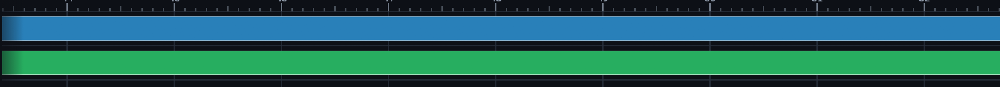
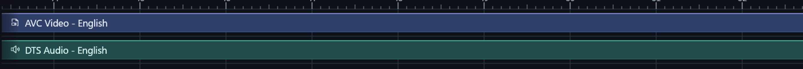

# Studio media strips and visible-span captions

Owner: [issue #80](https://github.com/ToghrolTP/pealayer/issues/80).

## Corrected native rendering

Video, audio and subtitle strips previously bypassed the active palette: their
fill used fixed RGB values and every border/caption was white. Names were
painted at the strip's source start, so ordinary horizontal panning left long
strips visible but their captions entirely offscreen. Cue labels had the same
source-start assumption despite their existing elision implementation.

Studio now uses coordinated indigo video, teal audio and orchid subtitle
surfaces. Each has a theme-specific body, subtle edge, contrast-tested text and
fine highlight, with separate light/dark values. The role data lives in the
existing native/Web shared palette catalog, not duplicated local constants or
the OS interaction accent. Neutral retains its original colors and borders.
Active/selected-stream and disabled dimming are not replaced by an aesthetic
transparency rule. No stream selection, mute or media timing changes.

Media strips and ordinary/dragged cue captions now share one paint-only
visible-span helper. It anchors the label inside the actual clipped viewport,
keeping the complete name visible wherever space permits. Short strips and
small visible remainders use native ellipsis rather than bleeding into adjacent
clips, sticky headers, the ruler or offscreen content. Fully offscreen or
too-small interiors do not paint a label. RTL pins to the logical trailing
edge. Vertical scrolling still clips normally; captions do not jump between
rows. The explicit cue-overflow preference remains supported, as do move/resize
gutters, hit targets, drag/selection and exact cue extents.

This pass changes the native main timeline and makes the semantic roles
available to the existing shared Web palette importer. It does not claim the
Web timeline's incomplete media-strip feature parity is finished.

## Verification

- Native UI suite: 559 passed, zero failed, one opt-in test ignored.
- Actual Timeline UI with real media rows, pointer wheel panning and both
  palettes at 640/1200-point widths: labels remain visible, the painted strip
  uses its palette role, and playback position/track selections do not change.
- Rendered strip captions at 180/640/1200-point widths, both text directions,
  light/dark and 1/1.25/1.5/2 display scales; long, partially visible, short and
  offscreen clips, including explicit cue overflow.
- Studio caption contrast is at least 4.5:1 for all three media kinds in both
  themes. Neutral's existing fill/white borders and active/disabled semantics
  have independent assertions.
- Final focused strip suite: four passed, zero failures (overlaps the UI suite;
  includes the final Neutral-border preservation assertion). Persistence tests
  receive private config/instance identities from their parent before startup.

## Installed checkpoint and actual native comparison

The package passed Web/PWA bundle integrity, native/runtime and downloader smoke
probes, native resources and all seven quick-action icons. The fresh authoring
inspection was clean before the graceful peer updater. The restarted app
acknowledged source `c99a0c2d619eb3cd82eb6eaf9dc8c11ce48e16ed`, executable
SHA-256 `419de2dcbee79de6c777ec854252f48410f27e98261a812605e7844aa45448bd`.
The destination libmpv remained unchanged. Independent live reads confirm the
installed identity, Studio palette, active NLE workspace and exact unchanged
paused position. Window, viewport and user split proportions were retained.

These are actual read-only Win32 captures from the running native app, with the
same Studio/dark palette, window geometry, horizontal pan and 1.5 display scale.
The strip-only crops are enlarged 2x; no private media image, filename or settings
are published. The viewport starts well after the media strips' source start.

Before: fixed neutral fills and entirely offscreen names.

After: Studio's coordinated surfaces, subtle highlights and names pinned inside
the visible strip span.

The app remains running; no additional review copy or hardware actuation was
needed. Temporal panning, short clips and the subtitle/light/RTL cases are
covered by the rendered tests, not inferred from this two-strip screenshot.

Cafe deployment remains user-deferred while its normal connection is unavailable.
No hardware output or production playback action is needed for these changes.
