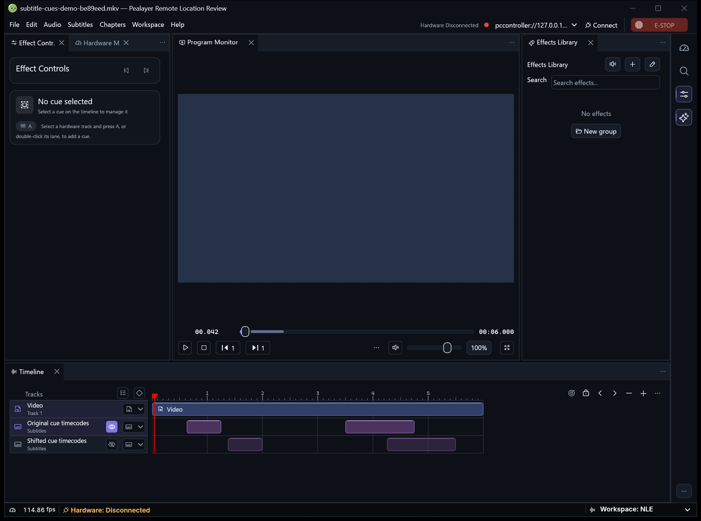

# Subtitle segments in the native timeline

Turn on **Show subtitle cue segments in the timeline** under Preferences →
Playback → Subtitles, or use the subtitle track's context menu. The setting
defaults off and is available through the existing configuration API as
`timeline_subtitle_segments`.

With the setting on, each subtitle strip draws the cue intervals for that
track. Empty sections show where there is no subtitle. Start and end use
source timecodes, independent of any playback subtitle delay. Track selection
and visibility retain their existing behavior.

Pealayer uses its bundled FFprobe, when available, or FFprobe on PATH to read embedded subtitle packet timings and
local subtitle files on a background worker. It uses mpv's subtitle stream
identity to keep multiple tracks separate. The scan is bounded and is
cancelled when the source changes or the setting is turned off. It uses
filesystem input only, so opening the timeline never starts a second network
media stream. Remote-only media, peer playback, unsupported formats, and
streams that do not expose explicit cue ends show a short status in the strip.

The focused checks cover stream identity, time origin, overlapping cues,
missing ends, and the actual painted gap between cue rectangles. Run the
FFprobe fixture together with those checks using
`cargo test --lib subtitle_timing -- --include-ignored`.

### Running application

The native capture shows two tracks of a synthetic subtitle fixture, with
the inactive track dimmed and its offset cue intervals still visible. It
was taken from the clean playback review at `e1a1367` before reconciling
the Terminal changes and CI fixtures.

