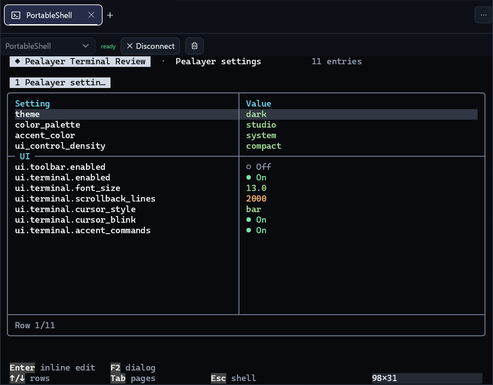
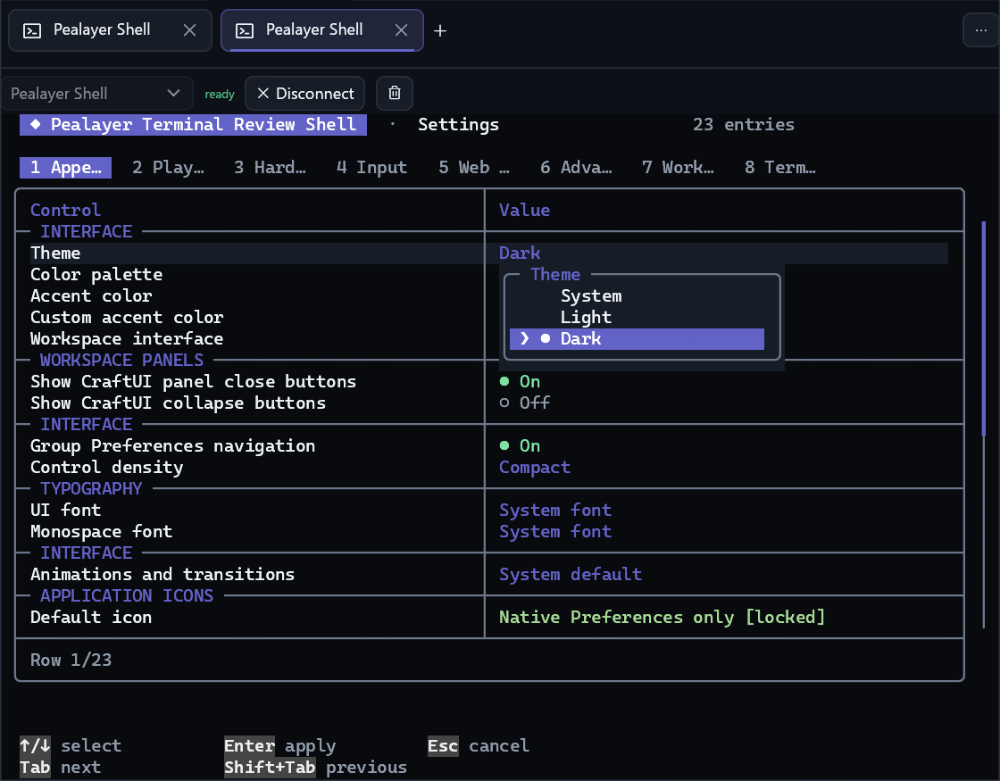
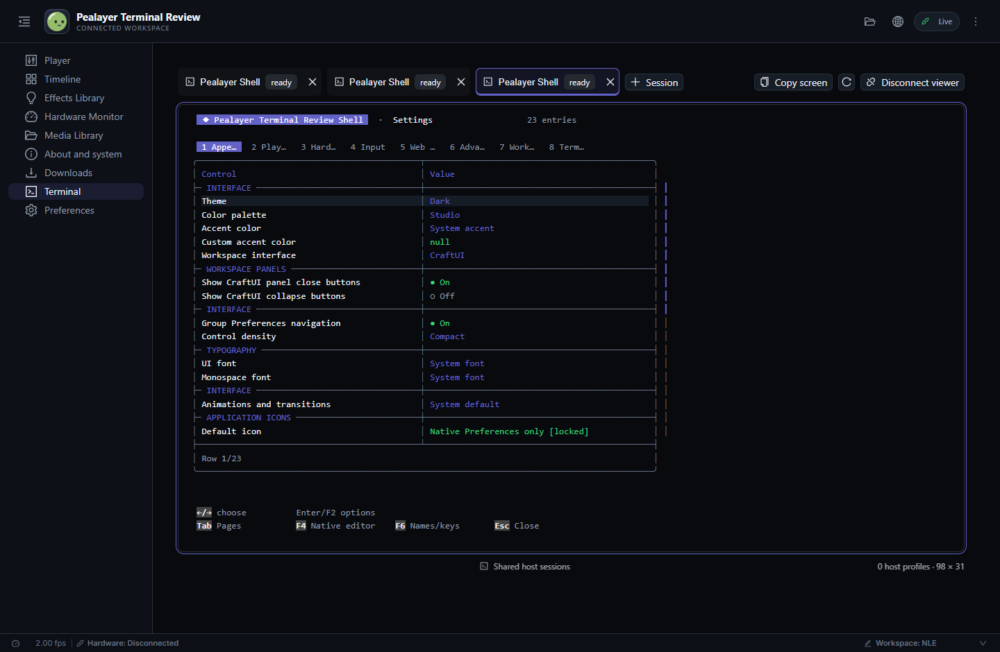

# Terminal: one host, multiple views

Continuation: [#80](https://github.com/ToghrolTP/pealayer/issues/80).

## Native design and PortableShell

- Session tabs have their own padded body, close target, restrained active
  surface/outline, hover feedback and motion-governed insertion/removal. Closing
  another tab preserves the selected session's identity. Closing the final tab
  leaves an empty state rather than silently recreating it.
- Terminal has a dedicated Preferences page. Its menu and screen context menu
  navigate there directly. Cursor shape, blinking, command-accent coloring,
  font size, scrollback, default target and security are configurable.
- The built-in session is named **Pealayer Shell**. The upstream PortableShell
  framework is embedded, not launched as an
  executable. Its multiline prompt, categorized help/usage, command and setting
  completion, F7 history, bracketed paste and editable settings registry are used.
  `configure` opens the upstream in-place table; `get [KEY]`, `set KEY VALUE`,
  `help set`, `status` and the explicit playback commands operate real Pealayer
  state. A queued setting is pending, not falsely reported as applied.
- Shell configuration uses the application's validation, persistence and runtime
  side-effect owner. Inline writes compare their observed value before applying;
  a stale edit refreshes instead of overwriting another surface. The catalog is
  generated from the shared Preferences contract, grouped into section pages,
  rather than a second hand-maintained demonstration subset. Labels, choices,
  numeric ranges and runtime validation have the same owner as Preferences.
  Private paths/values are redacted and execution grants remain native-only.
  Complex/oversized values are locked in the inline table rather than truncated
  into a destructive write; use bounded JSON `get`/`set` or
  `preferences KEY` to open that section's existing native editor.
- Real semantic colors are retained. The optional command/accent role follows
  the live app palette without recoloring warnings, errors or numeric values.
  Generic success notices expire; command history and errors are not deleted.
  Active session outlines use the actual live accent, not selection text ink.
  The paint regression deliberately makes selection ink white and changes the
  accent twice, checking that neither theme produces the reported white frame.
- The prompt contains the live playback/position/audio/controller summary,
  updated from host observations without a hidden polling loop. Playback
  commands serialize per session and remain pending until the decoder reports
  the requested state; a timeout is explicitly unconfirmed and never replayed.
  `status` uses the owner's prompt-safe structured report, aligned value starts,
  semantic state symbols and section dividers. One whole response suspends and
  restores the complete multiline prompt once, preserving unfinished input.
- Alternate-screen mouse reporting is forwarded only when advertised, with Shift
  retaining text selection. Prompt-mode wheel scrolling remains scrollback.
  Control-code/oversized paste is rejected atomically. Multiline paste requires
  bracketed-paste support, and never becomes an implicit submission.
- Transitions and caret blinking respect reduced motion. Hidden/unfocused
  terminals do not install a continuous blink timer. The core's coalesced table
  paint gets one bounded settle tick, not a permanent polling loop.

The PortableShell conversation's user requests were read through its oldest
message, and the actual pinned gallery/settings-editor implementation inspected.
Relevant defaults include semantic colors, multiline prompts, inline editing,
completion rollover/history, distinct prompt/table mouse ownership and no static
introductory narration. OS-specific demos, firmware controls and sample data are
not imported as fake Pealayer capabilities. Vendored files come from the verified
owner checkpoint recorded in `third_party/portable-shell/PEALAYER-VENDOR.md`;
the small application adapter supplies Pealayer metadata and callbacks. Shared
sources follow canonical upstream main at reviewed integration checkpoints, not
an indefinite handoff pin; exact resolved identities remain build receipts.
The owner-provided dialog title/close and framed Apply/Cancel actions are enabled.
Settings groups remain contiguous while retaining the shared catalog's group
and control order. Immediate status reports reconcile decoder properties so an
acknowledged pause does not briefly report the previous published UI state.

### Editable choices and explicit accent protocol

The owner-provided choice popup is consumed instead of creating a second native
editor. Theme, palette, accent, density and cursor choices retain their canonical
configuration tokens for validation/writes, with separate friendly display labels.
F6 switches readable setting names to technical keys; those keys use distinct
coloring and never replace the identity used for completion, CAS or persistence.

Pealayer opts into PortableShell's foreground role protocol:
ordinary fallback SGR followed by `OSC 777;ps;ink;accent ST`. A standard terminal
keeps the fallback color. Pealayer retains an explicit semantic mask, following
the same VT cursor/erasure/scrollback/alternate-screen operations as the actual
grid. It never infers accent from cyan, violet or an RGB/index collision. Normal
foreground/reset SGR clears the role; background/bold-only changes preserve it.
The private shared screen serializes `fg_role: "accent"` independently from its
fallback `fg`; Web and native viewers resolve that role at paint time. Existing
output therefore follows live theme changes without rerunning commands.

## Shared sessions and remote security

Desktop, Web and the native remote viewer use the same host session IDs, active
selection, profile discovery results and VT parser. Browsers are views, never a
second PTY owner. A remote Pealayer viewer uses the same host API and existing
authority origin. General workspace/status/WebSocket data contains metadata only,
never terminal screens, history, environment variables or profile arguments.

All execution grants default off:

1. Local system shells require `ui.terminal.allow_system_shell`.
2. Remote viewing/control requires `ui.terminal.allow_remote`, Web control
   permission, and a native-issued access key. It expires after eight hours,
   lives only in memory and is revoked on restart, replacement, explicit revoke
   or disabling access. A newly paired key replaces the old grant.
3. Remote system shells additionally require
   `ui.terminal.allow_remote_system_shell`. Otherwise their sessions/screens are
   omitted and all access to their IDs is denied. Imported profiles resolve on
   the host, with the existing elevation/unresolved-profile guards.

Remote configuration cannot grant itself execution rights. Native provenance is
transport-owned and cannot be deserialized from JSON. Revalidation occurs again
on the UI owner, closing the queued-config race. Requests have bounded sizes,
queues, deadlines and viewer counts. Input is serialized and never retried after
a lost acknowledgment. Disconnect cancels unsent viewer input, not host sessions.

Use HTTPS or a trusted encrypted tunnel outside localhost: a bearer key does not
encrypt HTTP. No unauthenticated Telnet/OS-shell listener is opened. Existing
same-origin/Host/DNS-rebinding checks remain in force; keys are not URL parameters,
browser storage or general status properties.

## Current API

Native JSON-RPC over the existing IPC path (`--remote` accepts the JSON):

```json
{"jsonrpc":"2.0","id":1,"method":"pealayer.terminal.control","params":{"operation":"snapshot"}}
```

Native-only `pealayer.terminal.pair` returns the private access key;
`pealayer.terminal.revoke` revokes it. Pairing is also in the native Terminal menu.
Never publish these responses or put keys in URLs.

Authenticated HTTP uses `Authorization: Bearer ACCESS_KEY`:

- `POST /api/terminal/control`: `snapshot`, `create` (target), `create_profile`
  (host profile ID), `select`, `close`, `clear`, `input` or `scroll` (session ID),
  and `refresh_profiles`.
- `GET /api/terminal/events?after=REVISION`: bounded, event-woken long-poll with
  revision and the authoritative private screen/profile snapshot. Idle timeouts
  are heartbeats, not synthetic state changes. Revocation is checked while waiting.
- The normal Pealayer peer gateway preserves these paths and the authorization
  header. A client cannot substitute its local filesystem/profile for the host's.
- Web UI: `#terminal`; its navigation entry remains hidden until the Terminal or
  remote access is enabled. Disconnecting that view does not close host sessions.

## Evidence and remaining gates

Focused native/core/type checks and actual native/Web captures belong to the PR
receipt. A before image was captured from the installed build, cropped to the
Terminal only (no private media). Production captures/transcripts/access keys stay
outside Git. Hosted platform checks, user acceptance and production deployment
are separate from source verification. Cafe remains unavailable at the user's
request; no tunnel/service or production hardware is changed by this pass.

### Actual native and Web checkpoint captures

These are real application captures, not the upstream gallery or a mockup.
The native crops preserve pixels at the same 1120 × 875 size, palette, window
geometry and 98-column Terminal viewport. Only the Terminal area is included.

| Initial review | Live integration checkpoint |
| --- | --- |
|  |  |

The initial capture is from `45b6e8e72efd2275b80c5d17a0ef7ec4d7ecbf15`.
The integration captures are from clean packaged/runtime source
`2775659d475a8cff14f4c988d6da2ca6f156d8ae`. Appearance has 23 entries;
the complete catalog spans eight pages, not just the visible rows. Private
settings stay locked to their native editor. The repeated Interface headings
visible in this checkpoint were subsequently consolidated in source.



[Actual 390-pixel Web view](../screenshots/terminal-web-phone-checkpoint.png)
keeps the host's same session/grid; its contained horizontal scrolling is
intentional, not a separate browser-owned shell or a host resize.

### Verification and final-package gate

- Latest focused source checks: 58 Terminal tests, 15 embedded-host tests and
  three status tests pass. Two opt-in OS-PTY cases remain ignored. The specific
  native Preferences provenance and invalid-config API CI failures also pass
  their repaired local checks.
- TypeScript, keyboard codec, 53 Web parity contracts and responsive guardrails
  pass. Actual Edge pairing, UI session creation, ordered setting edits/readback,
  shared table, desktop/phone containment, no credential storage and viewer
  disconnect without closing the host session pass.
- Actual native/HTTP checks pass owner/session identity, get/set persistence,
  readable/key switching, choice popup, default shell denial, policy escalation
  denial, invalid IDs, origin isolation, private-screen isolation and revocation.
- The isolated decoder accepted volume/mute, pause, exact seek, play and Stop,
  with actual confirmations rather than dispatch-only success. Test media was a
  muted public synthetic fixture; no board/output action was sent.
- Visual review discovered a one-frame stale immediate status report. The final
  source reconciles actual decoder observations and adds a regression. It also
  groups settings contiguously and consumes the owner's framed-dialog update.
- Final clean package source:
  `b3b26d791366e8617458b15a4b0f09dda75f7315`; executable SHA-256:
  `9401ff393fc839743911d2f5a91c4be2da299a024cd2c0886d5c624d81ae9dd0`.
  Native/downloader smoke, PWA integrity and Windows resource checks pass.
  **Its launch was blocked by tool policy. Final-build runtime/captures remain
  pending the requested isolated launcher command; the images above are not
  claimed as final-build evidence.**
- PR [#281](https://github.com/ToghrolTP/pealayer/pull/281) stays draft until that
  final native/Web gate and hosted platform checks finish. CodeQL's two browser
  test findings were fixed by passing data as CDP arguments, then replied to and
  resolved. No failure or required check is bypassed.
- Only review-only sessions were discarded under explicit permission. Regular
  Pealayer, Workspace Tools and the historical comparison remain untouched.
  Canonical production replacement, Cafe deployment and human acceptance are not
  inferred from an isolated review, source tests or a package smoke check.
