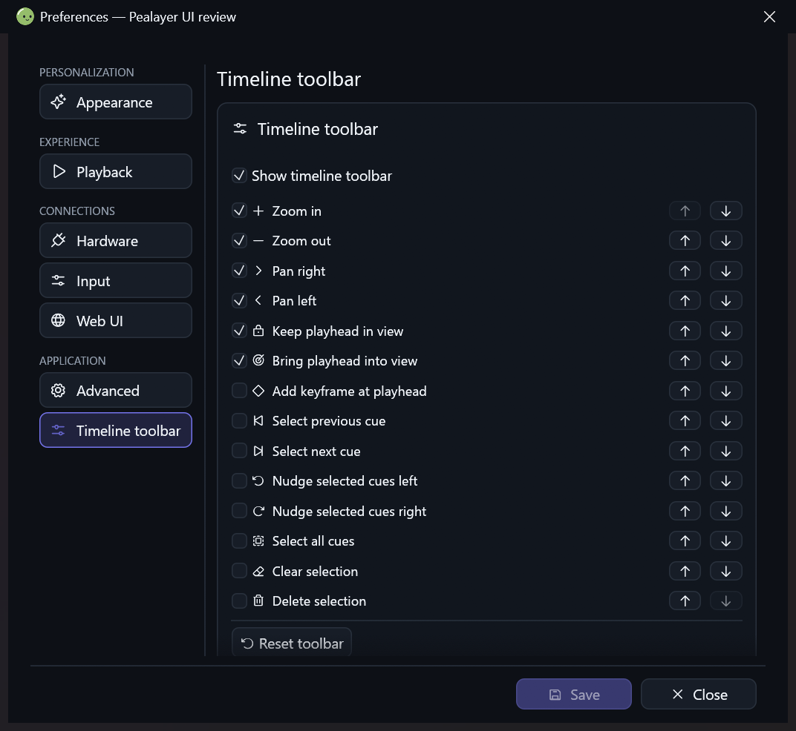

# Direct Timeline Toolbar preferences

The Timeline Toolbar overflow menu previously called the generic Preferences
opener. That intentionally retained the last selected page, so the toolbar entry
could land on Appearance or another unrelated page.

The entry now uses the existing process-local Preferences navigation contract:
`pealayer.preferences.navigate` with
`{"section":"timeline_toolbar","scroll_y":0}`. The dedicated page contains the
toolbar visibility setting and the same native visibility/order/reset editor as
the toolbar menu. It works with the separate native Preferences helper and the
embedded dialog, including an already-open draft. Navigation does not save,
discard or otherwise modify that draft.

The section is appended to the schema so persisted numeric selections for the
existing pages keep their meaning. Its visibility control is moved, not copied,
from Input. The navigation rail measures captions instead of truncating the new
page name to a fixed rail width. The Web schema and navigation icon recognize the
same page; the native customization editor remains shared with its toolbar menu.

## Regression gates

- Real rendered overflow-menu pointer click opens the exact page.
- Helper-message serialization and process-local JSON-RPC accept the same target.
- Repeated navigation at phone, compact-window and desktop widths preserves
  unsaved changes and resets only the destination scroll position.
- Existing Preferences section/scroll, draft, file-picker and layout tests remain
  applicable. Rendering and navigation do not actuate hardware.

Deployment receipts and native visual evidence belong to the owning PR. Cafe
deployment remains deferred until the user restores its normal connection.

## Verified delivery

- Final source: `95714e3737578b3315f036af223851164640f7d7`.
- Focused native checks: 67 Preferences tests and 19 toolbar/model/pointer tests
  passed (the suites overlap). TypeScript and packaged Web/PWA integrity passed.
- Windows resources, task icons, libmpv smoke and downloader resource/headless
  smoke passed. The package skips duplicate full regression suites explicitly.
- The separate native helper visibly opened the correct page through process-local
  RPC; a second navigation after selecting Appearance returned to the same page.
  This is an actual no-media, hardware-disconnected Studio/dark capture:

- The canonical local executable was gracefully updated; the running process
  reports the source above. Installed and packaged executable SHA-256 match:
  `b82942990ef1c46deca442aff21dbfdeb6ae93fa97630ac5a4b0a7ac0648b3de`.
- The isolated review remains open for inspection. Its Preferences helper is
  reported as unknown by authoring inspection, so it was not forcibly closed or
  replaced. No review preference was saved, and regular settings were not edited.
