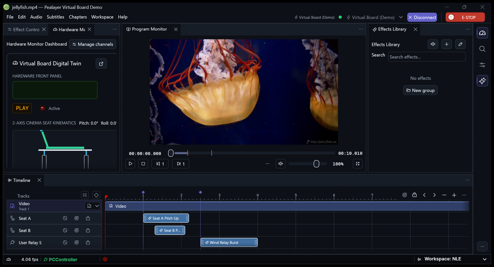

# Virtual Board Demo capture

The native capture shows the isolated Virtual Board attached, the sample
paused at zero, and the seat and wind cues in the workspace. The running
build was the exact source head of PR #295, `98714792b25af65a93fd8b0d76ac93d31bf1a7ce`.
The executable SHA-256 was
`5eaa505dd54fb7921148725602b4c4cc7dc3942310add5b6b9ebd27588c39aa1`.

