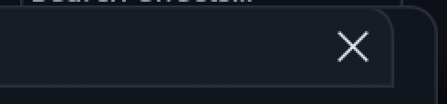
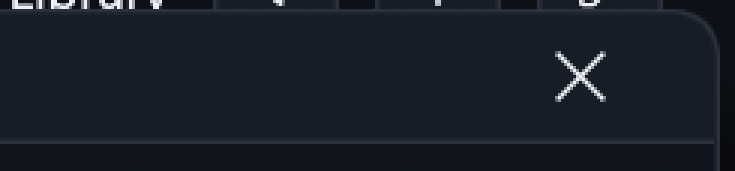
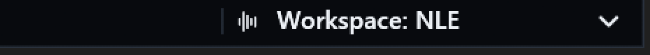

# Workspace selection and complete dialog title backgrounds

Owner: [issue #80](https://github.com/ToghrolTP/pealayer/issues/80).

## What failed and why

The Workspace menu returned the correct stable profile ID, but both saved
Simple/NLE profiles still held egui Dock snapshots. The CraftUI conversion
([source change](https://github.com/ToghrolTP/pealayer/commit/37c8acb)) replaced
the workspace decoder without reconciling these existing named snapshots.
The current decoder correctly rejected them; the restore path only updated a
configuration-status string, making the menu look inert. Testing the menu's
returned ID alone had missed the failed application restore.

The affected profiles were preserved privately before one-time maintenance
through the existing configuration and workspace RPC APIs. Their complete
metadata, Simple/NLE modes, panel membership, active tabs and split ratios were
retained in the current workspace format. The user's independent active layout
was restored after the switching checks. No retired-schema reader, silent reset
or destructive profile replacement was added to the application.

Failed restores now emit a plain-language warning with expandable diagnostics
and leave the previous mode/layout/selection unchanged. The real status menu
tests exercise both directions of a Simple/NLE change through the app itself.

The Workspace widget now has the same leading divider as the other status
groups, including when it is the only trailing widget. It honors divider
visibility. Its fixed width, caption alignment, chevron and trailing anchoring
are unchanged; right-alignment was deliberately not introduced.

## Titlebar geometry, not a styling choice

The pinned egui Window paints its title strip before measuring the body. A
body that grows beyond the requested width can expand the outer frame without
expanding that strip. A rendered constrained-width fixture measured a 494-point
outer window but only a 480-point header: a visible 14-point gap at the right.

The shared native-appearance setup now installs one deduplicated end-of-pass
geometry correction. It identifies built-in Windows from their own title-drag
response and final Area bounds, then extends only the existing title background.
Fill, opacity, radius, stroke, paint order and input responses are preserved.
Custom title-bar-free dialogs, pane headers and dropdowns are not restyled.
All Context reads are completed before the graphics transaction, preventing a
non-reentrant Context lock. No repaint polling or dependency-cache edits.

## Verification

The isolated native UI suite passed **554 tests, zero failures, one opt-in test
ignored**. The workspace-filtered suite passed **25 tests**, including the
application failure/ownership checks (overlapping UI checks are not counted
twice). Persistence fixtures received private config and instance identities
from their parent process before startup. `git diff --check` also passed.

- Real menu pointer selection restores Simple and NLE in the actual app model;
  stable IDs and persisted observed modes are checked, not only menu output.
- The actual leading divider is checked present/absent in LTR/RTL at multiple
  display scales; the caption/chevron slot remains unchanged.
- Invalid snapshots preserve the live workspace and publish visible diagnostic
  warnings rather than resetting user panels.
- Rendered title-frame bounds are checked across both palettes, light/dark,
  LTR/RTL and 1, 1.25, 1.5 and 2 display scales. Separate shape checks retain
  colors/radii/strokes and reject body, action-hover and transparent shapes.
- Live existing RPC restore reached both Simple and NLE. Names/icons/modes and
  original active split proportions were independently reread after the repair.

## Installed checkpoint and real native captures

The package passed Web/PWA bundle integrity, native libmpv and standalone
downloader smoke probes, Windows resources and all seven quick-action icons.
The fresh local authoring inspection was clean before the graceful updater.
The peer acknowledged the installed source
`a8494b408dc1aaf078a73e02c29bf98831d76e19`, executable SHA-256
`88f86864ab0390309446669d73cdca0fbbde1af0f089dca16901677211656063`.
The destination's libmpv remained SHA-256
`e56ce67cd00f06a59dc7ed5b97a49a9182a381554c755dc4570a52af1ef30e65`.
The app stayed at the exact paused media position and retained its active NLE
layout, current split ratios, existing window bounds and pane-control settings.

Installed RPC checks again reached Simple (editor off) and NLE (editor on),
then restored the user's independent active layout and original named profiles.
The observed config and player status agreed. Real native pointer selection is
covered by the rendered interaction tests; this is not labeled a human pass.

The following are actual read-only Win32 captures, not mockups. The isolated
Workspaces review used the same Studio/dark palette, 1.5 display scale and dialog
width. Its header corner is enlarged 3x; the canonical footer is enlarged 2x.
Only non-private header/footer crops are published. The media-free review had
auto-connect disabled and was closed normally through local process RPC after
clean authoring inspection; the regular and historical apps were retained.

Dialog before (title background ends short of the outer frame):

Dialog after (background reaches the outer frame, with the same close glyph):

Workspace before:

Workspace after (caption alignment unchanged):

Cafe deployment remains user-deferred while its normal connection is unavailable.
No hardware actuation is required. This does not close #80 or the separate
dynamic taskbar-artwork acceptance gate.
