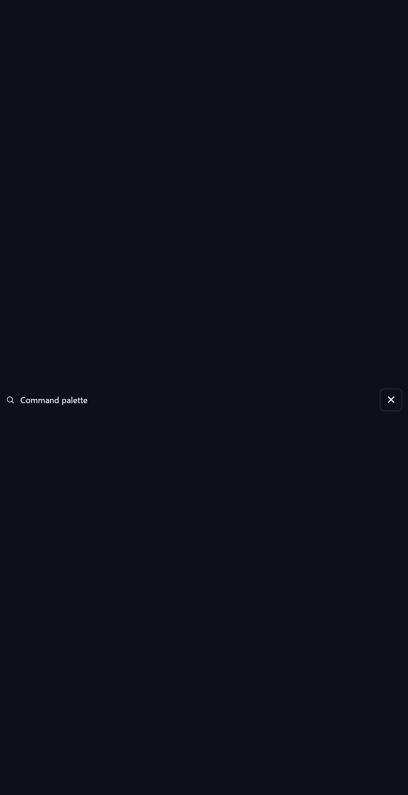
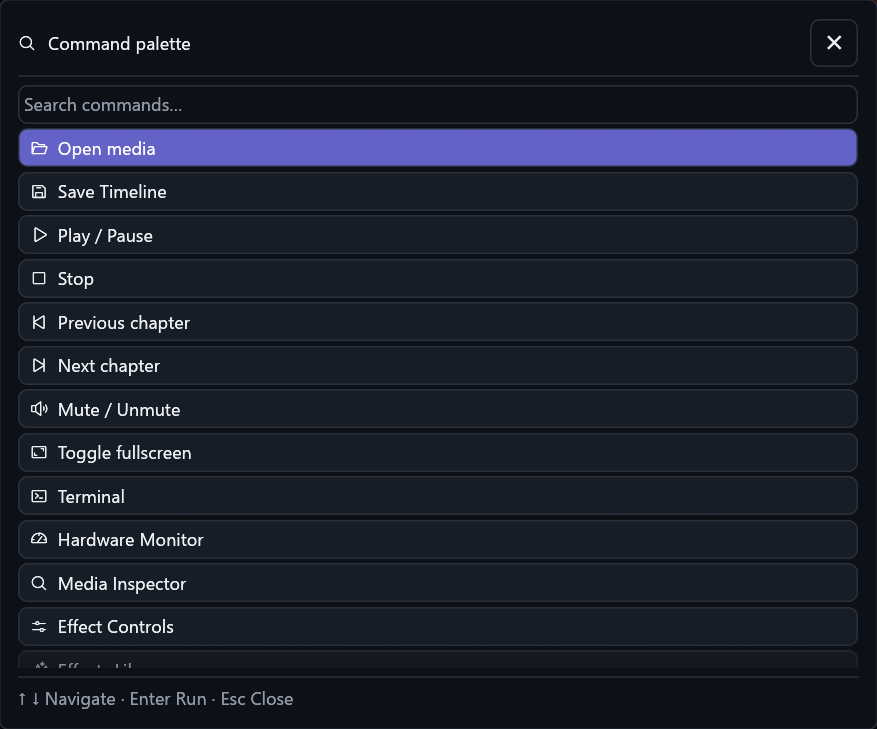

# Command toolbar and palette completion

Owner: [delivery #80](https://github.com/ToghrolTP/pealayer/issues/80).
This complements [workspace tools](workspace-tools.md), not a replacement toolbar.

## Causes and correction

- The command palette used an unbounded horizontal header in a centered modal.
  Its inherited remaining height produced a nearly full-height blank column,
  pushing search/results out of view. Explicit header allocation and a stable
  results viewport fix that feedback loop. The results budget includes measured
  wrapped keyboard help, control/font height and modal chrome.
- Workspace toolbar reorder reused shared drag helpers but omitted the overflow
  hide destination entirely. `action_customization::menu_hide_target` now owns
  the dots-to-red-Trash transition for both workspace and timeline toolbars.
  Each owner validates its typed payload; only primary release hides an action.
  Editor-row payloads cannot remove toolbar shortcuts. Workspace panel state,
  command order and unavailable extension IDs are preserved.
- Button text sizing made toolbar icons smaller than the rail. Toolbar and drag
  preview glyphs now use its 19-point baseline, bounded by the current control
  size, with visible-ink centering. No resting outlines were added.
- Studio weak text was not sufficiently different from enabled icon ink.
  Unavailable actions now use explicit 35% icon opacity and no active/hover
  decoration. Invocation stays capability-gated; customization remains possible.
  Cursors distinguish available actions, unavailable actions, reorder grips and
  an ongoing typed drag. Lock/modal restrictions still win.

## Verification

Focused native coverage includes actual pointer reorder/hide, reversible Trash
hover, Escape/lock protection, unavailable Save dragging, editor isolation,
palette keyboard/modal ownership, actual disabled paint/cursors, and stable
palette bounds under narrow/large viewports, large fonts and RTL. The existing
timeline and transport customization regressions exercise the shared target.

All **41** focused tests pass: 18 workspace toolbar/palette, 13 timeline toolbar,
one shared customization and nine media-control toolbar tests. The viewport
test covers 360×320, 900×700 and 1986×1133 logical points, 14/24-point fonts and
both directions. Package verification additionally passed TypeScript/bundle/PWA,
native smoke and Win32 action resources; the full regression matrix was not rerun.

## Real native comparison

Captured from the canonical application at 150% scaling using the maintained
read-only PrintWindow capture, Studio dark, unchanged 3002×1756-pixel window.
Before is clean `41d0668`; after is clean `509f8cb`. These are actual UI pixels,
not mockups. Full captures containing private media remain outside the repository.

### Palette

The before crop is deliberately tall: that is the defective modal's actual
blank column, not artificial padding. The after image crops its new bounded
frame. Neither palette image is rescaled; their differing heights are the fix.

### Toolbar

Matched 900×55-pixel crops at window offset (12,90), enlarged 2× with nearest
neighbor for visible glyph comparison. No interface pixels were redrawn.

Temporarily showing RF management while disconnected demonstrates the disabled
state below; the original visibility list was restored with a concurrent-edit
check. No RF command, hardware output or connection was invoked.

## Installed receipt and limits

- Runtime source: `509f8cb6f52768be27fecd1b1c9bbea3df83c0d4`.
- Packaged and canonical executable SHA-256 both:
  `15c2661253fea467cd9864fd2fc5bc559282c6d9c2e7060b07b21d25ee6afdac`.
- Graceful updater completed and the restarted peer acknowledged the package.
  Fresh authoring inspection was clean immediately before replacement.
- Actual palette and icon/disabled captures inspected. Paused media position,
  volume, mute and normal window geometry were unchanged. Temporary palette and
  toolbar visibility were restored; the separate terminal review and historical
  comparison were not replaced.
- Trash interaction/cursor claims are actual egui pointer/paint tests, not a
  claim that the native screenshots depict a physical mouse drag.
- Cafe-PC is user-deferred/offline. No Cafe deployment, physical hardware
  acceptance or completed hosted-CI merge is implied by this local receipt.
