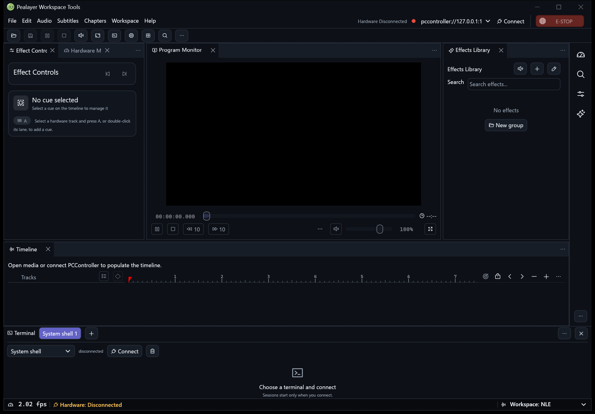
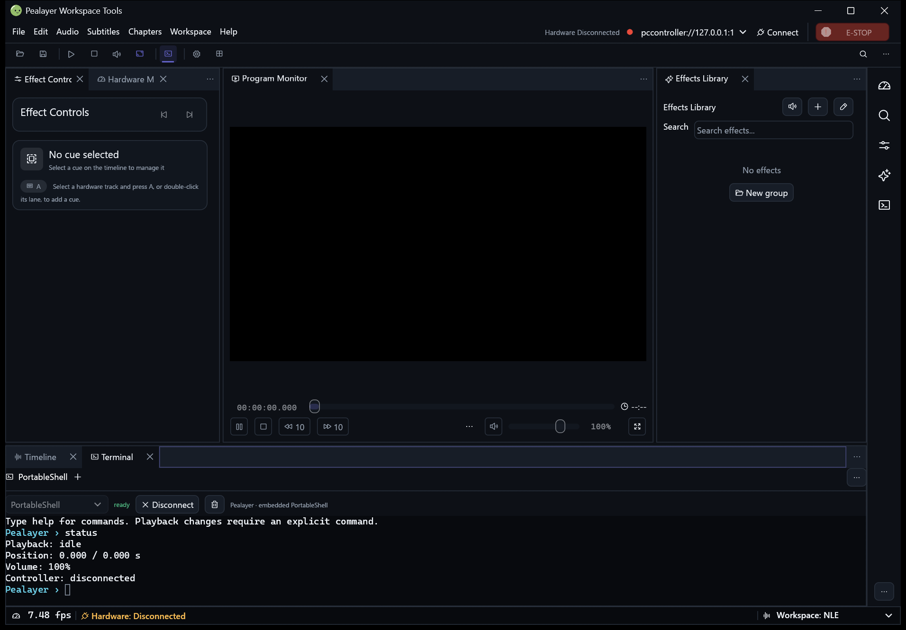
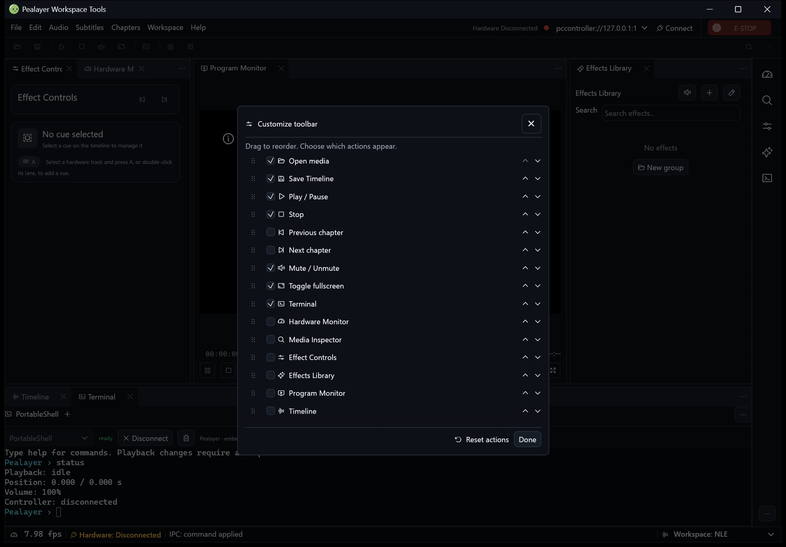
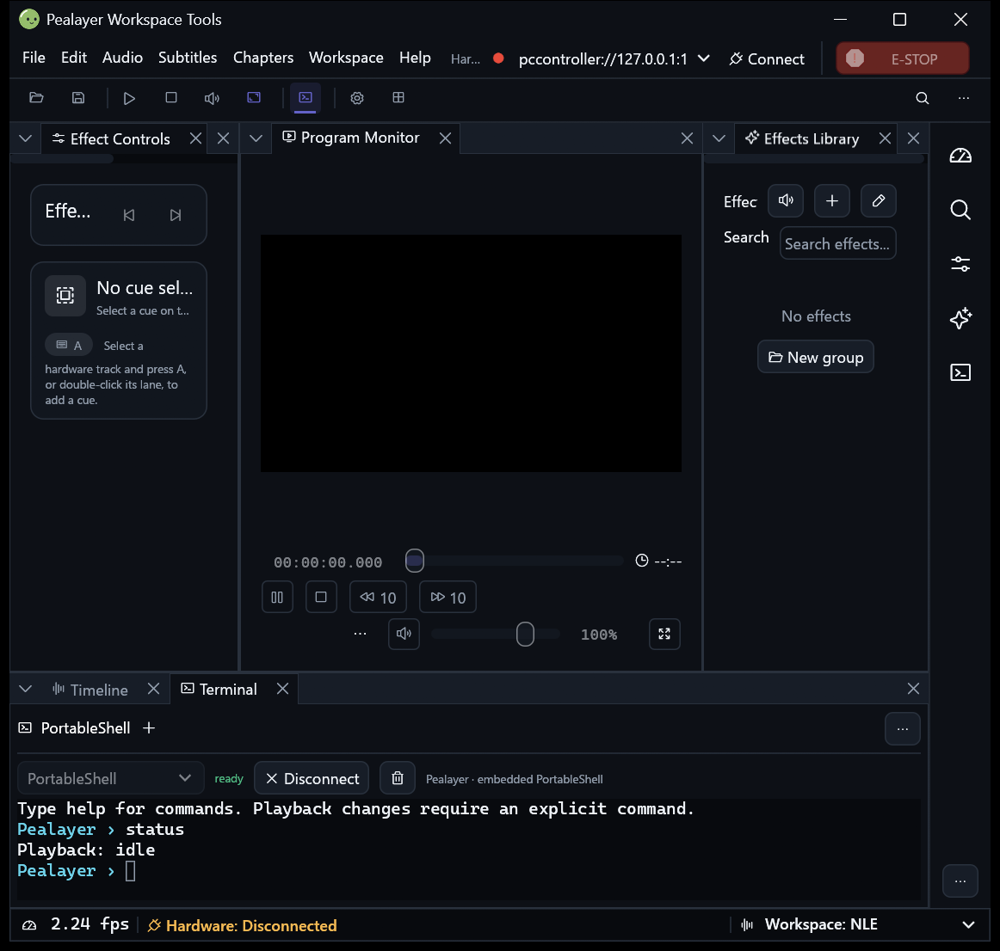

# Optional command toolbar and terminal

Tracking: [#272](https://github.com/ToghrolTP/pealayer/issues/272),
[plugin architecture #44](https://github.com/ToghrolTP/pealayer/issues/44), and
[delivery #80](https://github.com/ToghrolTP/pealayer/issues/80).

## Using the tools

Both surfaces are hidden in a fresh profile. Enable them from **Workspace** or
**Preferences → Workspace tools**. They use the current palette, fonts and
control density with either CraftUI or egui Dock; enabling or customizing them
does not reset panel membership or the sidebar rail.

The command toolbar reuses existing application commands. Its overflow menu
provides hidden/narrow actions and customization; individual buttons can be
hidden or moved earlier/later. The flat toolbar groups related actions with
dividers and reserves its trailing edge for the palette and overflow menu.
Right-click empty toolbar space for commands, or double-click it for the
customization dialog. Drag icons or editor rows to reorder; cancellation,
workspace locking and modal ownership do not change the layout. The editor
also provides keyboard-friendly move and visibility controls.
**Ctrl+Shift+P** opens the searchable command
palette even when the toolbar is hidden. Arrow keys select, Enter invokes one
available command, and Escape cancels. Existing dialogs retain keyboard priority.

The terminal is a genuine workspace pane in both renderers, initially located
as a hidden tab beside Timeline. It can be rearranged, floated or closed through
the same workspace controls as other panes, without discarding its sessions.
The body has independent session tabs rather than a second competing titlebar.
Opening it never
starts a process or connects. Choose a target and **Connect**:

- **PCController:** the selected host's command catalog and explicit command
  RPC, with history and advertised-name/alias completion. This is not the raw
  board serial terminal. PCController owns authorization, authority and safety.
  Its ordinary client may start the packaged local host on explicit Connect;
  no host is started merely by displaying the panel. A remote-consumer profile
  must choose an explicit controller endpoint, rather than interpreting its
  authority's loopback address on this computer.
- **System shell:** an owned local PTY/Windows ConPTY, using the system shell
  unless overridden in Preferences. Arguments are literal argv: quotes group
  spaces, doubled matching quotes are literal, backslashes are preserved, and
  no expansion/evaluation occurs in Pealayer. The shell itself is not a sandbox
  and may run its own startup profile.
  Refresh the profile picker to discover Windows Terminal and VS Code-family
  user settings. PortableShell owns their JSONC parsing, native paths and
  normalization; Rust only copies owned records. The picker preserves literal
  arguments, cwd and environment removals. Hidden profiles stay hidden;
  disabled, unresolved and elevation-requiring entries cannot be launched.
  Refresh is read-only and never selects or executes a profile automatically.
  Imported environment values and source paths are not exposed in shared status.
- **PortableShell:** the pinned C99 byte-callback core is embedded in Pealayer;
  no PortableShell executable, demo workbench or generic OS command executor is
  launched. A dedicated Pealayer host provides help, status, play/pause/stop,
  exact seek, volume/mute and Preferences commands through existing typed app
  dispatch. Opening the prompt is read-only. Closing cancels unfinished input,
  never submits it. Application responses preserve the current draft prompt.

Hiding the panel preserves sessions. Disconnect/Close session cancels queued
input and tears down only the owned session; a host command already dispatched
cannot be rolled back. Normal application quit asks before ending sessions and
waits for owned-worker cleanup. Active sessions block unattended updater replacement.

## Terminal processing and boundaries

`vt100` parses fragmented UTF-8 and escape sequences into actual cells, including
cursor movement, erase, screen modes, ANSI/256/truecolor, underline/inverse/bold
and wide cells. The view supports selection/copy, bounded scrollback, application
cursor keys, common control/function keys and bracketed paste. Paste is atomic
and capped at 16 KiB; rejection is visible. Status/cursor queries are answered
only for PTYs at their actual byte-stream position, including ConPTY startup.

OSC output cannot modify the clipboard, open URLs or execute app commands. No
transcript or command history is persisted or published by the status API.
Mouse-report protocol, full-scrollback selection, complex-script shaping and
complete xterm compatibility are not claimed. A fixed-cell Unicode parser is
not proof of bidirectional Persian shaping.

Inputs/outputs are bounded, command execution is serialized, uncertain commands
are never retried, and all process/IO/resize/termination work is off the UI thread.
The explicit active-child waiter uses a bounded 100 ms wait and cancellation wake;
there is no permanent terminal repaint loop when idle or hidden. Controller TCP
responses are bounded before JSON allocation; console results have a separate
1 MiB limit. Shell output streams through bounded 8 KiB chunks.

## Local automation

The existing JSON/JSON-RPC transports expose process-local methods, never relayed
to a playback authority:

```json
{"method":"pealayer.workspace.tools.get","params":{}}
{"method":"pealayer.workspace.tools.control","params":{"action":"set_visible","toolbar":true,"terminal":true,"persist":true}}
{"method":"pealayer.workspace.tools.control","params":{"action":"palette","open":true}}
{"method":"pealayer.workspace.tools.control","params":{"action":"editor","open":true}}
{"method":"pealayer.workspace.tools.control","params":{"action":"terminal","operation":"connect"}}
{"method":"pealayer.workspace.tools.control","params":{"action":"terminal","operation":"refresh_profiles"}}
{"method":"pealayer.workspace.tools.control","params":{"action":"terminal","operation":"write","data":"help"}}
{"method":"pealayer.workspace.tools.control","params":{"action":"terminal","operation":"disconnect"}}
```

Connect, Write, Resize and profile refresh require **native local IPC**, not browser HTTP/WebSocket
requests. UI/visibility commands use existing Web control permissions. Status
contains only availability, visibility, session IDs, target, dimensions, phase
and profile discovery counts/activity, never imported environment values.
An accepted command is queued once, not confirmation that it executed. Poll status
to observe connection transitions. `persist` requests an immediate configuration
save; normal workspace persistence still applies on later saves/application exit.

## Build/package boundary

Default builds include `workspace-toolbar` and `workspace-terminal`, both visually
disabled. The shipped product is one fully featured distribution, not separate
tool flavors. Internal `--no-default-features` checks omit both; either feature can
be checked alone without publishing another edition.
Omitted implementations retain configuration values without exposing broken
controls. [Extraction backlog](../backlog/workspace-tools-plugins.md) defines later
package ownership; this feature does not install a speculative plugin loader.

## Verification receipt

Local evidence:

- Default compilation; no-tools, toolbar-only and terminal-only checks passed.
- 42 focused workspace regressions passed, including seven command toolbar/palette
  tests. A separate terminal-filter pass passed 27 tests with two deliberate
  ignored fixtures; these counts overlap and are not an additive total.
- The opt-in real Windows PTY fixture passed UTF-8 I/O, resize, final-output/exit
  ordering and owned child cancellation. It uses the Rust test executable, not
  a production board or the user's shell profile.
- Mocked loopback PCController catalog/execute/error/disconnect/no-replay passed;
  the bounded-response reader regression passed. No physical output was actuated.
- Web TypeScript, preference-file tests, 53 parity contracts, workflow lint and
  whitespace checks passed. The packaged Web/PWA integrity check passed.
- A clean standard package from `1c8cc78911604100f49159b15fec39079d13bff8`
  passed manifest, identity, quick-action resources and runtime smoke checks.
  An isolated native review profile runs that package, not a reduced flavor.
- Native inspection found the disconnected terminal frame shrinking below its
  configured height. The subsequent source fix has an actual three-frame sizing
  and Preferences-height-change regression, which passed. That fix is not yet
  installed in the review process.

The initial review led to the follow-up below; its package alone did not establish
acceptance of that follow-up. The final native delivery receipt supersedes this
initial checkpoint. Cafe is user-deferred/offline. No physical controller or
remote deployment acceptance is implied by local fixtures.

Follow-up implementation replaces the initial fixed bottom panel and external
PortableShell profile above. The user authorized discarding the isolated review
tests; that instance exited through its own local IPC Quit command. Regular and
historical instances were left untouched. Earlier counts do not establish
acceptance of those changes; the combined results below cover the follow-up.

Combined follow-up evidence: 56 workspace tests, 41 terminal-filter tests (two
opt-in fixtures ignored in that pass), all six embedded host tests and the
separate real Windows PTY fixture passed. Counts overlap. All three reduced
feature checks passed again; these are developer checks, not product flavors.
TypeScript, preference-file tests and 53 Web parity contracts passed. The added
C sources compiled with the native Windows toolchain. Read-only profile import
fixtures exercised the actual C adapter, including ownership and malformed-source
atomicity. No user shell commands or physical outputs were used as fixtures.
The PortableShell copyright/license is embedded in About as well as retained in
the pinned vendor directory.

Native inspection caught a safe-writer presentation edge: embedded newlines were
stripped from status output. Responses now submit logical lines independently,
with a real VT-parser regression preserving both line breaks and unfinished
input. Embedded resize requests reject unsupported dimensions before queuing;
the view reports the same grid the core actually owns.

Visibility has two intentional owners: a general Show Terminal request reveals
the pane; explicitly restoring a workspace profile restores that profile's saved
membership. The review launch's `--workspace nle` selected an older snapshot
without Terminal. A regression now covers that explicit restore followed by a
new Show Terminal intent, without overriding saved profiles or losing siblings.

PortableShell source ownership: [profile-import PR #84](https://github.com/atomicdeploy/portable-shell/pull/84).
The pinned vendor receipt is `third_party/portable-shell/PEALAYER-VENDOR.md`.

## Native delivery and captures

The clean Windows package from `f7f2e8be335a226b6e7469e9c301c84fba4c5376`
passed runtime smoke, executable identity, all seven taskbar-action resources
and Web/PWA integrity. Its executable SHA-256 is
`048757d107282f6051caa84c4ca2df5b3395f9eddfc1076263313693fb6b12ae`.
The canonical local updater completed its graceful restart/build acknowledgement;
the installed executable independently has that hash and reports the matching
source commit. The loaded movie remained paused at its existing saved position
(578.286 s); this update did not require a new seek or playback mutation.

The isolated review runs the same package. Local IPC opened the embedded shell,
submitted only read-only help/status commands, refreshed profile discovery and
opened/closed the toolbar editor. Discovery returned 15 profiles, zero warnings;
no imported shell was executed and no profile names/environment values are
published here. Changing between CraftUI and egui Dock preserved the live session
and pane membership. The canonical profile retains both tools hidden with no
terminal session started. Regular, review and historical apps remain separate.

These are actual native captures at Studio/dark/Compact and 150% display scale,
not mockups. Before is the initial `1c8cc789` package; after/editor are the final
package above. Black Program Monitor means no media was loaded in the isolated
review; the fixture is deliberately disconnected from hardware.

### Before



### After — CraftUI, embedded Pealayer prompt



### Toolbar editor



### egui Dock — narrower viewport



Cafe deployment remains explicitly user-deferred/offline. Linux/macOS native
profile discovery, physical controller effects and full-screen-TUI compatibility
are separate acceptance gates; the Windows fixtures/captures do not claim them.
One upstream header retains its original extra blank EOF line; the file-specific
whitespace attribute preserves its pinned bytes while keeping other checks on.

## Publication and integration-test follow-up

The real before/after/editor images are embedded directly in PR #273 using
immutable public image URLs. Public HTTP image responses and GitHub-rendered
Markdown were checked, rather than treating local captures as publication.
The related CraftUI header repair #271 now has its enlarged image pair in its
description too. PortableShell #84 is merged with all 35 checks successful.

The full Linux integration run exposed three stale assertions in
`tests/workspace_dock_test.rs`: the catalog still expected six panes, and default
layout round-trip/fallback assumed every catalog pane except Media Inspector was
visible. Terminal is intentionally the seventh, optional, hidden-by-default pane.
The corrected suite preserves those defaults and additionally verifies explicit
Terminal reveal and serialization beside Timeline: 14 tests passed locally.
This changes test coverage and documentation, not the already-installed app code.
